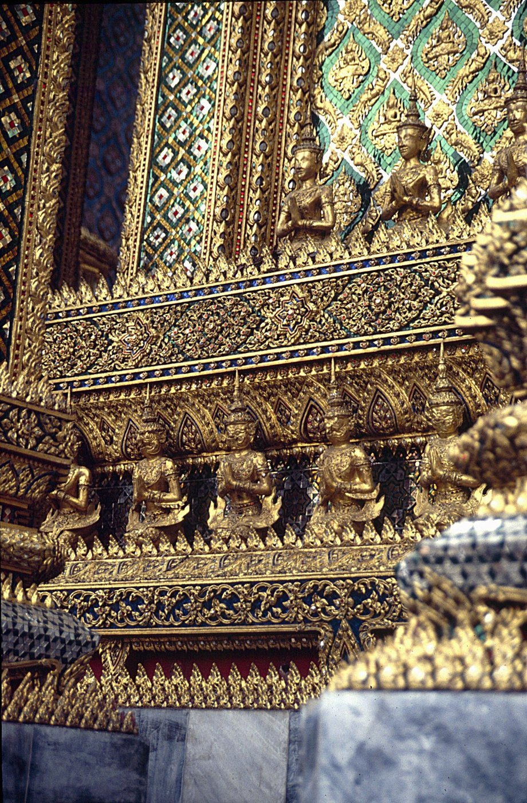
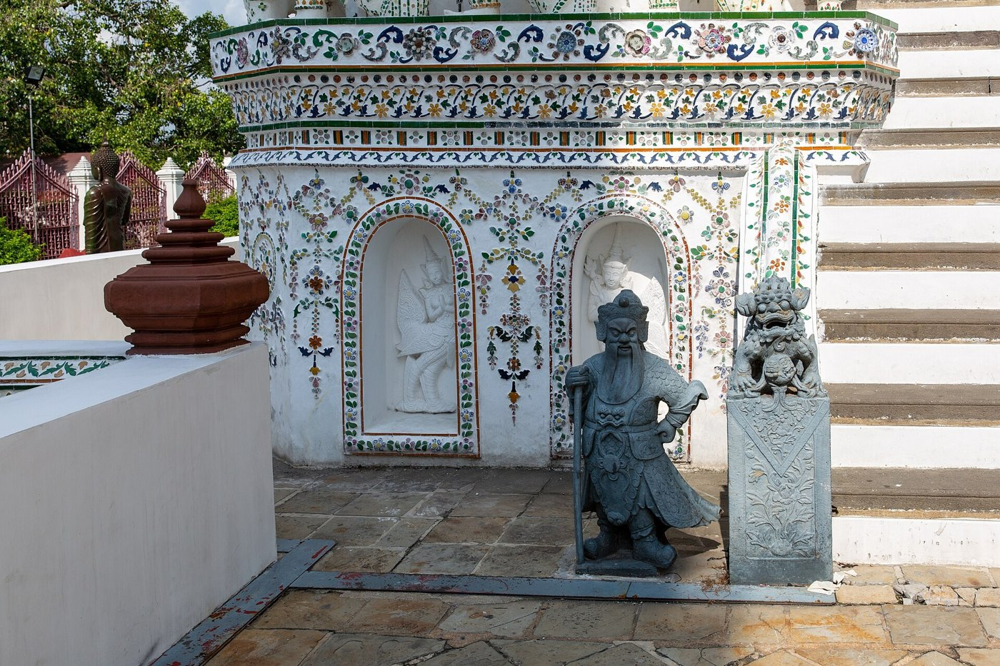

# 02 ฐาน (Base / Plinth)

## อยู่ตรงไหน
ฐานคือส่วนล่างสุดของทุกอาคารและทุกองค์ประกอบ ตัวอาคาร เจดีย์ เสา ซุ้ม พระพุทธรูป และแม้แต่ชั้นย่อยของยอด ล้วนมีฐานของตัวเอง
ส่วนที่ซ้อนขึ้นไปแต่ละชั้นจึงมักเริ่มด้วยฐานเล็กๆ อีกชุด ทำให้รูปทรงไทยมีชั้นบัวซ้ำกันเป็นจังหวะ

## เหตุผลของรูปร่าง
- **หน้าที่:** ยกตัวอาคารพ้นดินและน้ำ และกระจายน้ำหนัก
- **ความหมาย:** ฐานคือการ "ยกขึ้นสู่ที่สูง" ยิ่งเป็นของศักดิ์สิทธิ์มาก ฐานยิ่งมีชั้นมาก ฐานบัวมาจากคติดอกบัวรองรับสิ่งบริสุทธิ์ ฐานสิงห์มาจากแท่นที่มีขาสิงห์ ซึ่งเป็นแท่นของกษัตริย์และเทพ
- **การมองเห็น:** เส้นนอนของบัวแต่ละชั้นสร้างเงาแถบเข้มสลับสว่าง ทำให้ฐานดูหนักแน่นและอ่านความสูงได้ง่าย

## ศัพท์ของชิ้นส่วนในฐาน (ใช้ร่วมกันทุกแบบ)

| ศัพท์ | ลักษณะ |
|---|---|
| หน้ากระดาน | แถบแบนตั้งตรง เป็นแผ่นเรียบ มักมีลายประจำยามหรือกระจังเรียงอยู่ |
| ฐานเขียง | แท่นเหลี่ยมเรียบเป็นขั้น คล้ายเขียงซ้อนกัน อยู่ล่างสุด |
| บัวคว่ำ | บัวที่โค้งลงเหมือนกลีบบัวคว่ำ เป็นตัวรับน้ำหนักลงพื้น อยู่ช่วงล่าง |
| บัวหงาย | บัวที่โค้งขึ้นเหมือนกลีบบัวบาน อยู่ช่วงบน รองรับสิ่งที่อยู่ข้างบน |
| ท้องไม้ | แถบคอดลึกเข้าไประหว่างบัวคว่ำกับบัวหงาย ทำให้เกิดเงาเข้ม |
| ลูกแก้ว | วงกลมนูนคาดรอบตรงท้องไม้ หน้าตัดกลม |
| ลูกแก้วอกไก่ | ลูกแก้วที่มีสันคมตรงกลางเหมือนอกไก่ หน้าตัดเป็นรูปข้าวหลามตัดมน |
| เส้นลวด | เส้นนูนบางๆ คั่นระหว่างชั้น |
| กลีบบัว (บัวแวง/บัวจงกล) | บัวที่ทำเป็นกลีบให้เห็นทีละกลีบ |
| เท้าสิงห์ / แข้งสิงห์ | ส่วนโค้งเหมือนขาสัตว์ เตะออกที่ปลายล่าง เป็นเอกลักษณ์ของฐานสิงห์ |
| กาบเท้าสิงห์ / กาบแข้งสิงห์ | ลายกาบประดับที่มุมของแข้งสิงห์ |
| บัวหลังสิงห์ | บัวที่อยู่เหนือแข้งสิงห์ |

**ลำดับฐานของพระปรางค์ จากล่างขึ้นบน** [S13 ตามที่อ้างในผลค้นหาวิกิพีเดีย]:
ฐานเขียง (ฐานชั้นล่างสุด) → ฐานปัทม์ (ฐานอาคาร) → **ชุดฐานสิงห์ 3 ชั้น** → เรือนธาตุ
**เจดีย์ทรงลังกาแบบอยุธยา:** ฐานเขียง → ฐานปัทม์หรือฐานบัว → บัวถลา (ลักษณะจากลังกา) → บัวปากระฆัง

**ฐานหย่อนท้องช้าง** (ช่างบางท่านเรียกหย่อนท้องหมู หรือหย่อนท้องสำเภา)
- คือฐานอุโบสถที่แอ่นโค้งตรงกลาง
- "การทำฐานหย่อนท้องช้าง ย่อมเกิดจากงานปลูกสร้างซึ่งโครงสร้างเป็นไม้มาก่อน เพราะธรรมชาติของไม้อ่อน หย่อนกลางเมื่อรับน้ำหนัก ครั้นเห็นกันว่างาม คงแปลงมาใช้กับงานก่ออิฐ" [S19]
- เป็นลักษณะเด่นของอยุธยาตอนปลาย [S11]

**ฐานมณฑปทิศวัดอรุณ** (รูปอ้างอิง 30 และ 25): ฐานซุ้มโค้ง → แถบผู้แบก → บัวซ้อนหลายชั้น **ยื่นตามมุข มุมย่อ**

## แบบของฐาน (variation)

**1. ฐานเขียง** เป็นขั้นเหลี่ยมเรียบ 1–3 ชั้น ใช้กับอาคารทั่วไป หรือเป็นชั้นล่างสุดของฐานแบบอื่น
**2. ฐานบัว (ฐานบัวคว่ำบัวหงาย / ฐานปัทม์)** ไล่จากล่างขึ้นบน: หน้ากระดานล่าง → บัวคว่ำ → ท้องไม้ → บัวหงาย → หน้ากระดานบน
**3. ฐานบัวลูกแก้ว** เหมือนฐานบัว แต่มีลูกแก้วคาดกลางท้องไม้ ถ้าลูกแก้วมีสันคมเรียกฐานบัวลูกแก้วอกไก่
**4. ฐานสิงห์** ไล่จากล่างขึ้นบน: ฐานเขียง → เท้าสิงห์และแข้งสิงห์ (โค้งเตะ มีกาบเท้าสิงห์ที่มุม) → บัวหลังสิงห์ → ท้องไม้ (อาจมีลูกแก้ว) → บัวหงาย → หน้ากระดานบน
   อาจซ้อนเป็นฐานสิงห์ 2 ชั้น ใช้กับอาคารหรือแท่นที่ศักดิ์สูง เช่น พระที่นั่ง ฐานชุกชี ฐานปรางค์
**5. ฐานทักษิณ / ฐานประทักษิณ** เป็นลานรอบองค์เจดีย์หรือปรางค์ที่เดินเวียนได้ มีพนักหรือกำแพงแก้วล้อมรอบ และมีบันไดขึ้น (วัดอรุณมีฐานทักษิณซ้อนกันหลายชั้น)
**6. ฐานไพที** เป็นลานยกสูงรองรับกลุ่มอาคารหรือเจดีย์หลายองค์บนฐานเดียว
**7. ฐานแบก** เป็นแถบท้องไม้ที่มีประติมากรรมยักษ์ กระบี่ มาร หรือเทวดาเรียงกันทำท่าแบกชั้นข้างบน (ดู 14) ที่วัดอรุณมีทั้งที่ฐานปรางค์และที่ฐานมณฑปทิศ
**8. ฐานซุ้ม** ท้องไม้ทำเป็นซุ้มโค้งเรียง ในซุ้มมีรูปปั้นหรือลวดลาย ฐานล่างของมณฑปทิศวัดอรุณเป็นแบบนี้ มีซุ้มโค้งและกินรีเรียงกัน

## ต่อกับส่วนอื่นอย่างไร
- ฐานต้องเดินตามผังของตัวเรือนข้างบนทุกจุด **ถ้าตัวเรือนมีมุขยื่น ฐานทุกชั้นข้างใต้ต้องยื่นตามด้วย** และมุมของส่วนที่ยื่นต้องย่อมุมเหมือนมุมอาคาร (ผู้ดูแลยืนยันแล้ว: "ของจริงมันต้องยื่นออกมาตาม และไม่ใช่แค่สี่เหลี่ยมเฉยๆ")
- บัวหงายบนสุดของฐานคือพื้นที่ผนังตั้งอยู่ ขอบบัวยื่นเลยผนังออกมาเล็กน้อย
- ฐานทักษิณต่อกับบันไดที่ "หันหน้าออก" และมีพนักล้อมเสมอ

## สัดส่วน (แนวทาง)
- ฐานของอาคารเครื่องยอดสูงประมาณ 0.4–0.6 เท่าของความสูงตัวเรือน (มณฑปวัดอรุณ: ฐานรวมบัวสูงประมาณ 7 ม. ตัวเรือน 9 ม.)
- แต่ละชั้นของบัวยื่นออกจากชั้นข้างบนประมาณ 0.15–0.35 ม.
- ท้องไม้สูงกว่าหน้ากระดานเสมอ เป็นช่วงที่ "หายใจ" ของฐาน

## ข้อผิดพลาดที่พบ
1. ทำฐานปรางค์วัดอรุณเป็นลูกบาศก์ ของจริงเป็นฐานทักษิณซ้อน 3 ชั้น ไล่ขั้นเหมือนพีระมิด
2. ทำฐานเป็นสี่เหลี่ยมตรงๆ ทุกชั้น ของจริงย่อมุมทุกชั้น
3. ทำฐานมณฑปเป็นสี่เหลี่ยมผืนผ้าเรียบ ทั้งที่มุขข้างบนยื่น ที่ถูกคือฐานทุกชั้นยื่นตามมุขและย่อมุมที่มุมมุข

## การทำเป็นชิ้นไม้
- ใช้กล่องผนัง 4 แผ่นที่ขัดกันที่มุม (ไขว้ยื่นปลาย 3.6 มม.) เป็นตัวฐานแต่ละชั้น และใช้แผ่นวงแหวนแนวนอน (ring) ที่ใหญ่กว่ากล่องเล็กน้อยเป็นบัวคาด
- ถ้าต้องยื่นตามมุข ให้ใช้แผ่นไม้ซ้อนชั้นติดกาวที่หน้ากล่อง และให้ 4 ชั้นนอกสุดแคบลงเพื่อให้มุมเป็นย่อมุม ส่วนวงแหวนใช้ตัวเลือก `bay_mm=(ครึ่งกว้าง, ระยะยื่น, step, 2)`
- ลวดลายบนท้องไม้ เช่น ซุ้ม กินรี หรือผู้แบก ใช้ปากกาวาด หรือฉลุ 2 ชั้นซ้อนกันให้เกิดความลึก
