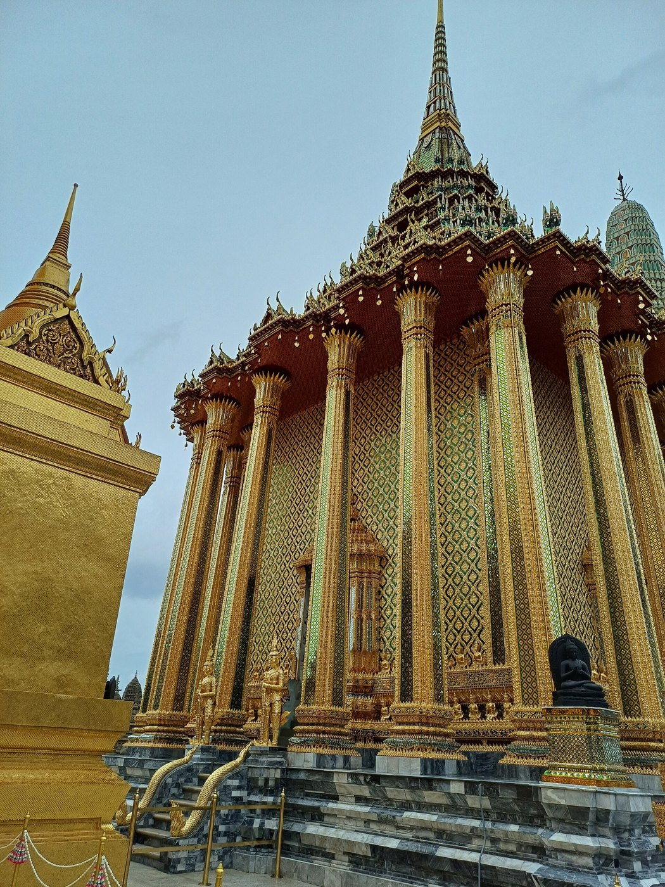

# 03 ย่อมุม (Redented corners)

## ชื่อ
ย่อมุม หรือย่อเก็จ ในภาษาอังกฤษเรียก redented corners / indented corners
นับชื่อตามจำนวนมุมยื่น (มุมนอก) ทั้งหมดของผัง

| ชื่อ | การย่อต่อหนึ่งมุม | มุมนอกทั้งหมด | ผังที่ได้ |
|---|---|---|---|
| ไม้สี่ (ไม่ย่อ) | 0 | 4 | สี่เหลี่ยมธรรมดา |
| ย่อมุมไม้แปด | 1 จังหวะ | 8 | มุมละ 2 มุม |
| ย่อมุมไม้สิบสอง | 2 จังหวะ | 12 | พบบ่อยที่สุดในงานหลวง |
| ย่อมุมไม้สิบหก | 3 จังหวะ | 16 | |
| ย่อมุมไม้ยี่สิบ | 4 จังหวะ | 20 | งานชั้นสูง ดูเกือบกลม |

```
ไม้สี่         ไม้แปด          ไม้สิบสอง
┌──────┐      ┌─┐  ┌─┐      ┌┐ ┌──┐ ┌┐
│      │      │ └──┘ │     ┌┘└─┘  └─┘└┐
│      │      └┐    ┌┘     └┐        ┌┘
│      │      ┌┘    └┐     ┌┘        └┐
└──────┘      │ ┌──┐ │     └┐┌─┐  ┌─┐┌┘
              └─┘  └─┘      └┘ └──┘ └┘
```

| เจดีย์ย่อมุมไม้สิบสอง วัดไชยวัฒนาราม | เส้นย่อมุมไล่ถึงยอด วัดภูเขาทอง |
|---|---|
|  |  |



**ย่อมุมไม้สิบสองแบบรัศมี** (ในยอดบุษบก-มณฑป) [S18]
- ร่างผังย่อมุมที่ชั้นล่างสุดกับชั้นบนสุด
- ลากเส้นรัศมีเชื่อม **มุมนอกถึงมุมนอก (12 เส้น)** และ **มุมในถึงมุมใน (8 เส้น)**
- ทุกชั้นที่อยู่ระหว่างกลางจะได้ตำแหน่งย่อมุมจากเส้นรัศมีเหล่านี้
- ผลคือ **มุมย่อทุกชั้นเรียงเป็นแนวเดียวกันวิ่งขึ้นไปหายอด** ทำให้ยอดดู "รวบ" เป็นทรงเดียว
- **เหตุผลของการย่อมุมที่ผนังอาคาร:** "ทำเพื่อลดทอนความแข็งกระด้างอันเกิดจากขนาดและมวลรวมอาคาร" [S18]

## อยู่ตรงไหน
ใช้ได้ทุกส่วนที่เป็นแท่ง ได้แก่ ฐาน ตัวเรือน เสา ชั้นของยอด ซุ้ม และฐานพระพุทธรูป
**หลักสำคัญคือย่อทุกชั้นและไล่ต่อเนื่องกันตั้งแต่ฐานถึงยอด** มุมย่อที่ชั้นล่างต้องเห็นเป็นแนวขึ้นไปถึงชั้นบน

## เหตุผลของรูปร่าง
1. **เงา:** มุมที่หักหลายครั้งสร้างเส้นตั้งเข้มสลับสว่างจำนวนมาก แท่งเหลี่ยมจึงดูเรียวและสูงขึ้น
2. **ความกลมโดยใช้ก้อนเหลี่ยม:** ช่างก่ออิฐสร้างทรงที่ใกล้กลมได้โดยไม่ต้องตัดอิฐโค้ง
3. **ฐานันดร:** ยิ่งย่อมาก ยิ่งประณีตและศักดิ์สูง

## ต่อกับส่วนอื่นอย่างไร
- บัวคาดหรือวงแหวนที่วางบนกล่องย่อมุม ต้องย่อมุมจังหวะเดียวกันหรือมากกว่า และต้องคลุมมุมยื่นทั้งหมดของกล่องข้างล่าง
- เสาย่อมุม (เสาย่อไม้สิบสอง) รับบัวหัวเสาที่ย่อมุมตาม
- ที่มุมของมุขที่ยื่นออกมา ก็ต้องย่อมุมด้วย ไม่ใช่เฉพาะมุมอาคาร

## สัดส่วน (แนวทาง)
- ระยะย่อแต่ละจังหวะประมาณ 1/10–1/7 ของครึ่งความกว้างแท่ง
- ระยะย่อด้านกว้างและด้านลึกเท่ากัน มุมจึงเป็นขั้นสี่เหลี่ยมจัตุรัส

## ข้อผิดพลาดที่พบ
- ทำแต่ละชั้นของปรางค์วัดอรุณเป็นสี่เหลี่ยมเรียบ ของจริงย่อมุมทุกชั้น (ผู้ดูแลชี้จากรูปว่า "แต่ละชั้นไม่ได้เป็นสี่เหลี่ยม")

## การทำเป็นชิ้นไม้
- **แผ่นแนวนอน:** ใช้ `redent(w, s, n)` ซึ่งคือผลรวมของสี่เหลี่ยม n+1 รูป และยืดเป็นผืนผ้าได้ด้วย `ex`
- **กล่องผนังย่อมุม:** ใช้ผนังขนานด้านละ n+1 แผ่น ที่ระยะ c, c−s, … ทุกคู่ที่มาเจอกันบากล็อกครึ่งกัน ระยะย่อต้องไม่น้อยกว่า 5.2 มม. ผนังชั้นในเจาะช่องซ่อนเพื่อประหยัดไม้
- **ส่วนที่ซ้อนเป็นชั้น:** ทำให้ชั้นนอกสุด 2–4 ชั้นแคบลงทีละ step เพื่อให้ได้มุมย่อ
