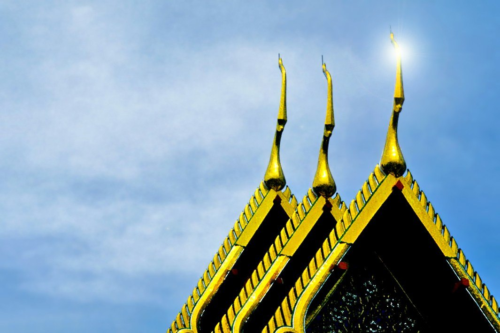
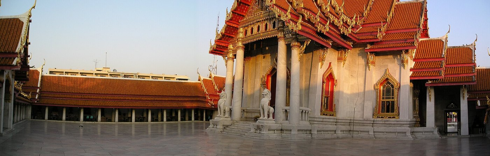
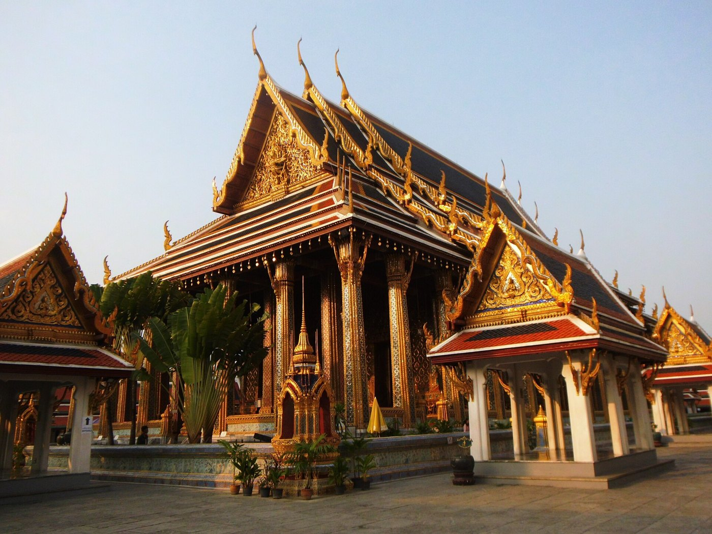
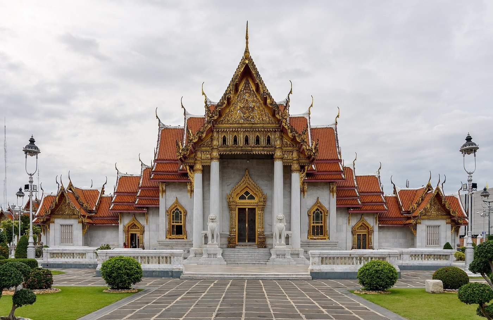

# 05 หลังคาทรงไทย — ระบบ ซ้อน · ลด · ตับ · มุข · จัตุรมุข · ปราสาท

## 1. ศัพท์โครงหลังคา (เครื่องบน)
| ศัพท์ | ความหมาย | ที่มา |
|---|---|---|
| อกไก่ | ไม้สันบนสุด จุดที่สองลาดมาพบกัน | S17 |
| แปลาน | ไม้วางขวางบนลาดหลังคาเป็นช่วงๆ ตัวรวยของลำยองพาดบนแปลาน (ดู 07) | S17 |
| แปหัวเสา | แปที่อยู่บนหัวเสา ช่วงล่างสุดของลาด | S17 |
| แปงวง | แปลานตัวที่สอง ที่งวงไอยราเกี่ยวกระหวัด | S17 |
| เชิงกลอน / เชิงชาย | ขอบล่างของลาดหลังคา ปั้นลมวางทับ | S17 |
| จันทัน | ไม้เอียงตามลาด รับแป | S9 (เรือนไทยภาคกลาง) |
| ขื่อ / เต้า | คานขวางรับโครง (เต้ายื่นรับชายคา) | S18 |
| ไขรา / ไขราหน้าจั่ว | ส่วนชายคาที่ยื่นเลยหน้าจั่ว ปั้นลมปิดทับริม | S17 |
| ตับ | หลังคาหนึ่งผืนที่ต่อเนื่องกัน งานกระเบื้องแต่ละตับมีกรอบสีของตัวเอง (รูปอ้างอิง 38, 43) | สังเกตจากรูป + S21 |
| ปีกนก / กันสาด / พาไล | หลังคาลาดต่ำที่คลุมระเบียงรอบตัวอาคาร | S11 |

## 2. ซ้อน — หลังคาซ้อนชั้น
**นิยามของราชบัณฑิตยสภา** [S19]: คิดเป็น "เรือนหลังคาทรงจั่วสองหรือสามเรือนลดหลั่นซ้อนกัน" แล้ว "เมื่อตัดฝาของเรือนที่ซ้อนออก ก็จะเหลือหลังคาทรงจั่วที่ร่นลงมาซ้อนกัน"

- **เรือนในสุด** ผนังสูงที่สุด หลังคาจึงอยู่บนสุดและเป็นหลังคาประธาน
- **เรือนที่อยู่ถัดออกมา** กว้างกว่าแต่ต่ำกว่า หลังคาของแต่ละหลังร่นลงมาเป็นชั้นๆ
- **ความชันเท่ากันทุกชั้น** ป้านลมจึงวิ่งขนานกันเป็นขั้น
- **มองที่ด้านจั่ว** เห็นป้านลมเป็นขั้นขนานไล่ลงมาด้านนอก และ **มีหางหงส์ที่ทุกขั้น** (รูปอ้างอิง 42, 43)
- อาคารหลวงใช้ "หลังคาซ้อนชั้นและมีหลายตับ" [S21] ส่วนใหญ่ 2–3 ชั้น อาคารหลวงบางหลังมีถึง 4 ชั้น [S11]
- **การนับ:** ชั้นล่างสุดคือซ้อนที่ 1 แล้วนับขึ้นไปเป็นซ้อนที่ 2, 3, 4 [ผลค้นหาจาก orst.go.th — ควรตรวจกับต้นฉบับ]

## 3. ลด — หลังคาลดชั้น
**นิยาม** [ผลค้นหาจาก orst.go.th — ควรตรวจกับต้นฉบับ]: ถ้าสันหลังคาของชั้นหนึ่ง **ต่ำกว่าหรือสั้นกว่า** ชั้นถัดไป เรียกว่า "หลังคาลด" หรือ "หลังคาชั้นลด"

- **ตามแนวยาวของอาคาร:** ช่วงกลาง (ประธาน) สูงที่สุด ช่วงที่ไปทางปลายหน้าและหลังต่ำลงทีละขั้น (รูปอ้างอิง 41: วัดโพธิ์)
- **จั่วที่ลดลงมาด้านหน้าจะต่ำกว่าและแคบกว่าจั่วที่อยู่ข้างหลัง** ความชันเท่ากัน ป้านลมจึงขนานกัน ดูแผนภาพ 01 และรูปอ้างอิง 37, 38, 40, 43
- **ทุกจั่วที่ลดมีช่อฟ้าของตัวเอง:** เห็นช่อฟ้าเรียงสูงขึ้นทีละตัวจากหน้าไปหลัง
- อาคารทางเหนือ "ชั้นล่างยืดเข้าหาทางเข้า" (lower tiers telescope toward the entrance) [S11]

## ⭐ 4. กฎที่ผู้ดูแลยืนยัน (ใช้กับทั้งซ้อนและลด)
> **ถ้ามีจั่วและหลังคาอีกผืนอยู่ข้างหลัง ผืนหลังต้อง "ใหญ่กว่าและอยู่ด้านบน": สูงกว่าและกว้างกว่า ป้านลมขนานกัน**
> **ห้ามทำผืนหลังให้เล็กหรือแคบกว่าผืนหน้า** — "อันนี้เป็น pattern มาตรฐานของหลังคาทรงไทย"

- **เหตุผลทางรูปทรง:** เป็นหลัก "เส้นทรงที่อิงหลักทรงเดิม" ซึ่งต้อง "คู่ขนาน" หรือ "ล้อกัน" กับเส้นตั้งต้น เพื่อ "เสริม" และ "ส่ง" รูปทรงขึ้นสู่ยอด [S18] เส้นที่ไม่ขนานจะทำลายทรง
- **เหตุผลทางโครงสร้าง:** ผืนในหรือผืนหลังคือหลังคาเรือนประธาน ส่วนผืนหน้าหรือผืนนอกเป็นเรือนที่ลดหลั่นลงมา [S19]
- **ความผิดที่เคยทำ (มณฑปวัดอรุณ v13):** หลังคาปีก (ผืนหน้า กว้าง 31 มม.) มีหลังคายอดด้านข้าง (ผืนหลัง) แคบกว่าคือ 22 มม. แก้เป็นผืนหลังกว้าง 34.5 มม. ความชันเท่ากัน (รูปอ้างอิง 33 คือภาพที่ผิด)

## 5. มุข
| แบบ | ลักษณะ |
|---|---|
| มุขโถง | ยื่นออก เปิดโล่ง มีเสารับ |
| มุขลด | หลังคามุขลดต่ำกว่าหลังคาหลัก |
| มุขประเจิด | จั่วยื่นโดยไม่มีเสารับ ใช้คันทวยค้ำ |
| มุขเด็จ | มุขสำหรับเสด็จออก |
หลังคามุขวิ่งเข้าชนลาดหลังคาหลัก ทำให้เกิดรางตะเข้ **มุขต้องยื่นจริงตลอดความสูง** ตั้งแต่ฐานถึงชายคา

## 6. จัตุรมุข · ทรงปราสาท · ทรงมณฑป
- **จัตุรมุข:** มีมุข 4 ทิศ หลังคาจั่ว 4 ผืนมาบรรจบกันตรงกลาง
- **นิยามของสมเด็จฯ กรมพระยานริศฯ** (อ้างใน [S18]):
  > "ทั้งสามอย่างต้องเป็นหลังคาซ้อนชั้น มียอดแหลม ถ้าเป็นเรือนยอดแหลมมีมุขเรียกว่าปราสาท ไม่มีมุขเรียกมณฑป ถ้าไม่ใช่เรือน เป็นของเล็กๆ มีหลังคาซ้อนชั้น สำหรับนั่ง หรือสำหรับตั้งอะไรๆ เรียกว่า บุษบก"

  และ: "การประกอบมุขเข้ากับมณฑปเป็นปราสาทนั้น เห็นของเก่าทำมุขเล็กกว่าองค์มณฑป ... ในภายหลังขยายมุขโตเท่ากับองค์มณฑป ... จึ่งดูยอดขึ้นไปตั้งอยู่บนหลังคาจตุรมุข ลักษณแห่งมณฑปหายไป"
- **ข้อสังเกต:** "มณฑปทิศ" วัดอรุณมีมุขยื่นหน้าหลังและมีปีก ตามนิยามข้างบนจึงใกล้ปราสาท แต่เรียกตามประเพณีว่ามณฑป
- **ยอดงอกจากกลางหลังคา** เรือนยอดหรือเรือนธาตุเริ่มในหลังคา หลังคาและสันทุกผืนวิ่งเข้าชนผนังของมัน ห้ามวางยอดลอยบนสัน และห้ามมีแท่งเสาโผล่ระหว่างหลังคา (ดู [08](08_เครื่องยอด.md))
- ตัวอย่างอ้างอิง: พระมณฑปวัดพระแก้ว (รูปอ้างอิง 31) และพระที่นั่งดุสิตมหาปราสาท (รูปอ้างอิง 39, 40)

## 7. แบบพระราชนิยมในรัชกาลที่ 3
- โบสถ์และวิหาร **ไม่มีช่อฟ้า ใบระกา หางหงส์** หน้าบันก่ออิฐปั้นปูนแทนไม้จำหลัก
- ใช้ **เสานางเรียง** รายสองข้างรับชายคาแทนคันทวยและนาคสำรวย
- ใช้โครงสร้างแบบจีนช่วยให้สร้างได้ใหญ่และเร็ว
- นิยมสร้าง **มณฑปและซุ้มประตูทรงมงกุฎ** [S15]
- วัดอรุณสร้างในรัชกาลที่ 3 แต่หมู่ปรางค์และมณฑปเป็นเครื่องยอด ประดับด้วยกระเบื้องถ้วยชาม

## 8. ความชัน
- อาคารวัดและวังภาคกลางชันมาก ประมาณ 45–60° อาคารยิ่งสำคัญยิ่งชัน
- **ผืนที่ซ้อนหรือลดกันต้องชันเท่ากัน** ส่วนแขนต่างทิศของจัตุรมุขใช้ความชันต่างกันได้
- หลังคาจริงมักแอ่นตามแนวสันเล็กน้อย ปลายเชิดขึ้น และชายคาแอ่นด้วย ตามเส้นจอมแหและหลักหย่อนท้องช้าง [S17, S19]

## 9. การทำเป็นชิ้นไม้ (สรุป รายละเอียดดู [16](16_แปลงเป็นงานไม้ตัด.md))
- **ลาดหลังคา:** แผ่นเอียงแผ่นเดียว ตัดตามรางตะเข้กับผืนอื่น และตัดเว้นรอบเรือนยอด
- **ซ้อนหรือลดแต่ละชั้น:** ใช้แผ่นลาดและหน้าจั่วชุดของตัวเอง ความชันเดียวกัน ผืนหลังกว้างและสูงกว่า
- **ทุกขั้นที่ชายคาลดลง:** ต้องมีหางหงส์ของตัวเอง
