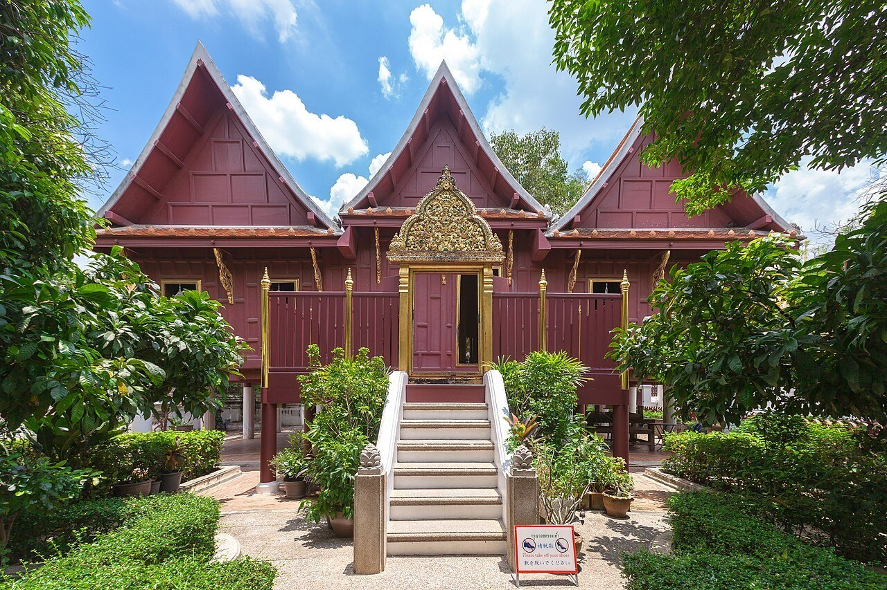
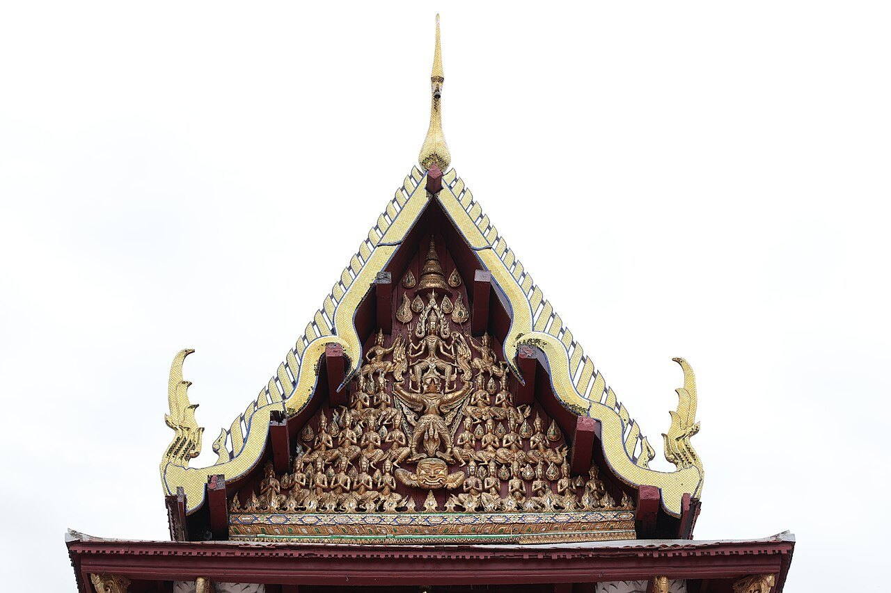
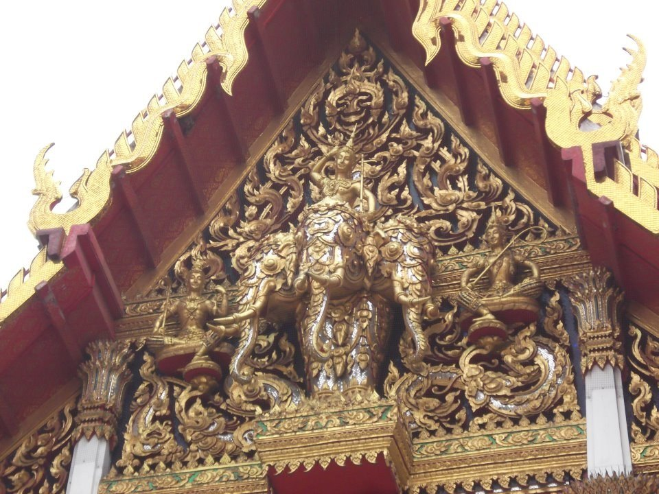
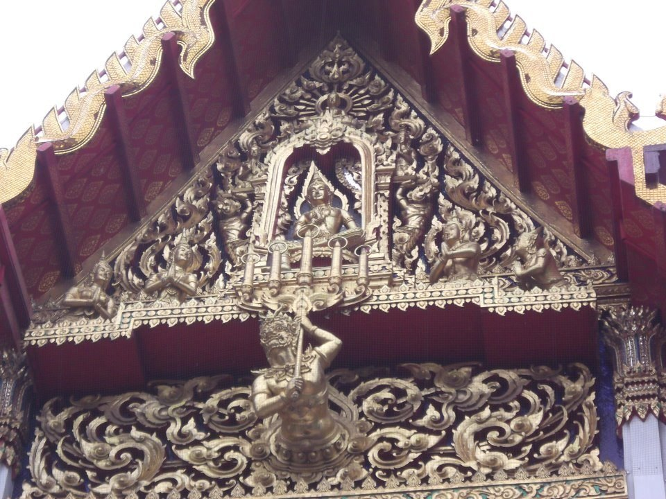
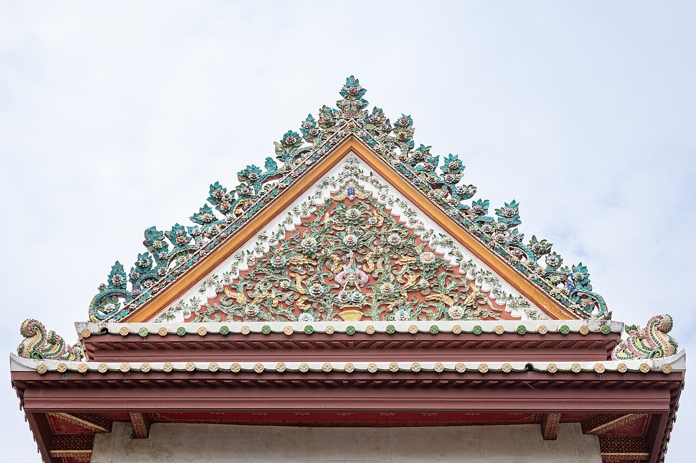
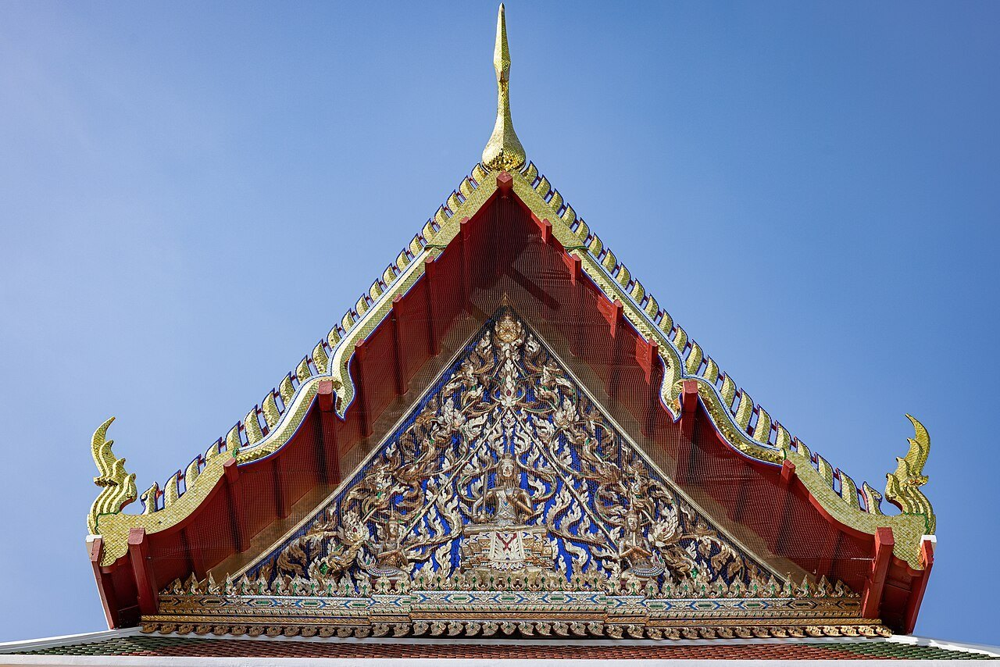
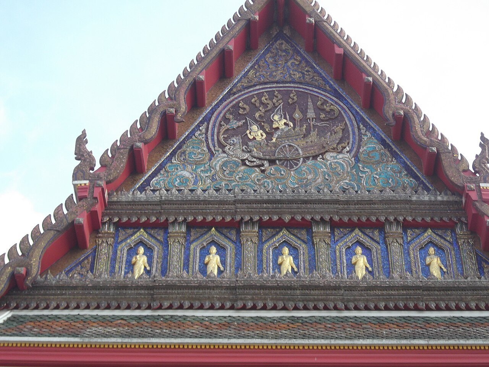
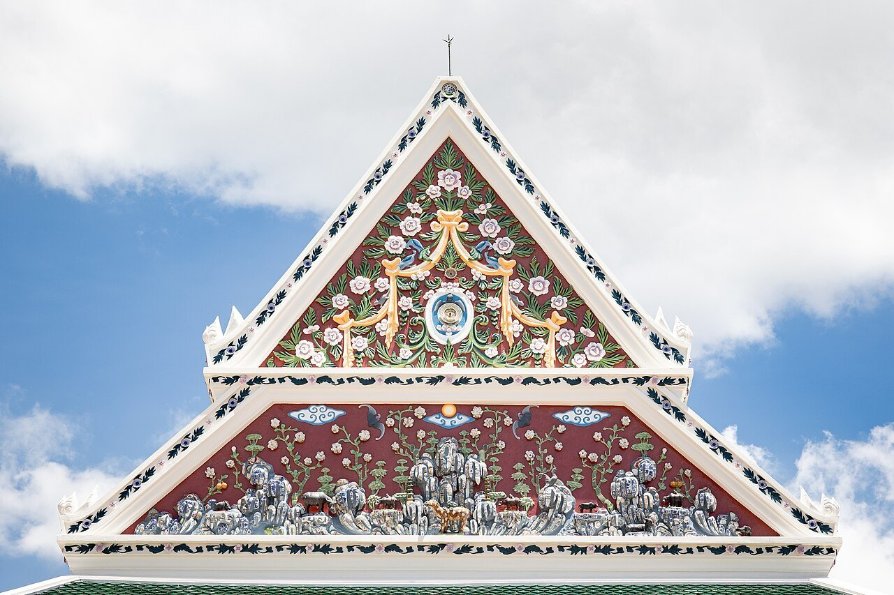

# 06 หน้าจั่วและหน้าบัน (Gable / Tympanum)

## ชื่อ
- **หน้าจั่ว** คือผนังสามเหลี่ยมที่ปลายหลังคาจั่ว
- **หน้าบัน** คือแผ่นประดับภายในกรอบหน้าจั่ว (tympanum) เป็นจุดแสดงลวดลายสำคัญที่สุดของอาคาร
- **บันแถลง** คือหน้าจั่วจำลองขนาดเล็กที่ใช้ประดับซุ้มและชั้นของยอด (ดู 08, 09)

## ปั้นลม / ป้านลม / ต้านลม [S17]
"เป็นไม้วางทับบนเชิงชาย ทาบทับปลายหัวเสา ทับหลังแปลาน และวางอยู่เหนืออกไก่ทั้งสองข้างซ้าย-ขวา ทำให้เกิดเป็นรูปสามเหลี่ยม"
- **หน้าที่:** ป้องกันลมพัดหัวจาก หัวแฝก หรือเครื่องมุงอื่นๆ และสร้างความงาม
- **ปั้นลมเปลี่ยนตามฐานานุศักดิ์:**

| ปั้นลมเรือนเครื่องสับ (หอไตรวัดระฆัง เดิมเป็นเรือนไทย) | เครื่องลำยองของวัด (วัดหน้าพระเมรุ) |
|---|---|
|  |  |

## หน้าบันจริงหลายแบบ
| พระอินทร์ทรงเอราวัณ ไม้จำหลัก | ลายกนกปิดทอง วัดราชบุรณะ | มุขหน้า วัดบวรนิเวศ |
|---|---|---|
|  |  |  |

| ปูนปั้นกระเบื้องถ้วยชาม วิหารวัดอรุณ | หน้าบันซ้อน วัดบุปผาราม | วัดเศวตฉัตร |
|---|---|---|
|  |  |  |

| เรือน | ปั้นลม |
|---|---|
| เรือนเครื่องผูก (ชาวบ้าน ไม้ไผ่ ผูกด้วยหวาย) | ไม้ตรงแข็งทื่อ วางพาดเหนืออกไก่ ไม่แต่งทรง |
| เรือนเครื่องสับ (ขุนนาง ไม้จริง ต่อด้วยสลักและเดือย) | ถากเป็น **เส้นจอมแห** ปลายบนแหลม (แบบหางปลา) ปลายล่างเป็น **ตัวเหงา** |
| อาคารทรงไทยชั้นสูง (วัง วัด) | **รวยระกา** มีใบระกา ช่อฟ้า หางหงส์ (ดู [07](07_เครื่องลำยอง.md)) |

- **สัดส่วนเรือนเครื่องสับ:** ส่วนล่าง (ใต้ถุน) กับส่วนบน (ตัวเรือน) ต้องพอดีกัน ถ้าตัวเรือนเตี้ยแต่เสาสูงมาก เรียก "อาคารหอบพื้น" ถือว่าไม่เป็นมงคล [S17]

## ตัวอย่างจริง

## ส่วนประกอบ (จากนอกเข้าใน และจากบนลงล่าง)
| ศัพท์ | ลักษณะ |
|---|---|
| ป้านลม / ลำยอง | กรอบไม้หรือปูนตามขอบลาดทั้งสองข้าง (ดู 07) |
| ช่อฟ้า | ปลายบนสุดที่ยอดจั่ว (ดู 07) |
| หางหงส์ | ปลายล่างของป้านลม (ดู 07) |
| หน้าบัน (ตัวแผ่น) | แผ่นสามเหลี่ยมเว้าลึกเข้าไปจากป้านลม |
| ลายกลางหน้าบัน | รูปประธาน เช่น เทพ พระนารายณ์ทรงครุฑ ตราประจำรัชกาล ช้างเอราวัณ พระพุทธรูป ล้อมด้วยลายกนกก้านขด |
| ไขรา / ไขราหน้าจั่ว | ส่วนยื่นใต้ฐานของหน้าบันที่รับปลายหลังคา |
| รวงผึ้ง / สาหร่ายรวงผึ้ง | แผงลายฉลุห้อยใต้คานหน้าจั่ว ระหว่างเสาของมุข |
| คันทวย | แขนค้ำใต้ไขราของมุขประเจิด |

## เหตุผลของรูปร่าง
- **หน้าที่:** ปิดปลายโครงหลังคาและกันฝน
- **ความหมาย:** หน้าบันคือ "หน้า" ของอาคาร ลายตรงกลางบอกว่าอาคารเป็นของใครหรืออุทิศให้ใคร อาคารหลวงใช้รูปพระนารายณ์ทรงครุฑหรือตราประจำรัชกาล
- **ความลึกเป็นชั้น:** หน้าบันเว้าลึกเข้าไปจากป้านลม ทำให้เกิดเงา ลวดลายจึงเด่นและอ่านรูปทรงสามเหลี่ยมได้ชัดแม้มองจากไกล

## รูปแบบที่แตกต่าง (variation)
1. **ตามวัสดุ:**
   - ไม้จำหลักปิดทองประดับกระจก (งานหลวงสมัยรัตนโกสินทร์)
   - ปูนปั้นประดับกระเบื้องถ้วยชาม (วัดอรุณ สมัยรัชกาลที่ 3)
   - ไม้เรียบลูกฟัก (เรือนไทย)
2. **ตามการซ้อน:**
   - หน้าจั่วเดี่ยว
   - หน้าจั่วซ้อน 2–3 ชั้น ผืนหลังใหญ่และสูงกว่าทุกชั้น (ดู 05)
3. **แบบพระราชนิยมในรัชกาลที่ 3:** บางวัดไม่มีช่อฟ้าใบระกา หน้าบันเป็นลายดอกไม้จีนประดับกระเบื้อง **(ควรตรวจรายชื่อวัด)**
4. **หน้าจั่วเรือนไทย:**
   - หน้าจั่วพรหมพักตร์ / ใบปรือ: แผงไม้ตีเป็นลายแสงอาทิตย์
   - หน้าจั่วลูกฟัก: แผงไม้แบ่งเป็นช่องสี่เหลี่ยม
   - ป้านลมปลายเป็นตัวเหงา
5. **หน้าจั่วเครื่องยอด (มณฑป/ปราสาท):** มีหน้าจั่วทั้ง 4 ทิศ สูงชันมาก กรอบหน้าบันหนา มีช่อฟ้าใหญ่

## ต่อกับส่วนอื่นอย่างไร
- ตั้งบนคานหรือบัวหัวผนังของด้านสกัด หรือบนชายคา (eave)
- ลาดหลังคาพิงหลังหน้าจั่ว ป้านลมคลุมขอบลาดและเชิดขึ้นเหนือผิวหลังคาเล็กน้อย
- สันหลังคาวิ่งข้ามยอดจั่วออกไปเป็นช่อฟ้า ยอดของหน้าบันจึงตัดแบนเพื่อให้สันวางพาดได้

## สัดส่วน (แนวทาง)
- ความชันของหน้าจั่วเท่ากับความชันหลังคา
- หน้าบันเว้าลึกจากป้านลมอย่างน้อยเท่ากับความหนาป้านลม ในงานไม้ใช้ 1 ชั้น (1.5 มม.)
- ลายกลางหน้าบันสูงประมาณ 1/3–1/2 ของความสูงหน้าจั่ว และวางชิดฐาน

## ข้อผิดพลาดที่พบ
1. ทำหน้าจั่วแปะเป็นแผ่นแบนบนกล่อง โดยไม่มีหลังคาจริงอยู่ข้างหลัง ไม่ถูก ต้องมีลาดหลังคาด้วย
2. ใส่ "หน้าจั่วเล็ก" ไว้ที่มุมอาคารโดยไม่มีหลังคาที่สอดคล้องกัน เมื่อแก้ตามโครงหลังคาจริง ตำแหน่งจั่วจะลงตัวเอง

## การทำเป็นชิ้นไม้
- **2 ชั้น:**
  - ชั้นหลังเป็นหน้าบันเต็มสามเหลี่ยม มีลายปากกา
  - ชั้นหน้าเป็นกรอบป้านลมรูป Λ กว้าง 3.8 มม. เปิดด้านล่าง ปลายล่างเป็นหางหงส์ชี้ขึ้น
- **ยอดจั่ว:** ตัดแบนเพื่อรับแผ่นสัน หรือแผ่นช่อฟ้าสั้นๆ ที่ติดตั้งฉากกับหน้าจั่ว
- **หน้าจั่วสูงยืนอิสระ:** ถ้าไม่มีอะไรรองรับด้านหลัง ให้ใส่สามเหลี่ยมค้ำเล็กๆ ซ่อนไว้ข้างหลัง
