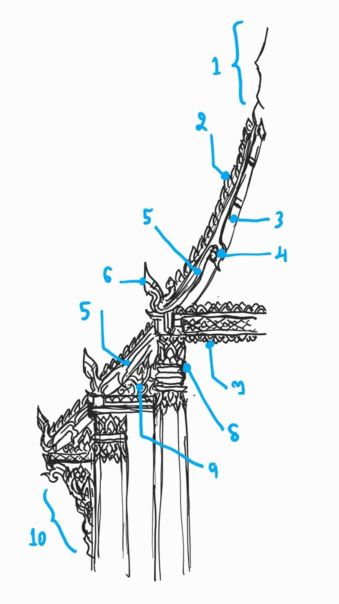
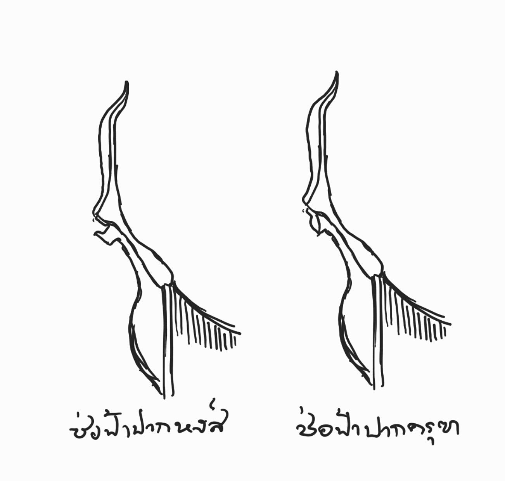
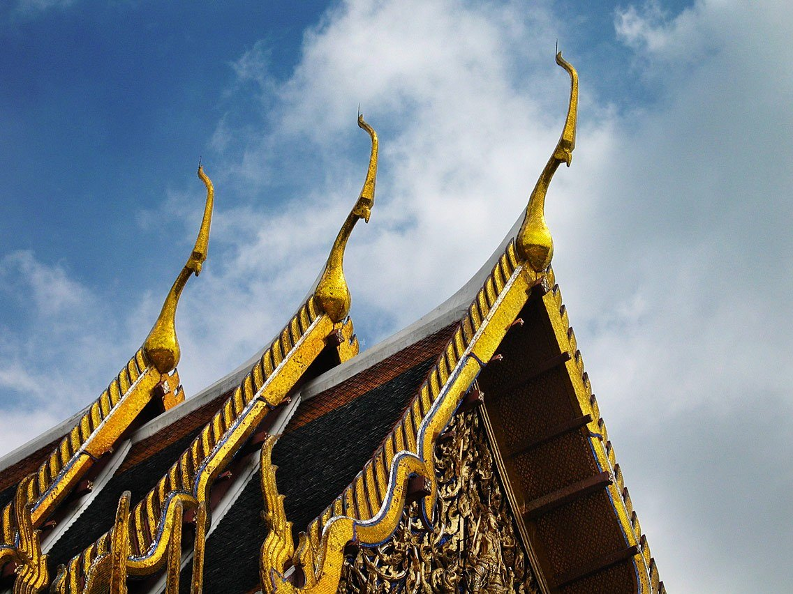
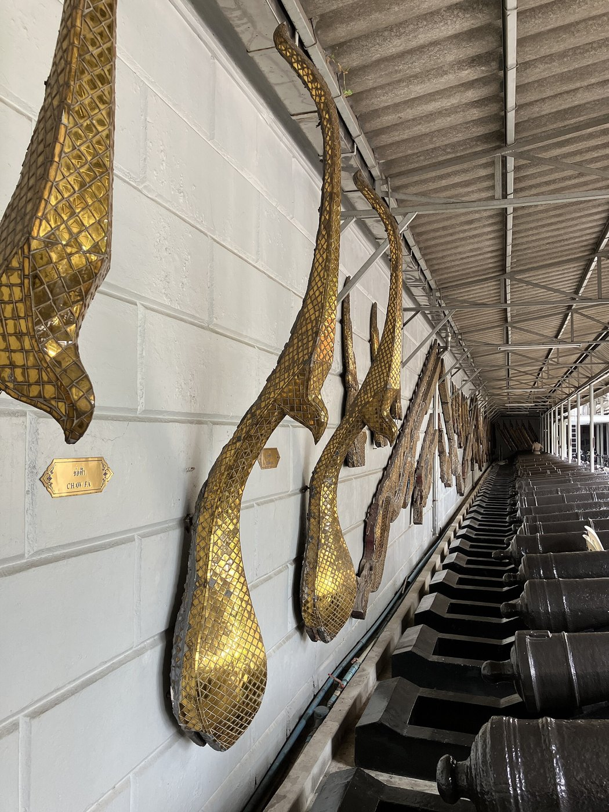
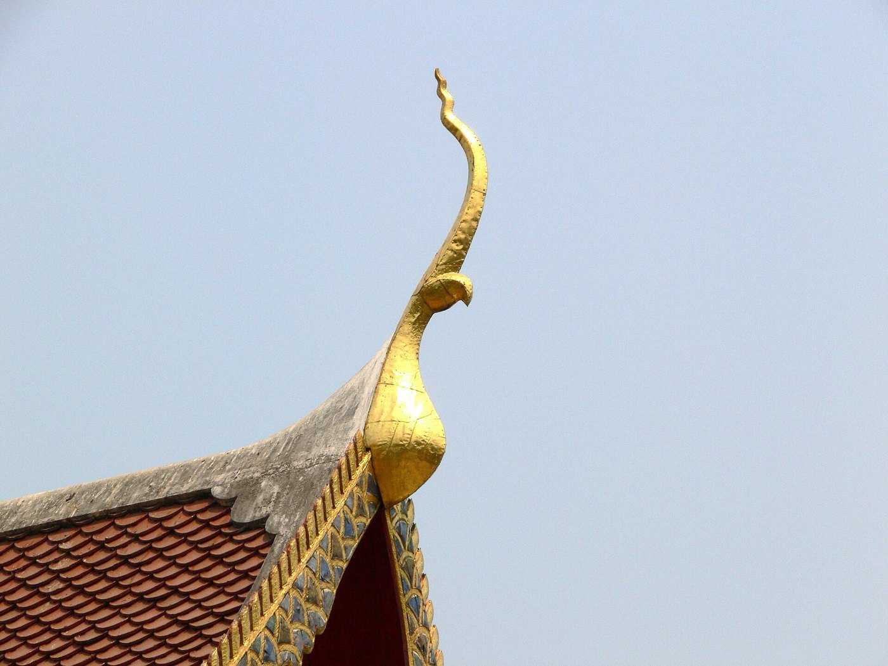
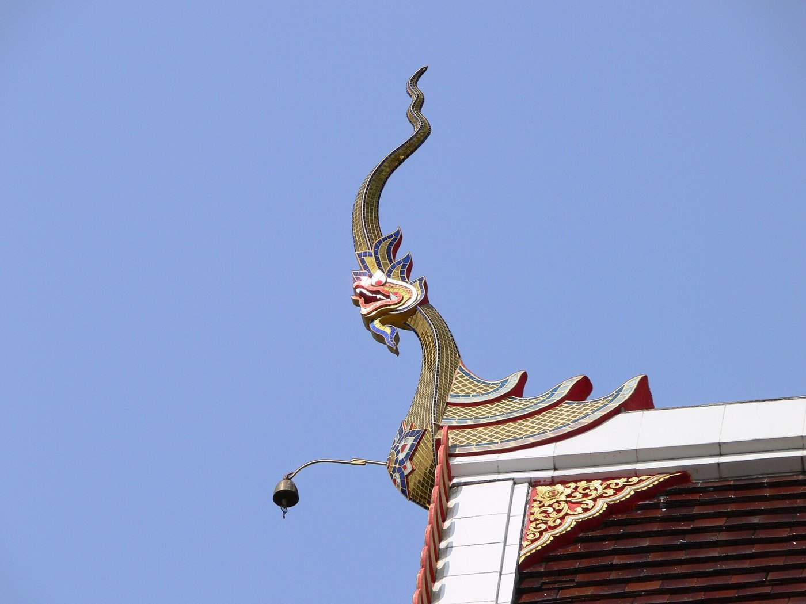
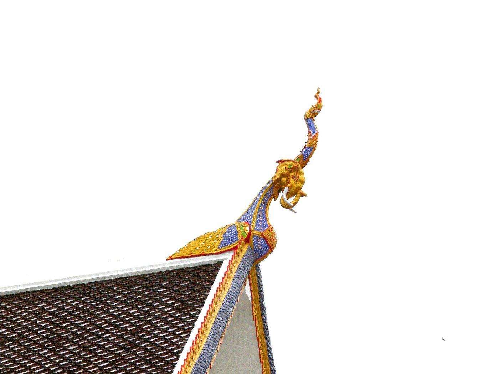

# 07 เครื่องลำยอง: รวยระกา · นาคสะดุ้ง · งวงไอยรา · ใบระกา · ช่อฟ้า · หางหงส์

**ดูภาพนี้:** นาคสะดุ้ง (5) และหางหงส์ (6) เกิดซ้ำที่ทุกตับหลังคาที่ลดลงมา ส่วนช่อฟ้า (1) อยู่ปลายสัน

## นิยาม
**ลำยอง หรือเครื่องลำยอง** คือส่วนประกอบช่วงบนของปั้นลม เป็นเครื่องตกแต่งที่ **"นิยมสร้างเฉพาะในวัดและพระที่นั่งต่างๆ เท่านั้น"** [S6]
ตัวรวยที่ทำคล้ายลำตัวพญานาคเรียก "ลำยอง" หรือ "ตัวลำยอง" ถ้ารวมหางหงส์ นาคเบือน ใบระกา ช่อฟ้า และรวมของหลังคาตับที่ 2, 3, 4 ด้วย เรียกรวมกันว่า **"เครื่องลำยอง"** [S17]

## ⭐ ระบบตามโครงสร้างจริง (สมใจ นิ่มเล็ก อ้างใน [S17])
ตัวรวยทำ "คล้ายธรรมชาติของสัตว์เลื้อยคลาน แสดงกิริยาอาการเลื้อยของงู หรือพญานาค เมื่อเลื้อยลงจากที่สูงจะต้องมีการพักลำตัวหรือม้วนตัวเกี่ยวกับสิ่งที่รองรับ เพื่อป้องกันการพลัดตก" แต่ละส่วนจึงผูกกับไม้โครงหลังคาตัวใดตัวหนึ่ง ไล่จากล่างขึ้นบน:

| ส่วน | อยู่ตรงไหน (ผูกกับโครงไม้) | รูปร่าง |
|---|---|---|
| **หางหงส์** | ปลายล่างสุด ที่เชิงกลอนหรือแปหัวเสา | "ประดิษฐ์เป็นรูปเศียรพระยานาค" ปกติ **หันหน้าไปทางด้านข้างของหน้าจั่ว** |
| **นาคเบือน** | ตำแหน่งเดียวกับหางหงส์ | หางหงส์ที่ "เอี้ยวคอหรือเบือนหน้า" มาทางเดียวกับหน้าจั่ว |
| **นาคสะดุ้ง** | ช่วงที่ตัวรวย "พาดอยู่กับแปลานตัวที่หนึ่ง" | ลำตัวพักหรือสะดุ้งเป็นจังหวะ |
| **งวง / งวงไอยรา** | ที่แปลานตัวที่สอง (เรียก **"แปงวง"**) | นาค "เกี่ยวกระหวัดยึดแป โดยมีปลายแหลมสะบัด" |
| ตัวรวยช่วงบน | เหนืองวง ทอดตรงขึ้นถึงอกไก่ | |
| **ใบระกา** | บนสันตัวรวยตลอดแนว | "ซี่หรือครีบ" คือครีบนาคหรือขนครุฑ [S11, S17] |
| **ช่อฟ้า** | **เหนืออกไก่** (ปลายสันหลังคา) | "รูปคล้ายหัวนก มีหน้าอก มีปาก มีหงอนเป็นปลายแหลมอ่อนช้อย" |

**ส่วนอื่นในชุดเดียวกัน** [S6]: รวยระกา · กระจังรวน · บัวจงกล · จั่วบังนก · คันทวย

## ⭐ กฎที่ผู้ดูแลยืนยัน
1. **ช่อฟ้าโผล่จากปลายสันหลังคา** อยู่ในระนาบตั้งของสัน ซึ่งตั้งฉากกับหน้าจั่ว ชี้ขึ้นแล้วโค้งออกนอกอาคาร มองตรงที่ด้านจั่วเห็นเป็นเขาตั้งตรง
   ❌ ผิด: ทำเป็นเขาม้วนไปด้านข้างในระนาบหน้าจั่ว ผู้ดูแลบอกว่า "คุณทำมันพุ่งไปข้างหน้า"
2. **หางหงส์เชิดขึ้น** เป็นเศียรนาค ไม่ใช่ตะขอม้วนลง
3. **ทุกจั่วมีช่อฟ้าของตัวเอง และทุกขั้นที่ชายคาลดลงมีหางหงส์ของตัวเอง** (รูปอ้างอิง 42, 43)

## แบบของช่อฟ้า

| ช่อฟ้าภาคกลาง (พระอุโบสถวัดพระแก้ว) | ช่อฟ้าของจริงในพิพิธภัณฑ์วัดพระแก้ว |
|---|---|
|  |  |

| ช่อฟ้าหัวครุฑ (ล้านนา) | ช่อฟ้าหัวนาค (ล้านนา) | ช่อฟ้าวัดเจ็ดยอด | ช่อฟ้าหัวช้าง (ท้องถิ่น) |
|---|---|---|---|
|  |  |  |  |

| แบบ | ลักษณะ | ที่มา |
|---|---|---|
| ปากนก / ปากครุฑ | "รูปทรงชะลูดสูง หงอนเพรียว ปากงุ้มเข้า" / "ปลายจะงอยแหลมโค้งและงุ้มลง" | S17, S7 |
| ปากปลา / ปากหงส์ | "ปากงอนออก" / "ปลายจะงอยทู่หงายขึ้นยื่นไปข้างหน้า" | S17, S7 |
| หัวนกเจ่า | "รูปทรงไม่สูง คอสั้นหงอนเตี้ย" | S17, S7 |
| ปากลาว · หัวช้าง และแบบท้องถิ่นอื่น | | S7 |

- **ส่วนของช่อฟ้า:** ส่วนปลายยอดหรือหงอน · ส่วนปาก · ส่วนท้องหรืออกสุบรรณ [S7]
- **ความหมาย:** ช่อฟ้าคือครุฑที่ "ยุดหางนาค" ซึ่งไหลลงมาตามป้านลมทั้งสองข้าง [S11] นิยมแขวนกระดิ่งที่ช่อฟ้า [S11]
- **ล้านนาและล้านช้าง:** มีช่อฟ้าหรือ "โหง่" อยู่ **กลางสัน** ต่างจากภาคกลางที่อยู่ปลายสัน
- **ใบระกา** มีลายเช่น "น่องสิงห์" และ "หอยจับหลัก" [S7]
- **หางหงส์** มีหลายแบบ เช่น นาค · นาคเบือน · หัวนาค [S7] และมักทำเป็นลายกระหนกเปลว [S11]

## ฐานานุศักดิ์
ปั้นลมที่ไม่มีเครื่องลำยองใช้กับเรือนเครื่องสับ (ปลายล่างเป็นตัวเหงา ยอดเป็นหางปลา) และเรือนเครื่องผูก (ไม้ตรง) ส่วนเครื่องลำยองเต็มชุดสงวนไว้สำหรับวัดและวัง [S17] (ดูแผนภาพใน [06](06_หน้าจั่ว_หน้าบัน.md))

## การทำเป็นชิ้นไม้ (ไม้ 1.5 มม. เนื้อไม้อย่างน้อย 3.4 มม.)
- **ช่อฟ้า:** ต่อเป็นชิ้นเดียวกับแผ่นสัน (ระนาบตั้งตามแนวสัน) คอกว้าง 3.6 มม. ปลายงอออก ถ้าเป็นจั่วยืนอิสระ ให้ใช้ชิ้นสั้นติดตั้งฉากบนยอดจั่วที่ตัดแบนไว้
- **ป้านลมและหางหงส์:** ฉลุเป็นชิ้นเดียวกับกรอบหน้าจั่วชั้นหน้า หางหงส์ชี้ขึ้น
- **ใบระกา:** เล็กเกินกว่าจะตัด ให้วาดปากกาเป็นตัว Λ เรียงตามป้านลม
- **นาคสะดุ้งและงวงไอยรา:** ถ้าสเกลใหญ่พอ (ป้านลมกว้าง 6 มม. ขึ้นไป) ให้ทำขั้นหยักที่ตำแหน่งแปลานตัวที่ 1 และ 2
