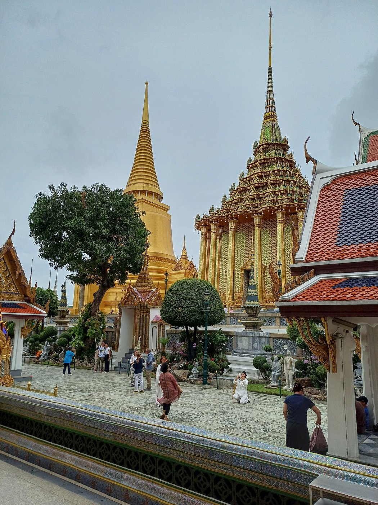
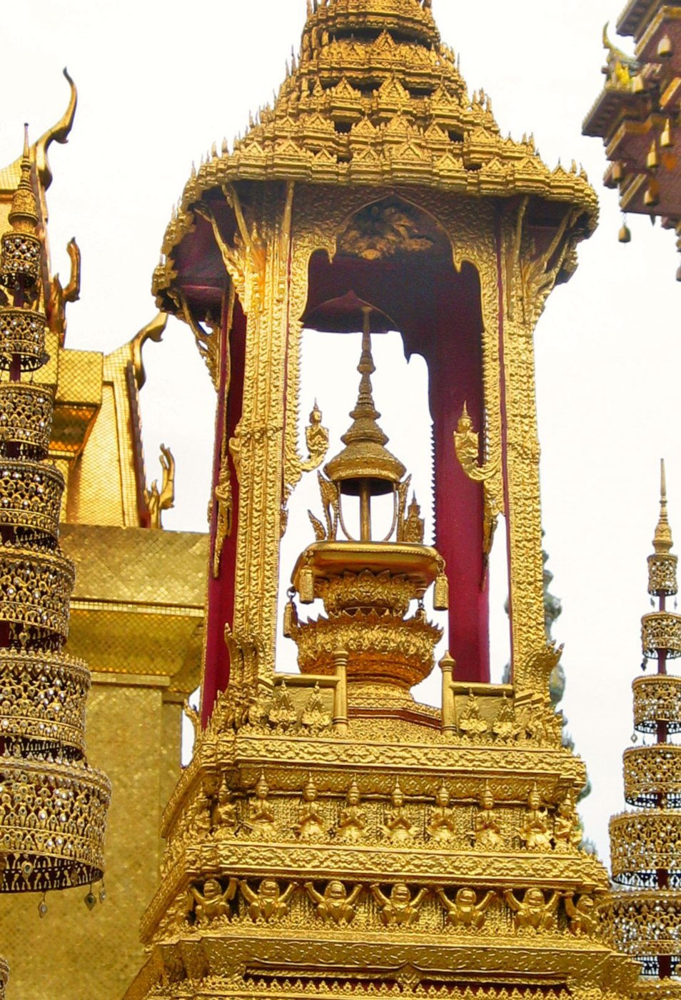
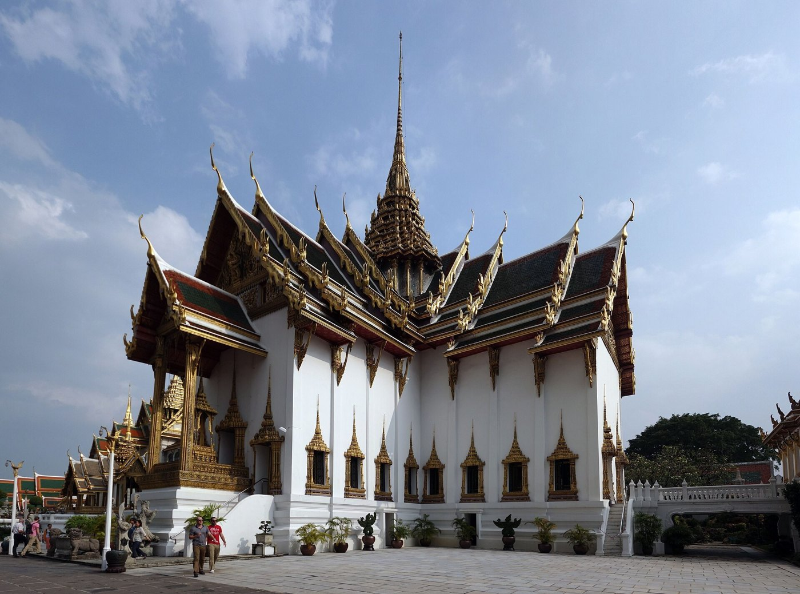
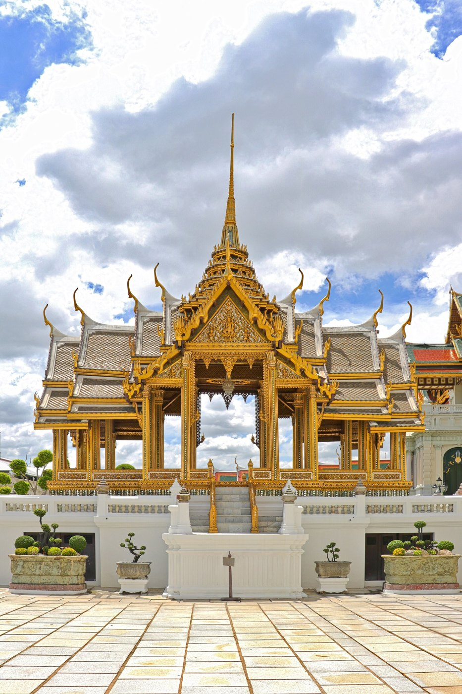

# 08 เครื่องยอด: ยอดบุษบก-มณฑป · ยอดปราสาท · ยอดมงกุฎ — องค์ประกอบ วิธีขึ้นทรง สัดส่วน

แหล่งหลักของไฟล์นี้: บุณยกร วชิระเธียรชัย (2558) งานวิจัยว่าด้วยการขึ้นทรงยอดบุษบก-มณฑปตามแบบแผนช่างหลวง [S18]

## 1. นิยามและฐานานุศักดิ์
- **บุษบก** = "ซุ้มยอด" อาคารโถงขนาดเล็กใช้ได้คนเดียว ตั้งเสาที่มุมทั้งสี่รับยอด (เสาย่อมุมไม้แปดหรือไม้สิบสอง)
  ใช้เป็น (1) ธรรมาสน์ (2) ที่ประดิษฐานพระพุทธรูป หรือตั้งผ้าไตรในพิธีทอดกฐินทางเรือ (3) บุษบกมาลาที่ประทับ
- **มณฑป** = "เรือนยอด" ผังจัตุรัส เป็นได้ทั้งอาคารโถง อาคารทึบ หรืออาคารทึบที่มีเสาหานรอบ ใช้ประดิษฐานพระพุทธรูป รอยพระพุทธบาท พระบรมสารีริกธาตุ หรือพระไตรปิฎก
- **ปราสาท** = มณฑปที่มีมุข (ดูนิยามของสมเด็จฯ กรมพระยานริศฯ ใน [05](05_หลังคา.md))
- **จำนวนชุดเชิงกลอนตามแบบแผนช่างหลวง:** บุษบก 5 ชั้น · มณฑป 7 ชั้น · ปราสาท 5 ชั้น · มหาปราสาท 7 ชั้น
  ของจริงพบตั้งแต่ 3 ถึง 7 ชั้น และ "ไม่ได้จำกัดเลขคี่เท่านั้น" แต่ปัจจุบันนิยมกำหนดให้เป็นเลขคี่
- **ยอดแบบอื่นที่ยืมมาจากเครื่องสูง:** ยอดมงกุฎ · ยอดเกี้ยว · ยอดเรือนชั้นหรือวิมาน · ยอดปรางค์ · ยอดเจดีย์ · ยอดปรางค์-เจดีย์ · ยอดมณฑป-ปรางค์

## 2. องค์ประกอบ 16 ส่วน (บนลงล่าง) [S18]
| # | ส่วน | ประกอบด้วย |
|---|---|---|
| 1 | พุ่มข้าวบิณฑ์ (ชิ้นบนสุด) | กำพู · ดอกไม้ไหว · ยอดพุ่ม |
| 2 | เม็ดน้ำค้าง | ปลายเจาะรูสำหรับเสียบพุ่มข้าวบิณฑ์ |
| 3 | ปลี | ปลียอด · บัวคลุ่ม (บัวโถ) · ลูกแก้ว · ปลี |
| 4 | บัวกลุ่ม | บัวคลุ่ม 5 ชั้น (ยอด 5 ชั้น) หรือ 7 ชั้น (ยอด 7 ชั้น) |
| 5 | เหม | 3 ชั้น |
| 6 | บัลลังก์ | หน้ากระดานบัวคว่ำ · ท้องไม้ · หน้ากระดานบัวหงาย |
| 7 | บัวคอเสื้อ | สูงเท่ากับบัลลังก์หรือสูงกว่าเล็กน้อย |
| 8 | องค์ระฆัง | คือหลังคาชั้นที่ 5 หรือ 7 ซึ่งเป็น **หลังคาประธาน** |
| 9 | ชุดเชิงกลอน 5 หรือ 7 ชั้น | **1 ชุด = ท้องไม้ + เชิงกลอน + หลังคา** (หลังคามีลักษณะบัวคว่ำ) |
| 10 | การย่อมุมเชิงกลอน | ย่อมุมไม้สิบสองแบบรัศมี |
| 11 | การยกเก็จ / ยกกระเปาะบรรพแถลง | ส่วนกลางด้านที่ยื่นออกมารับซุ้ม |
| 12 | บราลี | ปักบนอกไก่ของหลังคาซุ้ม |
| 13 | ซุ้มบรรพแถลง | 1 ซุ้ม = ซุ้มรังไก่ + หน้าบัน + เครื่องลำยอง |
| 14 | กระจัง / นาคปัก / กระจังมุม | ที่มุมของชั้น |
| 15 | เสา / เสาหาน / เสารับยอดปราสาท | |
| 16 | ไขรายอด / ไขรายอดปราสาท | |

## 3. ⭐ ยอดเริ่มจากในหลังคา (กฎที่ผู้ดูแลยืนยัน + หลักวิชา)
- "ส่วนยอด ... เป็นส่วนที่ต่อเนื่องขึ้นมาจากองค์ประกอบส่วนเรือนหรือระบบโครงสร้างที่ถูกออกแบบขึ้นมาเฉพาะ เช่น เสาภายในอาคาร หรือชุดขื่อ ... ตั้งเสาตะมอ ... ซ้อนชั้นแบบลดหลั่นต่อเนื่องกันขึ้นไปตามรูปชั้นหลังคายอด" [S18]
- **ชุดเชิงกลอนชั้นที่ 1 ใช้เรือนหรือเสารับยอดทำหน้าที่เป็นท้องไม้** [S18] ยอดจึงต่อเนื่องจากตัวอาคาร ไม่ได้วางทับ
- **ในโมเดล:** ทำเรือนยอดเป็นแท่งสี่เหลี่ยมที่เริ่มในหลังคา ให้หลังคาและสันทุกผืนวิ่งเข้าชนผนังของมัน ชั้นแรกของยอดอยู่ราวระดับยอดหน้าจั่ว
  ❌ ห้ามวางวงชั้นยอดลอยบนสันหลังคา
  ❌ ห้ามมีเสาสี่เหลี่ยมยาวตั้งแต่ชายคาโผล่ระหว่างหลังคา

## 4. วิธีขึ้นทรง 5 ขั้น (สรุปจาก [S18])
| พระมณฑปวัดพระแก้ว | บุษบก (ซุ้มยอดขนาดเล็ก) |
|---|---|
|  |  |

| พระที่นั่งดุสิตมหาปราสาท: ยอดปราสาทงอกจากจุดตัดหลังคาจัตุรมุข | พระที่นั่งอาภรณ์ภิโมกข์ปราสาท |
|---|---|
|  |  |

1. **กำหนดทรง:** ร่างทรงจอมแห **กว้าง 1 ส่วน สูง 2 ถึง 2.5 ส่วน** ลากเส้นทรงจากปลายเม็ดน้ำค้างลงมาถึงท้องเชิงกลอนชั้นที่ 1
2. **กำหนดส่วน:**
   - **ส่วนหลังคา 1 ส่วน : ส่วนยอด 1.5 ส่วน** ส่วนหลังคานับจากท้องเชิงกลอนล่างสุดถึงบ่าองค์ระฆัง ส่วนยอดนับจากบ่าองค์ระฆังถึงปลาย
     ให้น้ำหนักทางระยะที่ส่วนยอดมากกว่าเสมอ "มิฉะนั้นแล้วยอดจะดูสั้น" แม้ส่วนหลังคาจะมีมวลมากกว่า
   - **เชิงกลอนบนสุดกว้าง ≈ 1/3 ของเชิงกลอนล่างสุด** (ยอด 7 ชั้น: 1/3 ≈ ความกว้างเชิงกลอนชั้นที่ 6)
   - **องค์ระฆังสูง ≈ ความกว้างเชิงกลอนบนสุด** (ยอด 5 ชั้น) หรือ **≈ 1/4 ของเชิงกลอนล่างสุด** (ยอด 7 ชั้น)
   - เหนือบ่าระฆัง: บัลลังก์พอประมาณ แล้ว **เหม บัวกลุ่ม และปลี สูงพอๆ กัน**
     ยอด 7 ชั้น: เหมเตี้ยกว่าบัวกลุ่ม ปลีเตี้ยกว่าบัวกลุ่มเล็กน้อยแต่สูงกว่าเหม
3. **ย่อมุมไม้สิบสองแบบรัศมี:**
   - ร่างผังย่อมุมที่เชิงกลอนล่างสุดกับหน้ากระดานบนของเหมชั้นบนสุด
   - ลากเส้นรัศมีเชื่อมมุมนอกถึงมุมนอก (12 เส้น) และมุมในถึงมุมใน (8 เส้น)
   - ทุกชั้นที่อยู่ระหว่างกลางจะได้มุมย่อตามเส้นรัศมีเหล่านี้ **มุมย่อของทุกชั้นจึงเรียงเป็นแนวเดียวกันขึ้นไปถึงยอด**
4. **ซุ้มบรรพแถลง:**
   - ยกกระเปาะ (เก็จ) กลางด้านที่ชั้นบนสุดและชั้นล่างสุด แล้ว **"โรยเส้นจอมแห"** เชื่อมกัน ทุกชั้นที่อยู่ระหว่างกลางจะได้ตำแหน่งและระยะยื่นของซุ้มจากเส้นนั้น
   - ทำซ้ำกับซุ้มรองที่อยู่ซ้ายและขวา
   - หลังคาซุ้มแต่ละชั้นก็หาความสูงด้วยเส้นจอมแหเช่นกัน
5. **องค์ประกอบย่อย:**
   - บราลีบนอกไก่ของซุ้มต้องสัมผัสเส้นจอมแห
   - จากนั้นใส่เส้นลวด ท้องไม้ กระจัง นาคปัก บัวคอเสื้อ ครอบสันหลังคาประกอบลายรักร้อย เกล็ดกระเบื้อง กระจังรวนที่หลบหลังคา บัลลังก์ เหม บัวกลุ่ม ลูกแก้ว บัวคลุ่ม ปลียอด และพุ่มข้าวบิณฑ์

## 5. ⭐ จังหวะความสูงของชุดเชิงกลอน — สูงขึ้นทีละเท่าๆ กันเมื่อขึ้นไป
ข้อสำคัญที่ขัดกับสัญชาตญาณ: **ชุดเชิงกลอนชั้นบนสูงกว่าชั้นล่าง** โดยเพิ่มทีละค่าคงที่ (อนุกรมเลขคณิต) แล้ว **ชั้นที่ส่งไปองค์ระฆังจะเพิ่มพิเศษ** [S18]

| แบบ | ความสูงชุดเชิงกลอน ชั้น 1 → บนสุด (ม.) | ผลต่างต่อชั้น |
|---|---|---|
| พระเมรุมาศ ร.6 (5 ชั้น) | 1.11 · 1.22 · 1.35 · 1.50 · **2.65** | +0.11, +0.13, +0.15 (เพิ่มทีละ 0.02) แล้ว +1.15 |
| พระเมรุมาศ ร.8 (5 ชั้น) | 0.96 · 1.08 · 1.20 · 1.32 · **2.05** | +0.12 คงที่ แล้ว +0.73 |
| มณฑปพระพุทธบาท สระบุรี (7 ชั้น) | 1.20 · 1.44 · 1.68 · 1.92 · 2.16 · 2.40 · **3.85** | +0.24 คงที่ แล้ว +1.45 |

- **ความสูงหลังคาแต่ละชั้น** (มณฑปพระพุทธบาท): 0.75 · 0.96 · 1.17 · 1.38 · 1.59 · 1.80 · 3.85 ม. (+0.21 คงที่)
- **เชิงกลอน** สูงเท่ากันทุกชั้น ยกเว้นชั้นที่ 1 ที่ใหญ่กว่าเล็กน้อย (ร.6: 0.45 ม. แล้ว 0.40 ม.) เพราะทำหน้าที่เป็นฐานรับยอด
- **เหตุผล:**
  - ลดทอนมวลของหลังคา
  - "ก่อให้เกิดจินตภาพความงามที่เคลื่อนไหว ไม่หยุดนิ่ง"
  - เน้น **องค์ระฆังซึ่งเป็นหลังคาประธาน** ให้เด่น
  - "สืบเนื่องมาจากการลดทอนขนาดผืนหลังคาและการซ้อนชั้นหลังคาที่ปรากฏในส่วนหลังคาของอาคาร" ระบบเดียวกับซ้อนใน [05](05_หลังคา.md)

## 6. บ่าองค์ระฆัง 2 ลักษณะ [S18]
1. **บ่ารวบเข้าหาเส้นทรง** หรือยื่นออกนอกเส้นทรงเล็กน้อย มาพร้อมบัลลังก์เต็มชุด เป็นแบบดั้งเดิม เช่น ยอดพระที่นั่งดุสิตมหาปราสาท พระที่นั่งอาภรณ์ภิโมกข์ปราสาท และพระมณฑปวัดพระแก้ว
2. **บ่ายื่นออกนอกเส้นทรงชัด** คล้ายเจดีย์ย่อมุมไม้สิบสองอยุธยา เป็นแบบสมเด็จฯ กรมพระยานริศฯ ในพระเมรุมาศ ร.6 ส่งอิทธิพลต่อแบบยุคหลัง

## 7. การทำเป็นชิ้นไม้
- **ชุดเชิงกลอน:** 1 ชุด = กล่องผนังสั้น (ท้องไม้) + วงแหวนยื่น (เชิงกลอน) + วงหรือกล่องเอียงรวบ (หลังคา) ความสูงแต่ละชุดใช้อนุกรมเพิ่มคงที่ และชั้นองค์ระฆังให้สูงพิเศษ
- **ทรง:** คุมขนาดทุกชั้นด้วยเส้นจอมแห
  - กว้าง : สูง = 1 : 2–2.5 (ถ้ามองจากต่ำ ให้ยืดถึง 1 : 3)
  - หลังคา : ยอด = 1 : 1.5
  - เชิงกลอนบนสุด = 1/3 ของเชิงกลอนล่างสุด
- **บันแถลงทุกชั้น:** แผ่นตั้งกลางด้าน ระยะยื่นและความสูงไล่ตามเส้นจอมแหที่โรยจากชั้นบนลงชั้นล่าง
- **ย่อมุม:** ใช้ s/w เท่ากันทุกชั้น มุมจึงเรียงเป็นรัศมีเข้าศูนย์กลาง
