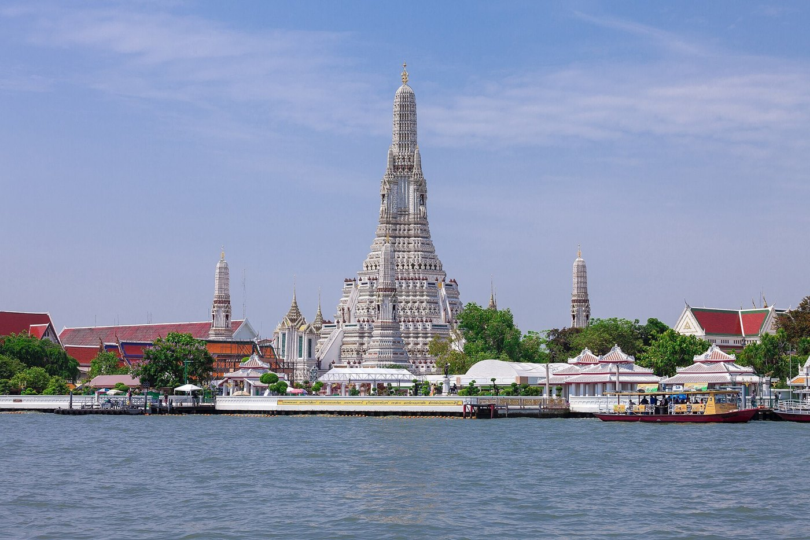
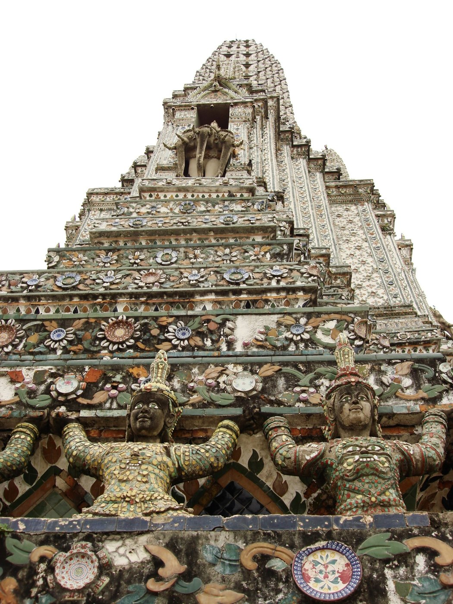
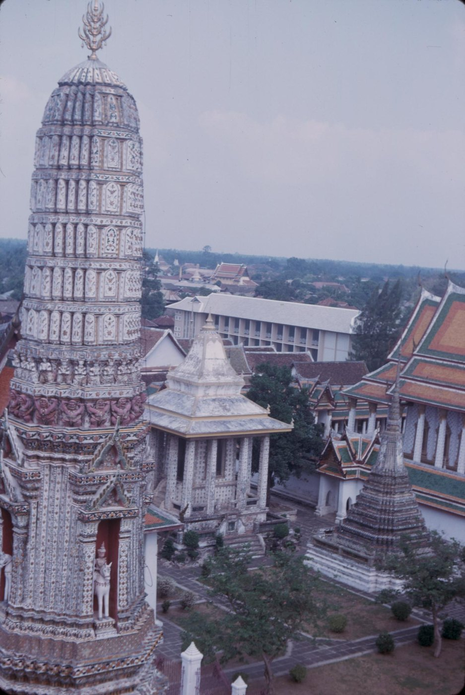
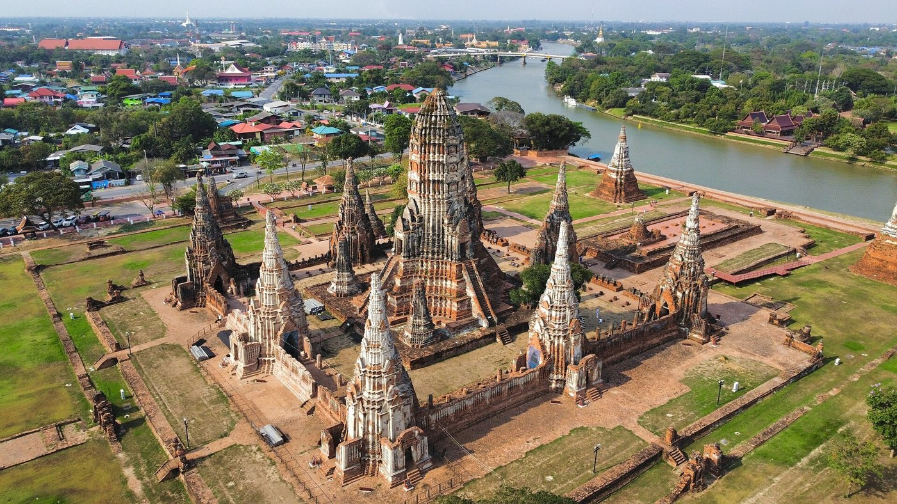

# 09 ปรางค์ (Prang)

## ชื่อ
ปรางค์ หรือพระปรางค์ ภาษาอังกฤษใช้ prang
สืบมาจากปราสาทขอม (ศิขร) ผ่านอยุธยาจนถึงรัตนโกสินทร์ ยุคหลังยิ่งเรียวและสูงขึ้น
ปรางค์ประธานวัดอรุณเป็นแบบรัตนโกสินทร์ที่สูงเรียวที่สุดแบบหนึ่ง

| ซุ้มจระนำ: พระอินทร์ทรงเอราวัณ | ชั้นซ้อนและผู้แบก | ปรางค์ทิศ |
|---|---|---|
|  |  |  |

**ส่วนประกอบตามที่ระบุในวิกิพีเดีย** (บนลงล่าง) [ผลค้นหา S13]:
นภศูล (ยอดปลายสุด) · บัวกลุ่ม (รับนภศูล) · ชั้นรัดประคด (ชั้นยอด) · กลีบขนุน (ตกแต่งใต้ชั้นรัดประคด) · บันแถลง (กลางกลีบขนุน) · ชั้นอัสดง (เรือนยอด) · เรือนธาตุ · ซุ้มจระนำ (ประดิษฐานพระพุทธรูป) · ชุดฐานสิงห์ (3 ชั้น) · ฐานปัทม์ · ฐานเขียง

**ทรงปรางค์:** ด้าน "ก่ง (โก่ง) ออก" แล้ว "รวบเข้า" ก่อนถึงปลายยอด ดึงเป็น "จอม" ขึ้นเล็กน้อย เป็นแบบแผนของงานเครื่องก่อ ต่างจากทรงจอมแหของงานเครื่องไม้ [S18]

**วัดอรุณ — แหล่งข้อมูลยังขัดกัน (ควรตรวจ):**
- **ปรางค์ประธาน:** มีพระอินทร์ทรงช้างเอราวัณ 4 องค์ที่ชั้นที่สอง [S12] ยอดเป็นนภศูลประดับมงกุฎ [S13] และมงกุฎย้ำคติพระอินทร์ [S20]
- **ปรางค์ทิศ:** วิกิพีเดียอังกฤษบอกว่ามีปรางค์ทิศองค์หนึ่งอุทิศแด่พระพาย [S12] ส่วนบทความศิลปวัฒนธรรมกล่าวถึง "รูปเทวดาทรงช้าง ... หมายถึงพระเจ้าจักรพรรดิราช" ในซุ้มของปรางค์บริวาร [S20] **ยังไม่ได้ข้อยุติ**
- **ความสูง:** แหล่งต่างๆ ให้ไว้ระหว่าง 66.8–86 ม. [S12]
- **วัสดุ:** ประดับกระเบื้องถ้วยชามจีนและเปลือกหอย [S12] สร้างเสร็จในรัชกาลที่ 3 [S12]

## ส่วนประกอบ (ล่างขึ้นบน)
| ส่วน | ลักษณะ |
|---|---|
| ฐานไพที / ฐานทักษิณ | ลานซ้อนหลายชั้น มีบันไดหันหน้าออกและพนักล้อม (วัดอรุณมี 3 ชั้นหลัก) |
| ฐานสิงห์ / ฐานแบก | ฐานสิงห์ซ้อนกัน มีแถบยักษ์แบก กระบี่แบก มารแบก |
| เรือนธาตุ | แท่งย่อมุม มีซุ้มจระนำ 4 ทิศ |
| ซุ้มจระนำ | ซุ้มยอดบันแถลงซ้อน ในซุ้มมีรูปเคารพ (วัดอรุณ: พระอินทร์ทรงช้างเอราวัณ) บางทิศเป็นประตู |
| บัวรัดเกล้า | บัวคาดบนเรือนธาตุ |
| ชั้นรัดประคด | แถบคาดคั่นระหว่างชั้นซ้อน มีหน้ากระดานและบันแถลง |
| ชั้นซ้อน (ยอดฝักข้าวโพด) | ชั้นย่อมุมซ้อนกันประมาณ 5–7 ชั้น ไล่เล็กลงตามทรงจอมแห |
| กลีบขนุน | แผ่นยอดแหลมตั้งที่มุมของแต่ละชั้น เป็นปรางค์จำลองหรือเทพจำลอง ทำให้ยอดดูกลม |
| บันแถลง | หน้าจั่วจำลองที่กลางด้านของแต่ละชั้น |
| บัวกลุ่ม / บัวรองรับยอด | บัวกลมใต้ยอด |
| นภศูล | ยอดโลหะเป็นแท่งหลายแฉก (ตรีศูล) อาจมีมงกุฎครอบ ที่วัดอรุณมีมงกุฎบนนภศูล **(ควรตรวจ)** |

## เหตุผลของรูปร่าง
- ปรางค์คือเขาพระสุเมรุ ชั้นซ้อนคือสวรรค์แต่ละชั้น
- กลีบขนุนกับบันแถลงทำให้ยอดเหลี่ยมดูกลมมน และพื้นผิวมีเงาถี่เหมือนเปลวไฟ
- **ทรงจอมแห:** ด้านข้างเว้าเข้า ช่วงล่างผายกว้าง ช่วงบนเรียวยาว

## ปรางค์ประธานกับปรางค์ทิศ (วัดอรุณ)
- **ปรางค์ประธาน:** อยู่กลาง สูงที่สุด ซุ้มจระนำมีพระอินทร์ทรงช้างเอราวัณ
- **ปรางค์ทิศ 4 องค์:** อยู่ที่มุมทแยงของลานทักษิณ เล็กและเตี้ยกว่าประธานมาก ซุ้มมีพระพายทรงม้า **(ควรตรวจ)**
- **มณฑปทิศ 4 หลัง:** อยู่บนแกนหลัก 4 ทิศ ระหว่างปรางค์ทิศ (ดู 11)

## สัดส่วน (แนวทาง)
- ปรางค์รัตนโกสินทร์มีความสูงรวมต่อความกว้างฐานเรือนธาตุประมาณ 5–7 เท่า ยอดชั้นซ้อนยาวกว่าเรือนธาตุมาก
- แต่ละชั้นซ้อนเล็กลงทีละน้อย ด้านข้างเว้าเข้า (curve > 1)

## ข้อผิดพลาดที่พบ
1. รูปทรงอ้วนเกินไป ของจริงเรียวและสูงกว่า ทั้งปรางค์ประธานและปรางค์ทิศ
2. ทำยอดเป็นวงแหวนซ้อนเหมือนกองเหรียญ ผู้ดูแลให้ทำชั้นซ้อนเป็นผนัง (กล่องสั้นซ้อนกัน) แทน
3. ยอดของปรางค์ประธานสั้นเกินไป ของจริงยอดยาวกว่านี้
4. สัดส่วนยอดของปรางค์ทิศผิด
5. ใช้แท่งไม้กลมสำเร็จรูป (rod) ทำยอด ผู้ดูแลไม่ชอบ ห้ามใช้ rod

## การทำเป็นชิ้นไม้
- **แกน:** แผ่นแกน X/Y บากล็อกกากบาท
- **ฐานและเรือนธาตุ:** เป็นกล่องผนังย่อมุม
- **ชั้นซ้อน:** เป็นผนังที่มีวงแหวนเป็นบัวคาด (`tiers` ที่ใช้ `fill`)
- **กลีบขนุนและบันแถลง:** แผ่นตั้งติดที่มุมและกลางด้าน
- **นภศูล:** เป็นยอดของแผ่นแกน X ประกบอีกแผ่นให้หนาขึ้น
