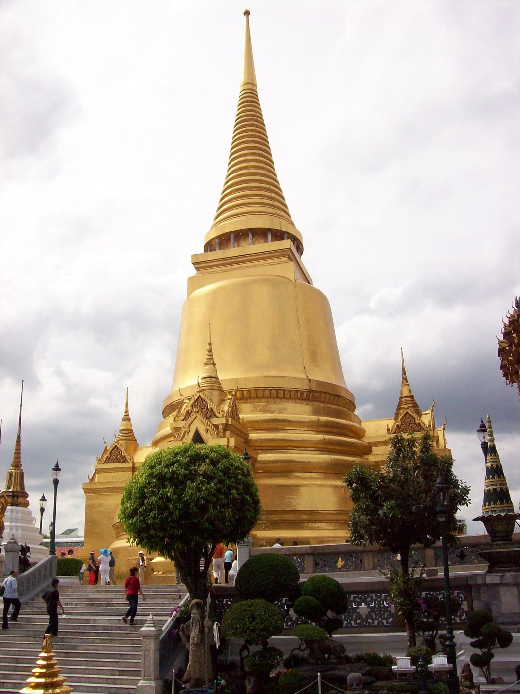
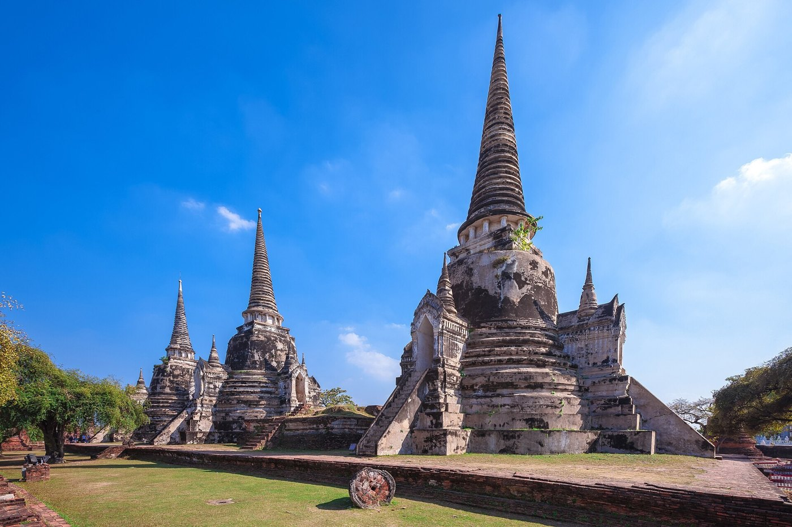
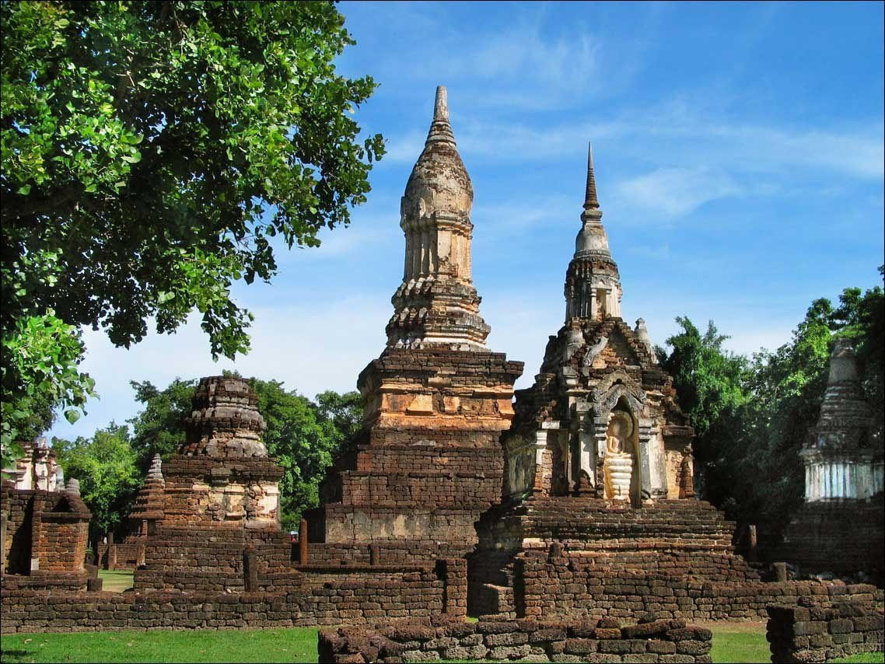
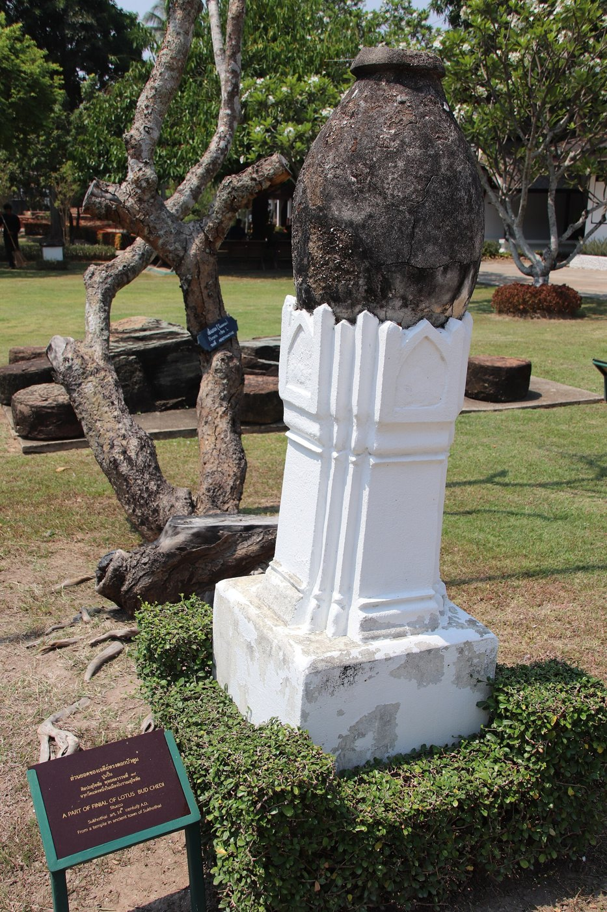

# 10 เจดีย์ (Chedi / Stupa)

## ชื่อ
เจดีย์ หรือสถูป ใช้บรรจุพระบรมสารีริกธาตุ อัฐิ หรือสิ่งศักดิ์สิทธิ์

## ส่วนประกอบ: เจดีย์ทรงระฆัง (ล่างขึ้นบน)
| ส่วน | ลักษณะ |
|---|---|
| ฐานเขียง / ฐานไพที | แท่นสี่เหลี่ยมหรือกลมเป็นขั้น |
| ฐานบัว / ฐานสิงห์ / มาลัยเถา | บัวกลมซ้อนกันหลายวงรองรับองค์ระฆัง (มาลัยเถา = วงกลมไล่ขนาดซ้อนกัน 3 วง) |
| บัวปากระฆัง | บัวคาดที่ขอบล่างขององค์ระฆัง |
| องค์ระฆัง (อัณฑะ) | ทรงระฆังคว่ำ เป็นที่บรรจุสิ่งศักดิ์สิทธิ์ |
| บัลลังก์ | แท่นสี่เหลี่ยมเหนือระฆัง (คติแท่นที่ประทับ) |
| ก้านฉัตร / เสาหาน | แท่งเล็กหรือเสารายรอบเหนือบัลลังก์ |
| ปล้องไฉน | วงแหวนซ้อนกันเรียวขึ้น (คติฉัตรซ้อน) |
| ปลี | กรวยเรียวเรียบ |
| เม็ดน้ำค้าง / ลูกแก้ว | ลูกกลมที่ปลายสุด |

**เจดีย์ทรงลังกาแบบอยุธยา** [ผลค้นหา S13]: ฐาน (ยกระดับ) · ฐานเขียง · ฐานปัทม์หรือฐานบัว · **บัวถลา** (ลักษณะจากลังกา) · **บัวปากระฆัง**
**สุโขทัย** [S9]: "ฐานทำเป็นฐานสี่เหลี่ยมซ้อนกันสามชั้น จากนั้นทำเป็นฐานบัว" มีเจดีย์ 3 แบบ ได้แก่ ทรงพุ่มข้าวบิณฑ์ (ลักษณะเฉพาะของสุโขทัย) ทรงกลม และทรงแบบขอม
ทั้งเจดีย์และยอดอาคารคุมเส้นรอบนอกด้วย **เส้นจอมแห** [S17] (ดู [00](00_ปรัชญาและคติ.md))

| ทรงระฆัง (ลังกา) รัตนโกสินทร์ | ทรงระฆัง อยุธยา | ทรงดอกบัวตูม สุโขทัย |
|---|---|---|
|  |  |  |

## รูปแบบที่แตกต่าง (variation)
- **ทรงระฆัง (ทรงลังกา):** ระฆังกลมใหญ่ ฐานกลม เรียบ
- **ทรงย่อมุม (ย่อมุมไม้สิบสอง):** ทุกส่วน ตั้งแต่ฐาน ระฆัง ถึงบัลลังก์ เป็นเหลี่ยมย่อมุม พบมากในอยุธยาตอนปลายและรัตนโกสินทร์
- **ทรงดอกบัว / บัวยอดตูม:** ยอดเหมือนดอกบัวตูม พบในสุโขทัย
- **ทรงปราสาทยอด:** เรือนธาตุมีซุ้มทิศและยอดเป็นเจดีย์
- **เจดีย์ราย:** เจดีย์เล็กล้อมรอบองค์ประธาน

## เหตุผลของรูปร่าง
- ระฆังคือเนินดินฝังพระธาตุตามคติอินเดีย บัลลังก์คือแท่นที่ประทับ ปล้องไฉนคือฉัตรซ้อนที่ยกย่องพระพุทธเจ้า
- ยิ่งเรียวขึ้นข้างบน ยิ่งเน้นแกนตั้งที่ชี้สู่ฟ้า

## สัดส่วน (แนวทาง)
- องค์ระฆังกว้างประมาณ 0.6–0.75 เท่าของฐาน ส่วนปล้องไฉนรวมปลียาวประมาณ 1–1.5 เท่าของความสูงระฆัง
- รัตนโกสินทร์เรียวกว่าสุโขทัยและอยุธยาตอนต้น

## การทำเป็นชิ้นไม้
- **ส่วนกลม:** ใช้วงแหวนซ้อนแบบ `rings` โดยไล่ขนาดตามโปรไฟล์ระฆัง ถ้าเป็นวงกลมจริงใช้ polygon หลายเหลี่ยม (n สูง)
- **ปล้องไฉน:** วงแหวนเล็กสลับใหญ่
- **ปลี:** เป็นยอดของแผ่นแกน
