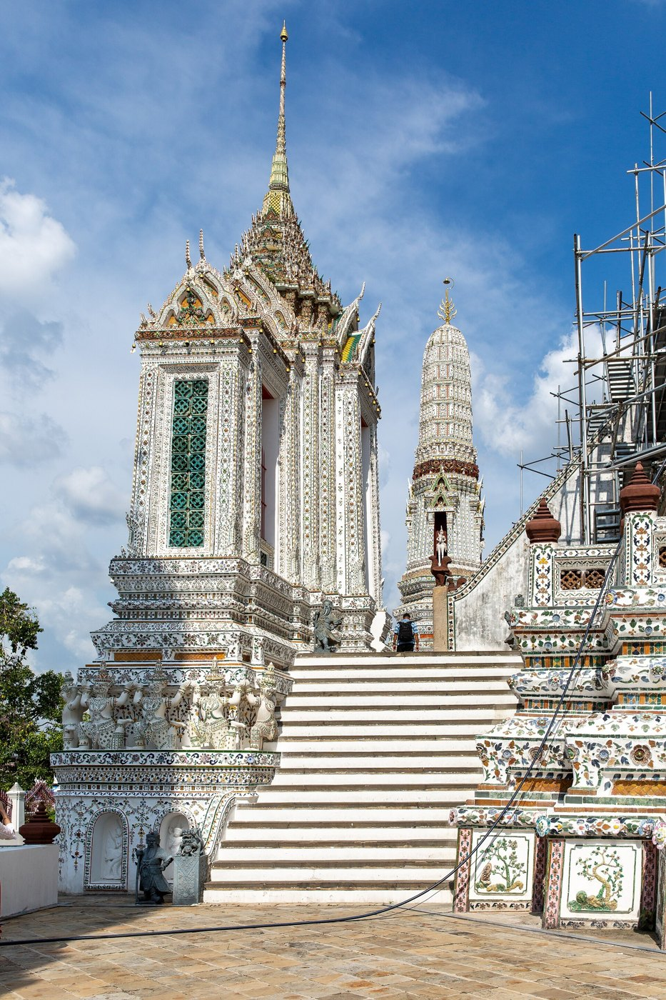
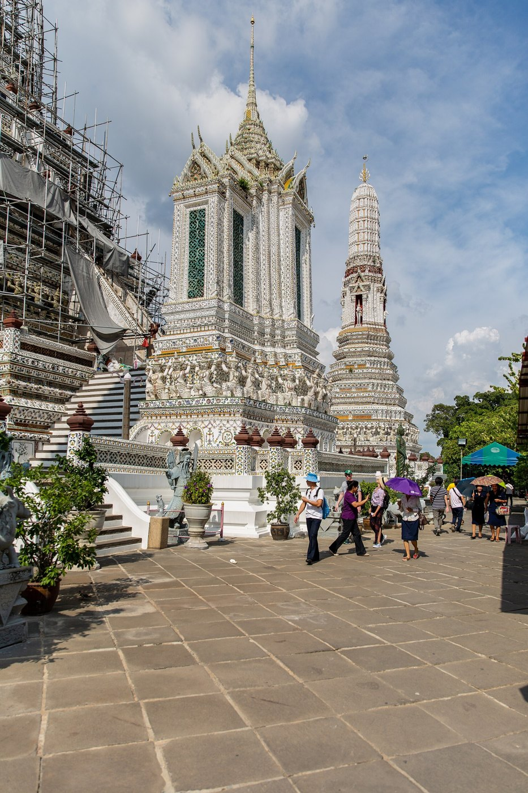
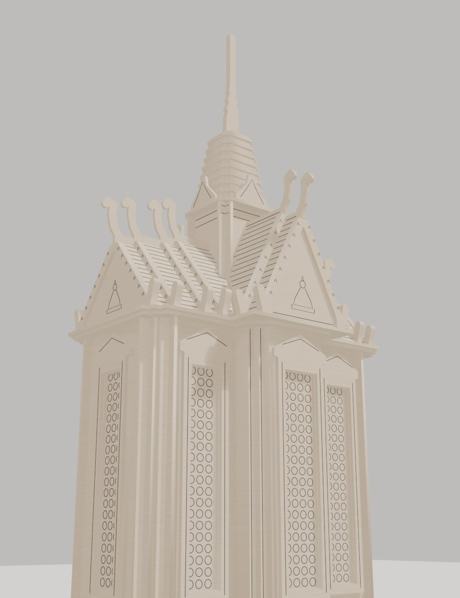
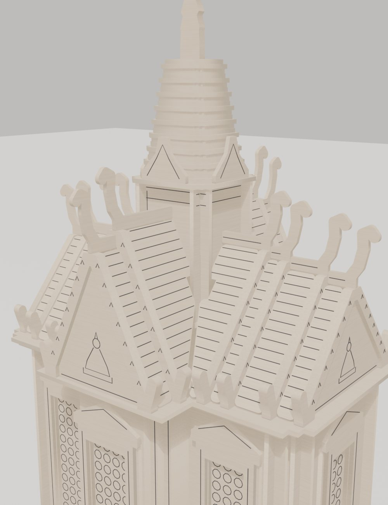
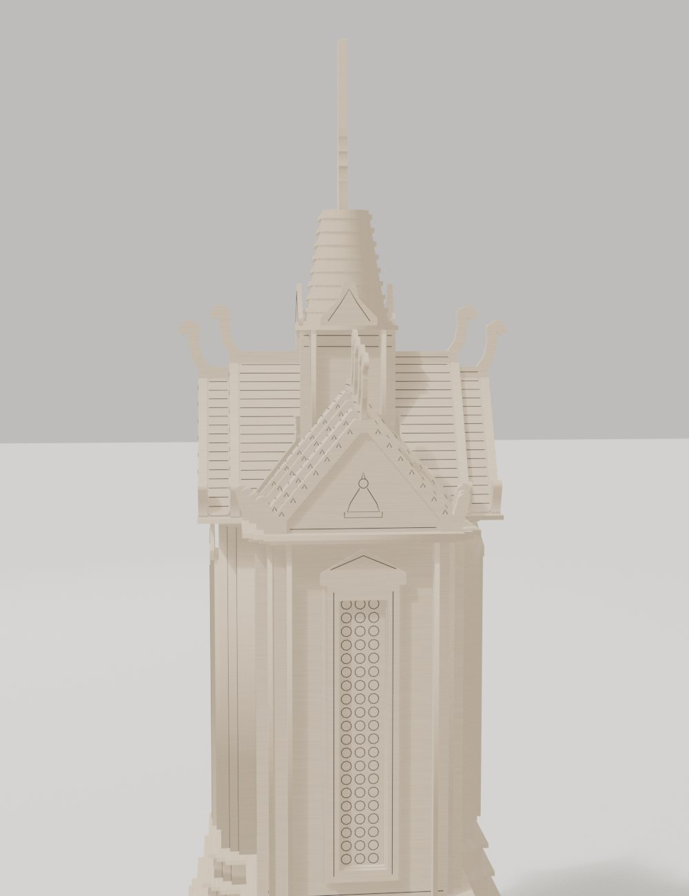
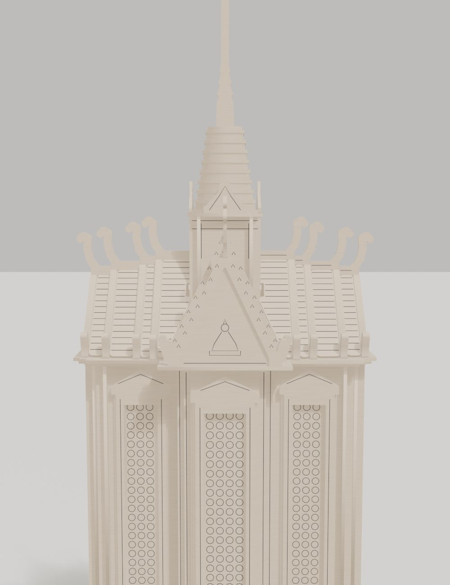

# 11 มณฑป — กรณีศึกษา: มณฑปทิศวัดอรุณ

ไฟล์นี้บันทึกรูปทรงที่ได้หลังแก้กับผู้ดูแล 14 รอบ ใช้เป็นแม่แบบของอาคารทรงมณฑปแบบไทย
โมเดลอยู่ที่ `E:\blender\wat_arun_mondop\part_v14\`

## มณฑปคืออะไร
อาคารสี่เหลี่ยม (จัตุรัสหรือผืนผ้า) มีหลังคาจั่วทั้ง 4 ทิศ และ **ยอดทรงมณฑปที่งอกจากกลางหลังคา**
ใช้ประดิษฐานสิ่งสำคัญ เช่น รอยพระพุทธบาท พระไตรปิฎก หรือพระพุทธรูป
มณฑปทิศวัดอรุณมี 4 หลังบนแกน 4 ทิศรอบปรางค์ประธาน ในแต่ละหลังมีพระพุทธรูปปางสำคัญ เช่น ประสูติ ตรัสรู้ ปฐมเทศนา ปรินิพพาน **(ควรตรวจว่าหลังไหนเป็นปางไหน)**

**ภาพจริงจาก Wikimedia Commons:**



| ฐานซุ้ม | เทวดาแบก | มณฑปทิศใต้ |
|---|---|---|
|  |  |  |

**ภาพที่ผู้ดูแลส่งมา (ภายใน):**


**ตามนิยามช่าง** [S18]: มณฑปคือ "เรือนยอด" ซึ่งมาตรฐานมีชุดเชิงกลอน 7 ชั้น ส่วนมณฑปที่มีมุขเรียกปราสาท ตามคำอธิบายของสมเด็จฯ กรมพระยานริศฯ
มณฑปทิศวัดอรุณมีมุขยื่นหน้าหลังและมีปีก **รูปทรงจึงใกล้ปราสาท** และหลังคาเป็นแบบทรงปราสาท (ดู [05](05_หลังคา.md))

## ผัง
```
มองจากบน (ด้านยาว = แนวขนานลานทักษิณ)

      ┌──────┬────────────┬──────┐
      │ ปีก   │   มุขกลาง   │  ปีก  │  ← มุขยื่นหน้า 1.2 ม.
 ┌────┘      │  ┌──────┐  │      └────┐
 │  จั่วปลาย  │  │ ยอด  │  │  จั่วปลาย  │
 │  ปีก(ต่ำ)  │  └──────┘  │  ปีก(ต่ำ)  │
 └────┐      │            │      ┌────┘
      │      │            │      │   ← มุขยื่นหลังเช่นกัน
      └──────┴────────────┴──────┘
```
- **ผัง:** สี่เหลี่ยมผืนผ้า ในผังกรมศิลปากรเป็นสี่เหลี่ยมผืนผ้าที่มีกากบาทข้างใน ด้านยาวขนานกับลานทักษิณ
- **ด้านยาว:** แบ่ง 3 ช่วงเกือบเท่ากัน (ปีก–มุข–ปีก) ช่วงละหนึ่งหน้าต่าง
- **มุขกลางยื่นหน้าและหลัง** และฐานทุกชั้นยื่นตามมุข มุมของมุขย่อ 2 จังหวะ
- **ด้านสกัด (ปลายปีก):** มีหน้าต่าง 1 บาน

## ไล่จากล่างขึ้นบน
1. **ฐานซุ้ม:** ซุ้มโค้งเรียง ในซุ้มมีกินรี
2. **ฐานแบก:** เทวดาหรือยักษ์คุกเข่ายกแขนแบก (ที่วัดอรุณเป็นรูปปั้นนูนเกือบลอยตัว)
3. **บัวคาด 3 ชั้น:** ทุกชั้นยื่นตามมุข
4. **ตัวเรือน:** สูงชะลูด (สูงประมาณ 2 เท่าของความลึก) มุมย่อมุม หน้าต่างลายกระเบื้องเขียวสูงประมาณ 3/4 ของผนัง มีกรอบซุ้มยอดแหลม
5. **บัวหัวผนังและชายคา**
6. **หลังคาทรงปราสาท:**
   - **แขนหน้า–หลัง:** หลังคาจั่วยื่นไปถึงหน้ามุข มีหน้าจั่วชั้นเดียวอยู่ไกลจากยอด
   - **แขนซ้าย–ขวา:** หลังคาสั้น หน้าจั่วอยู่ใกล้ยอด
   - **หลังคาปีก:** ต่ำกว่า อยู่นอกหน้าจั่วซ้ายขวา ยาวไปถึงปลายปีก
   - **มองจากด้านข้าง:** เห็นหน้าจั่ว 2 ชั้น ผืนหน้าคือปีก ผืนหลังคือแขนยอด ซึ่งกว้างกว่าและสูงกว่า ความชันเท่ากัน
   - **มองจากด้านหน้า:** เห็นหน้าจั่วเดียวตรงกลาง สองข้างเป็นลาดหลังคาปีก มีช่อฟ้า 4 ตัว (2 ตัวปลายปีก และ 2 ตัวของแขนข้างที่อยู่ใกล้ยอด)
7. **เรือนธาตุของยอด:** เริ่มในหลังคา สันทั้ง 4 วิ่งเข้าชน
8. **บัวรับและบันแถลง 4 ทิศ**
9. **ชั้นเชิงกลอน:** สูงพอๆ กับหน้าจั่ว
10. **ปลียาว**

## ลำดับการแก้ (บทเรียน)
| รอบ | ทำผิด | ที่ถูก |
|---|---|---|
| v1–v2 | ผังจัตุรัส | ผังผืนผ้า มีปีกซ้ายขวา |
| v3 | ช่อฟ้าม้วนข้างในระนาบหน้าจั่ว | ช่อฟ้าโผล่จากสัน ชี้ขึ้น โค้งออก |
| v4–v5 | มีเสาสี่เหลี่ยมโผล่ระหว่างหลังคา | หลังคาสามเหลี่ยมมาชนกันตรงกลาง |
| v6 | หน้ามุขแบน | มุขยื่นจริง |
| v7 | ฐานเป็นสี่เหลี่ยมเรียบ | ฐานยื่นตามมุข มุมย่อมุม |
| v8 | หน้าจั่ว 2 ชั้นอยู่ด้านหน้า | หน้าจั่ว 2 ชั้นอยู่ด้านข้าง ด้านหน้าชั้นเดียว |
| v9–v10 | หน้าจั่วยอด 4 ทิศเป็นจัตุรัส | หน้าจั่วหน้าหลังอยู่ไกล ซ้ายขวาอยู่ใกล้ |
| v11 | เชื่อโมเดลสแกนที่ไม่มีหลังคาหลังหน้าจั่ว | มีหลังคาจริง (ช่องว่างในสแกนคือข้อผิดพลาดของเครื่อง) |
| v12 | ยอดวางลอยบนสัน | เรือนธาตุเริ่มในหลังคา สันวิ่งเข้าชน |
| v14 | หลังคาผืนหลังแคบกว่าผืนหน้า | ผืนหลังกว้างกว่า สูงกว่า ขนานกัน |
| v15 | หน้า/หลังมีจั่วชั้นเดียว ข้างมีแขนละชั้นเดียว | **ทุกแขนซ้อน 2 ชั้น:** ด้านข้างเห็นช่อฟ้า 4 ตัว (คู่ล่าง = ปลายปีก, คู่บน = แขนยอด) ด้านหน้าเห็น 2 ตัว |

## แหล่งอ้างอิงที่ใช้
- รูป Wikimedia Commons: มณฑปทิศตะวันตก ทิศใต้ ทิศตะวันออก ทิศเหนือ
- โมเดล Sketchfab "Wat Arun temple 3D model" (photogrammetry ซึ่งมีจุดผิดเพี้ยนบนหลังคา) และ CGTrader
- ผังพื้นและรูปด้าน: กลุ่มอนุรักษ์โบราณสถาน กองโบราณคดี กรมศิลปากร
- พระมณฑปวัดพระศรีรัตนศาสดาราม: ใช้เทียบแบบแผนหลังคาทรงปราสาท

## ผลลัพธ์: โมเดลไม้ตัด v15 (1:80, basswood 1.5 มม., 293 ชิ้น)
| มุมจากพื้น | หลังคาระยะใกล้ |
|---|---|
|  |  |
| ด้านข้าง: ช่อฟ้า 4 ตัว (คู่ล่าง + คู่บน) | ด้านหน้า: จั่ว 2 ชั้น |
|  |  |
