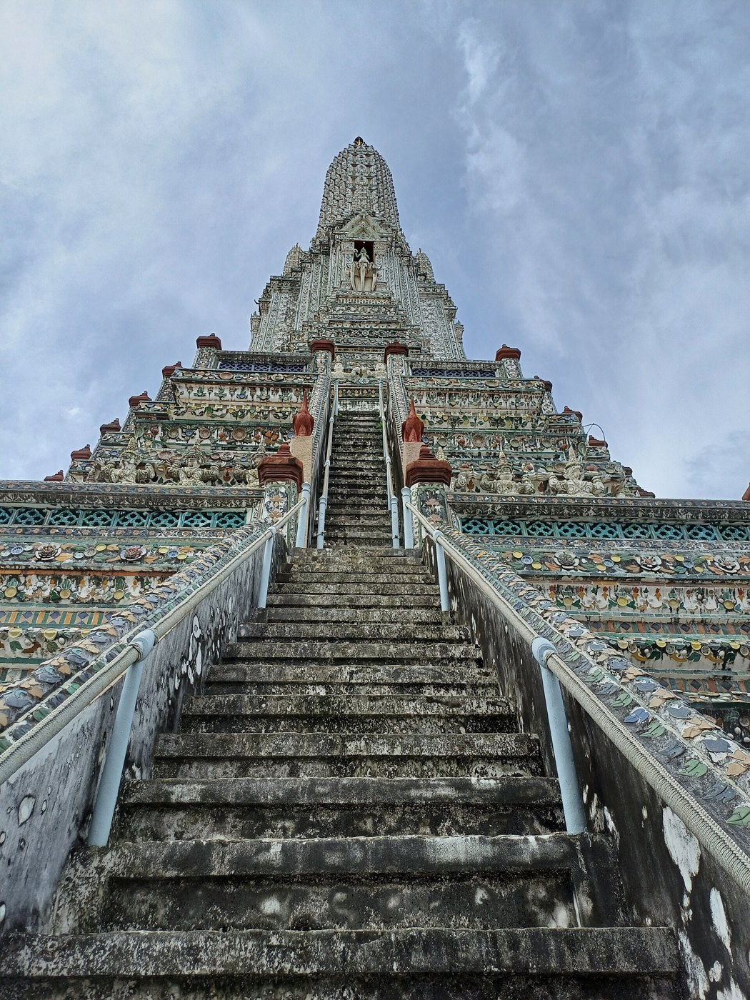

# 12 บันได ระเบียง กำแพงแก้ว และองค์ประกอบรอบอาคาร

## บันได
- **บันไดหน้าอาคารหรือฐานทักษิณ** หันหน้าออกจากอาคาร คนเดินจากข้างนอกขึ้นมาหาอาคาร ขั้นบันไดตั้งฉากกับผนัง
- **พนักบันได / ราวบันได:** ผนังเตี้ยสองข้างของบันได ปลายล่างมักเป็นนาค (ราวนาค) สิงห์ หรือยักษ์ทวารบาล
- **บันไดของฐานทักษิณวัดอรุณ:** บันไดชั้นล่างอยู่ซ้ายขวาข้างฐานมณฑป และวิ่งขึ้นเข้าหาปรางค์ประธาน มีระเบียงหรือสะพานเชื่อมจากลานชั้น 1 ไปถึงหลังมณฑป บันไดชั้น 2 เริ่มจากบนสะพานนั้น (ตามผังกรมศิลปากร)
- **บันไดวัดอรุณชันมาก** ลูกตั้งสูง ลูกนอนแคบ เพื่อให้ผู้ขึ้นก้มตัว ตามคติการขึ้นเขาพระสุเมรุ **(ควรตรวจคำอธิบายเชิงคติ)**

## ระเบียงและกำแพงแก้ว
- **กำแพงแก้ว:** กำแพงเตี้ยล้อมเขตอาคารสำคัญ หัวกำแพงมีบัวหรือลายกระจัง
- **พนักระเบียง / ลูกกรง:** แถวลูกกรงหรือพนักประดับกระเบื้องที่ขอบฐานทักษิณ ที่วัดอรุณเป็นพนักต่อเนื่องตามแนวย่อมุม และเปิดช่องตรงบันได
- **เสาเม็ด / เสานางเรียง:** เสาหัวเม็ดที่มุมกำแพงหรือหัวพนัก
- **ระเบียงคด:** ทางเดินมีหลังคาล้อมรอบอุโบสถหรือเจดีย์

## องค์ประกอบอื่น
- **ใบเสมา / ซุ้มเสมา:** หลักแสดงเขตอุโบสถ มี 8 ทิศ
- **ซุ้มประตู:** ประตูกำแพงที่มียอดแบบมณฑป ปราสาท หรือมงกุฎ
- **ตุ๊กตาจีน / ยักษ์ทวารบาล:** ยืนเฝ้าข้างบันได ที่วัดอรุณเป็นตุ๊กตาศิลาจีน

## ข้อผิดพลาดที่พบ
1. ทำขั้นบันไดหันข้าง ผิด ต้องหันหน้าออก
2. ทำบันไดชั้นล่างกว้างเกินไป ส่วนช่องที่มณฑปแคบเกินไป สัดส่วนผิด
3. ใช้บันไดตรงกลางชนมณฑป ผิด ที่ถูกคือบันไดอยู่ซ้ายขวาข้างฐานมณฑป

## การทำเป็นชิ้นไม้
- **บันได:** แผ่นซ้อนขนานผนัง แต่ละแผ่นสั้นลงทีละขั้น (ลูกตั้งอย่างน้อย 3.6 มม.) มีพนักสองข้าง ใช้ `stairs_out`, `stair_steps`, `layers_per_step`
- **พนักระเบียง:** แถบตามขอบย่อมุม ขัดกันที่มุม และตัดเว้นช่องตรงบันได ใช้ `outline_strips`
