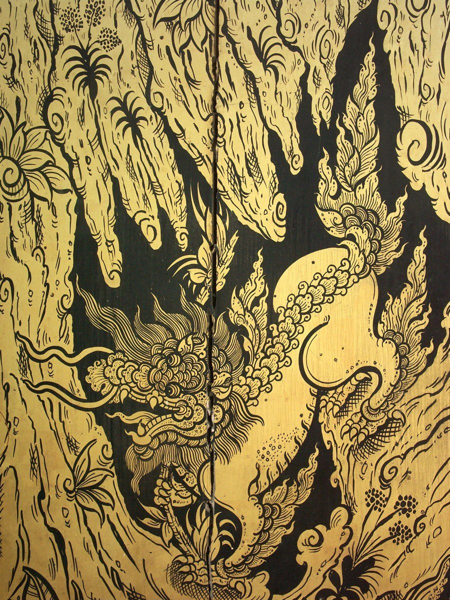
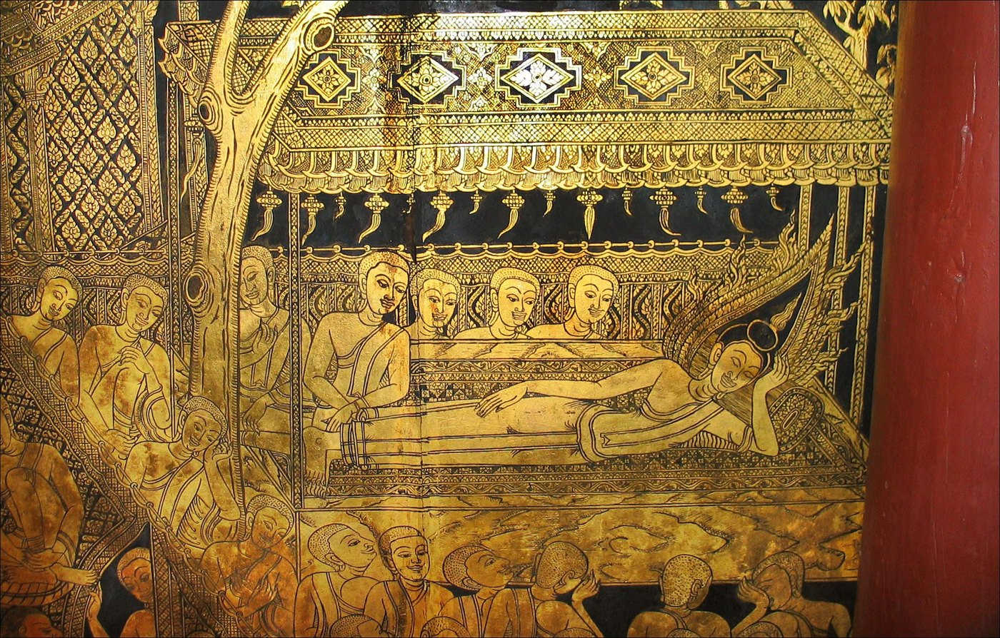
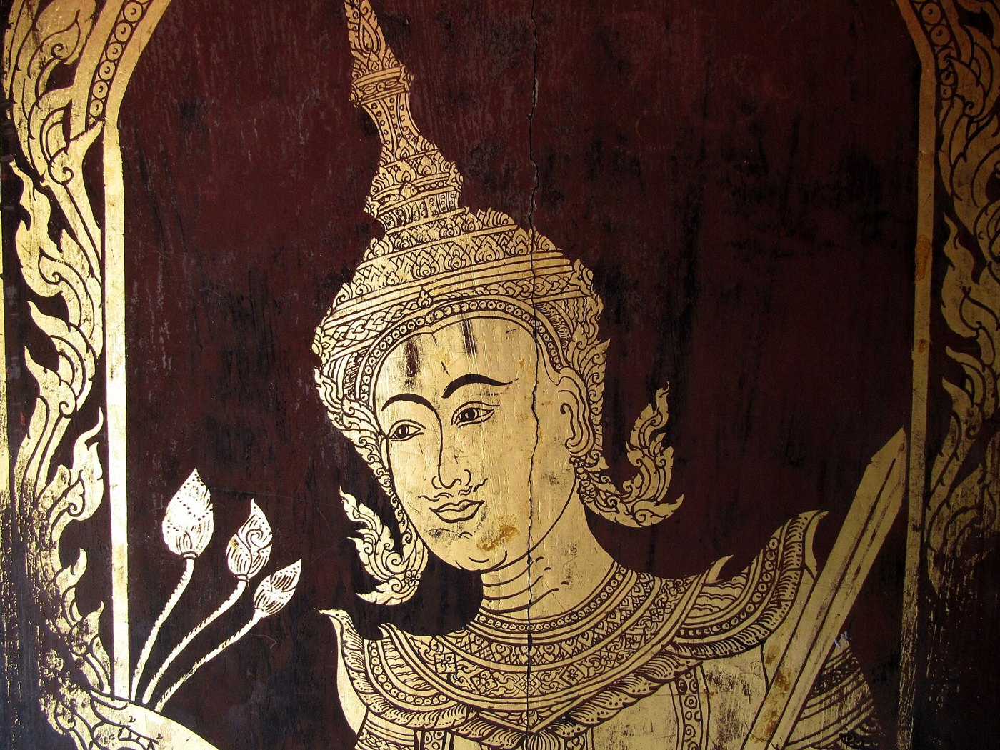

# 13 ลายไทย — ระบบ แม่ลาย หลักการผูกลาย และเทคนิคการประดับ

## 1. นิยาม
- **ลวดลายไทย** แยกเป็น 3 คำ [S16]
  - **ลวด:** "องค์ประกอบทางสถาปัตยกรรมที่ประดิษฐ์เป็นเส้นสันนูนครึ่งวงกลมบนพื้นผิววัตถุเรียบ"
  - **ลาย:** "เส้นที่ผูกขึ้นเป็นรูปในด้านวิจิตรศิลป์"
  - **ไทย:** รูปแบบที่สื่อรสนิยมและเอกลักษณ์ไทย
- **กระหนก หรือกนก:** พจนานุกรมให้ความหมายว่า "ลวดลาย" สะกด "กนก" ได้ และ "กนก" ยังแปลว่าทอง [S1]
  คนทั่วไปเรียกลายไทยทั้งหมดว่าลายกนก แต่ที่จริง **กระหนกเป็นลายตระกูลหนึ่ง**
- **การผูกลาย:** "การออกแบบหรือการจัดวางองค์ประกอบของเส้นด้วยฝีมือและความคิด เพื่อให้เกิดรูปแบบตามที่ต้องการ" [S16]
- **ที่มา:** ต้นแบบจากลายอินเดียสมัยคุปตะ (ราว พ.ศ. 800–1200) แล้วช่างไทยคลี่คลายต่อ [S1, S15, S16]

## 2. ลายไทยแบ่งตามยุค 4 กลุ่ม [S15]
| กลุ่ม | ลักษณะ | ยุค |
|---|---|---|
| 1 | เลียนธรรมชาติโดยตรง เช่น เถาวัลย์ ผักกูด ดอกไม้ | ทวารวดี · ลพบุรี |
| 2 | เลียนธรรมชาติแล้วประยุกต์ให้เป็นตัวเอง | สุโขทัย · เชียงแสน · อู่ทอง |
| 3 | คลี่คลายจากธรรมชาติจนพลิ้วและลงตัว เอกลักษณ์ชัด | อยุธยา · รัตนโกสินทร์ตอนต้น |
| 4 | คลี่คลายเป็นอัตลักษณ์เฉพาะบุคคล | รัตนโกสินทร์ตอนปลาย · ปัจจุบัน |
งานวัดอรุณ (รัชกาลที่ 3) อยู่ในกลุ่ม 3 คาบกลุ่ม 4 และมีลายดอกไม้จีนจากกระเบื้องถ้วยชามมาก

## 3. ที่มาของรูป (แรงบันดาลใจ) [S15]
- **ธรรมชาติ:** เถาวัลย์ ดอกบัว (บัวหลวง บัวสัตตบงกช บัวสัตตบุษย์) กาบไผ่ กาบกล้วย และเปลวไฟที่พลิ้วไหว
- **ศรัทธา:** ดอกบัว พวงมาลัย ควันธูป เปลวเทียน
- ศิลปะไทย **ดัดแปลงธรรมชาติไปตามคติและปรัชญา** ไม่เลียนแบบตามจริงแบบตะวันตก

## 4. แม่ลายพื้นฐาน
| ลายรดน้ำบานประตู: กระหนกเปลวรอบสัตว์หิมพานต์ | ลายรดน้ำผนัง: ลายกนกเต็มพื้นและภาพเล่าเรื่อง |
|---|---|
|  |  |

### 4.1 กระหนก — "พื้นฐานจากสามเหลี่ยมชายธง" [S1, S15]
- อาจมีตัวเดียวหรือหลายตัวก็ได้ มักวางฐานมุมแหลมหันไปทางเดียวกัน ขนาดและสัดส่วนต่างกันไป [S15]
- **ต้นแบบ** คือ "หางไหล" ซึ่งมาจากลักษณะของเปลวไฟ [S1]
- **กระหนกสามตัว = แม่ลายของกระหนกทั้งหลาย** [S1]
  เป็นแม่ลายอันดับหนึ่งใน "แม่ลายทั้งสี่" อาจารย์บางท่านเรียกกระหนกกินนรีหรือกระหนกหางหงส์ เพราะหางของกินนร กินรี และหงส์ทำเป็นลายนี้ [S14]

*ภาพตัวอย่างกระหนกสามตัวที่เป็นภาพต้นฉบับจริงยังไม่ได้รวบรวม (ควรหาภาพจากตำราลายไทยที่ใช้สัญญาอนุญาตเสรี) ดูกระหนกเปลวในกรอบประตูลายรดน้ำด้านล่าง*

**โครงสร้างกระหนกสามตัว** [S14, S16]
- **ทรง:** สามเหลี่ยมมุมฉากด้านไม่เท่า **สูงกว่ากว้าง** หรือทรงดอกบัวครึ่งซีก
  1. **ตัวเหงา** — อยู่ล่างและหน้า "ขมวดก้นหอยคว่ำหน้าลง ปลายยอดตั้งขึ้น แสดงความรู้สึกเศร้าๆ เหงาๆ" รองรับกาบและตัวยอด
  2. **กาบ (ตัวประกบหลัง)** — ประกบหลังตัวเหงา และส่งให้เกิดตัวยอด
  3. **ตัวยอด** — เปลวบนสุด "ปลายยอดสะบัดอ่อนไหวคล้ายเปลวไฟ" ที่โคนเถาลายมีกาบหุ้ม
- **การบากตัวลายให้ละเอียดขึ้น** ทำให้เกิดกระหนกเปลว ใบเทศ หางโต ฯลฯ **ซึ่งยังแบ่งตามโครงสามส่วนนี้ทั้งสิ้น** [S14]
- **ตระกูลกระหนก** [S1]: กระหนกเปลว · ใบเทศ · ผักกูด · นารี · หางหงส์ · ลายนาค · กระหนกกอ · กระหนกช่อลายต่างๆ

### 4.2 กระจัง — ทรงคล้ายสามเหลี่ยมหน้าจั่ว [S2, S15]
| แบบ | โครงสร้าง |
|---|---|
| กระจังฟันปลา | ฐานที่สุด: สามเหลี่ยมในสี่เหลี่ยม |
| กระจังตาอ้อย | พัฒนาจากฟันปลา ทรงในสี่เหลี่ยมด้านเท่า เส้นอ่อนเรียวทั้งซ้ายขวา **ปลายยอดแหลมมีบาก (หยัก) ทั้งสองข้าง** ถ้าอยู่เดี่ยวเรียก "ตาอ้อย" ถ้าเรียงต่อกันซ้ายขวาใช้ทำลายบัวหงายและบัวคว่ำ [S14] |
| กระจังใบเทศ | ทรงอ่อนช้อยเหมือนตาอ้อย แต่แบ่งชั้นในได้หลายชั้นตามความละเอียด ส่วนในเรียก **"แข้งสิงห์"** |
| กระจังหู / กระจังปฏิญาณ | อยู่ในสัดส่วน **กว้าง 1 : สูง 3** บนเป็นใบเทศ ข้างและกลางเป็นกระหนก |
| กระจังรวน | สัดส่วนเหมือนกระจังหู แต่กลับด้านยอด เอียงซ้ายหรือขวาได้ (ใช้ที่หลบหลังคา [S18]) |
**ใช้ที่:** ขอบบนของบัว หัวกำแพง และขอบแถบลาย เรียงเป็นแถวให้จังหวะ

### 4.3 ประจำยาม — สี่เหลี่ยมจัตุรัสตะแคง [S3, S15]
- ดัดแปลงจาก **"ดอกสี่ทิศ"** [S15] เป็นสี่เหลี่ยมตะแคงประกอบวงกลมกับกระจังใบเทศ ถ้าย่อจะใช้กระจังตาอ้อยเล็กๆ [S3]
- เป็นลายฐานของลายรักร้อยและลายราชวัตร [S3]
- **ใช้ที่:** กลางหน้ากระดานของฐาน คั่นจังหวะลายแถว

### 4.4 พุ่มข้าวบิณฑ์ — "ลายช่อ" ทรงพุ่ม [S3, S14, S15]
- **ที่มา:** "ข้าวปั้นตีแต่งเป็นรูปคล้ายดอกบัวตูมที่ใช้บวงสรวงบูชา" จึงใช้ในงานทางศาสนา [S15]
- **สัดส่วนกว้าง 2 ส่วน สูง 3 ส่วน:** สองส่วนบนเขียนอย่างกระจังใบเทศแต่ให้สั้น เอายอดลงต่อกับตอนบน "เท่ากับเขียนกระจังใบเทศสองตัวกัน" มีแข้งสิงห์ล้อมรอบ และใส่ "ตัวห้าม" ตรงรอยต่อ [S14]
- **ใช้เป็นลายดอกลอย** เช่น ผนังด้านในพระมณฑปวัดพระแก้วเป็นลายรดน้ำทรงข้าวบิณฑ์บนพื้นชาด [S10] และเป็นชิ้นบนสุดของยอดบุษบก-มณฑป [S18]
- **ลายหน้าขบ:** ทรงเหมือนพุ่มข้าวบิณฑ์ แต่ทำเป็นหน้าสัตว์หิมพานต์ [S3]

### 4.5 ลายกาบ · นกคาบ · นาคขบ [S15]
- **ลายกาบ:** ต้นกำเนิดของ "ช่อลาย" โครงมาจากกาบหุ้มโคนหรือข้อของพืช เช่น กาบไผ่ กาบกล้วย
- **นกคาบ / นาคขบ:** หน้านกหรือหน้านาคที่คาบลายอื่น หรือมีช่อลายออกจากปาก **วางที่ข้อต่อของก้าน** (เช่น กระหนกก้านขดนกคาบ ที่ขอบประตูพระมณฑป [S10])

### 4.6 เครือเถา / ก้านขด [S4]
- เส้น "คดโค้งหลายแนว แตะหรือสอดสลับกัน คล้ายการเกี่ยวพันของเถาวัลย์" มีใบงอกจากกาบ
- **3 แบบ:** เครือเถาหางโต · เครือเถาใบเทศ · เครือเถาเปลว
- **ใช้ที่:** หน้าบัน กรอบประตูหน้าต่าง ตู้ งานปัก และผ้าไหม

### 4.7 พรรณพฤกษา [S16]
- ลีลาใกล้พรรณไม้จริง ที่พบมากคือ **ลายพุดตานและลายบัว**
- โครงประกอบด้วย ดอก ใบ ก้าน ต้องจัดให้เข้ากับโครงพื้นที่
- **ตัวอย่าง:** หน้าบันลายพรรณพฤกษาปิดทอง (รูปอ้างอิง 42)

## 5. หลักการออกแบบลาย 5 ข้อ [S16]
1. **พื้นที่:** รู้กรอบก่อนเสมอ
   - **ขอบเขตเหลี่ยม:** สี่เหลี่ยมจัตุรัส สี่เหลี่ยมผืนผ้า **สามเหลี่ยมหน้าจั่ว**
   - **ขอบเขตวง:** วงกลม วงรี ครึ่งวง
   - **พื้นที่อิสระ:** ผิวภาชนะ หรือที่ว่างระหว่างตัวภาพ
2. **ความซ้ำ:** เรียงลายเดิมซ้ำให้เป็นระเบียบและเป็นเอกภาพ แต่ถ้าซ้ำล้วนจะจำเจ
3. **สัดส่วน:** ขนาดลายต้องสัมพันธ์กับตัวภาพและพื้นที่ ลายที่อยู่ใกล้กันต้องมีขนาดและรายละเอียดใกล้กัน
4. **ความสมดุล:**
   - **สมมาตร:** ใช้มากที่สุด เช่น หน้าบัน
   - **อสมมาตร:** ซ้ายขวาไม่เหมือนกันแต่น้ำหนักรวมเท่ากัน
5. **ช่องไฟ (ช่องไฟพื้น)** — "การเขียนลายไทยเป็นการเล่นกับช่องไฟ"
   - ช่องว่างระหว่างตัวลายต้องสม่ำเสมอ "การมองเห็นลวดลาย สิ่งแรกที่จะเห็นได้ก่อน คือ ช่องไฟพื้น และถัดมาจึงมองเห็นเถาลาย"
   - ถ้าช่องไฟดี แม้ตัวลายไม่ดีนักก็ยังดูงาม

**หลักจากการผูกลาย** [S5]: มีจุดเริ่มลาย เช่น โคนใบ ตัวนก หรือทรงกลม · เส้นโค้งไม่หักกระด้าง · น้ำหนักเส้นต่างกันเมื่อลายซ้อน · จัดพื้นที่ว่างอย่างมีชั้นเชิง

## 6. เทคนิคการออกแบบ 5 ขั้น [S16]
1. **กำหนดพื้นที่:** ขนาดของพื้นที่ต้องพอดีกับภาพรวม
2. **กำหนดโครงสร้างลาย** เลือกชนิดของลาย:
   - **ลายเดี่ยว / แม่ลาย** เช่น กระจังตาอ้อย กระจังฟันปลา แข้งสิงห์
   - **ลายกนก:** ปลายสะบัดพลิ้ว
   - **ลายพรรณพฤกษา**
   จากนั้นร่างโครงเส้นทั้งหมดก่อน แล้วตรวจสมดุล สัดส่วน และช่องไฟ
3. **จัดวางลายแต่ละตัว:**
   - กนก = ตัวเหงา + ตัวประกบ + ตัวยอด
   - พรรณพฤกษา = ดอก + ใบ + ก้าน
   - ที่ที่ช่องไฟห่างเกินไป ให้เติมลายอื่น
4. **ใส่รายละเอียด** (จุด เส้นใน) ให้สัมพันธ์กับโครงรอบนอก
   - **ไส้ลาย:** "กระจกรูปคล้ายหยดน้ำที่ใช้ประดับส่วนที่เป็นไส้ของลาย" เช่น ในกระจังตาอ้อยและกระหนกใบเทศ งานประดับกระจกต้องเว้นพื้นที่ไส้ลายไว้
5. **กลับด้านลาย:** ออกลายจากแกนกลางไปข้างหนึ่งจนเต็ม คัดลอกลงกระดาษไข แล้วพลิกไปวางอีกข้าง ได้ลายสมมาตร
   ใช้กับหน้าบัน บานประตู และตู้ ข้อเสียคือถ้าใช้ทุกที่จะจำเจ

## 7. เทคนิคการประดับ (ตามแขนงงาน) [S16]
| แขนง | เทคนิค | ข้อจำกัด |
|---|---|---|
| จิตรกรรม | เขียนสีตัดเส้น · **ลายรดน้ำ** (เขียนด้วยน้ำยาหรดาล ลงรักปิดทอง รดน้ำ) · **ลายกำมะลอ** · พระบฏ (บนผ้า) | สะบัดพลิ้วได้เต็มที่ |
| ประติมากรรม | ปั้นปูน · จำหลักไม้ · สลักหิน · หล่อ | **ลดความพลิ้วลง** เพื่อความแข็งแรง ส่วนที่ยื่นพ้นมากมักแตกหัก |
| สถาปัตยกรรม | ภายในใช้แบบจิตรกรรม (กันแดดฝน) ภายนอกใช้แบบประติมากรรม (ปูนปั้น ไม้จำหลัก) | ลายวิจิตรสงวนไว้ให้ศาสนาและวัง |
| ประณีตศิลป์ | ประดับมุก · ทองแผ่ลวด · เครื่องศิราภรณ์ · หัวโขน · เบญจรงค์ | ผสม 2 เทคนิคขึ้นไป |
- **วัดอรุณ:** ประดับกระเบื้องถ้วยชามจีน และเปลือกหอย *Mauritia mauritiana* ที่เรือจีนใช้ถ่วงน้ำหนัก [S12]

## 8. ใช้กับงานไม้ตัด
- **หลักของประติมากรรมใช้กับงานไม้ตัดตรงๆ:** ลดความพลิ้ว ส่วนที่ยื่นต้องหนาพอ (เนื้อไม้อย่างน้อย 3.4 มม.)
- **ลายเล็ก** (กระจัง ประจำยาม ไส้ลาย ใบระกา): ใช้ปากกาวาด
- **ลายใหญ่** (ซุ้ม กรอบ เปลวกนกใหญ่): ฉลุแล้วซ้อน 2 ชั้น
- **หน้าบัน:** ใช้เทคนิคกลับด้าน วาดครึ่งเดียวแล้วสะท้อน
- **ช่องไฟสำคัญกว่าความละเอียด:** ลายปากกาที่ถี่เกินจะเป็นปื้นดำ ให้คุมระยะห่างเส้นให้สม่ำเสมอ
