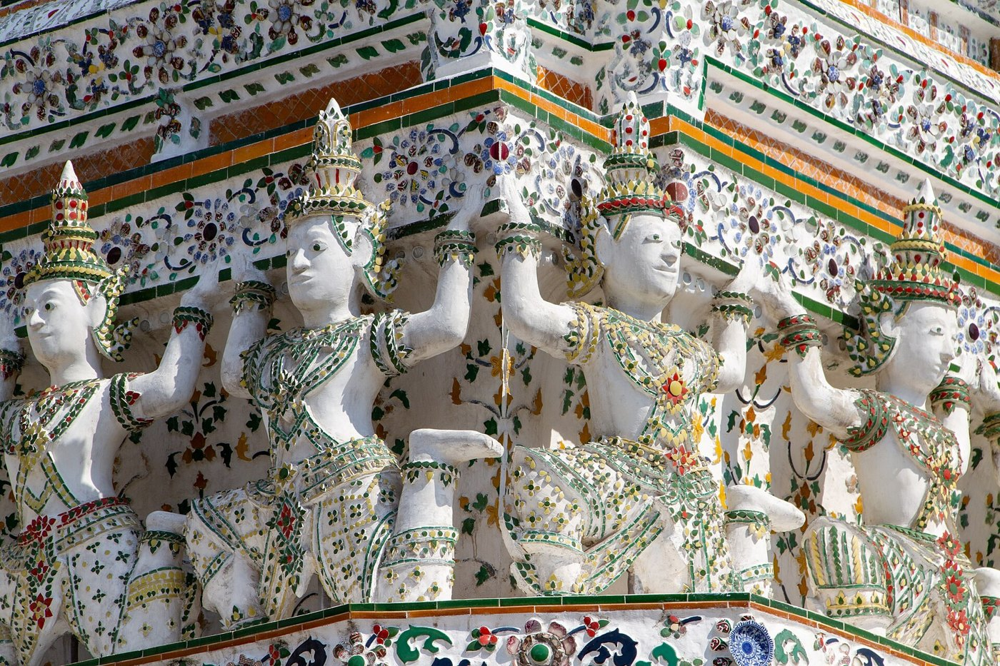
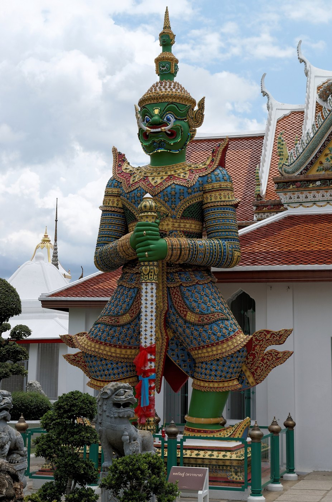

# 14 ประติมากรรมประดับ (Figures)

## ผู้แบก (atlantes / caryatids)
| ชื่อ | รูป | ตำแหน่งที่พบ |
|---|---|---|
| ยักษ์แบก | ยักษ์ยืนหรือนั่งยองๆ ยกแขนแบก | ฐานปรางค์ ฐานเจดีย์ |
| กระบี่แบก (ลิงแบก) | วานรยกแขนแบก | ฐานปรางค์วัดอรุณ |
| มารแบก | อสูรร่างเล็กแบกแถว | ฐานชั้นซ้อน |
| ครุฑแบก / ครุฑยุดนาค | ครุฑกางปีกยุดนาค | ฐานอุโบสถหลวง |
| เทวดาแบก | เทวดาคุกเข่ายกแขนแบก | ฐานมณฑปทิศวัดอรุณ |

- **ความหมาย:** สิ่งที่อยู่ข้างบนมีความศักดิ์สิทธิ์จนแม้ยักษ์และเทวดายังต้องแบกไว้ ตัวผู้แบกยังทำหน้าที่เป็นท้องไม้ของฐาน
- **ท่าทาง:** คุกเข่าหรือย่อตัว แขนทั้งสองยกเหนือศีรษะ ฝ่ามือดันชั้นบน ยืนเรียงชิดกันเป็นจังหวะ

## รูปอื่นบนอาคาร
- **กินรี / กินนร:** ครึ่งคนครึ่งนก อยู่ในซุ้มฐาน
- **พระอินทร์ทรงช้างเอราวัณ:** ในซุ้มจระนำของปรางค์ประธานวัดอรุณ
- **พระพายทรงม้า:** ในซุ้มของปรางค์ทิศวัดอรุณ **(ควรตรวจ)**
- **ยักษ์ทวารบาล / ตุ๊กตาจีน:** เฝ้าประตูและบันได
- **สิงห์ / นาค:** ปลายพนักบันได

## การทำเป็นชิ้นไม้
- **แถวผู้แบก:**
  - เป็นแถบไม้มีคานบนกับคานล่าง ระหว่างรูปแต่ละตัวเจาะช่องยอดแหลม (ช่องใต้แขนที่ยกขึ้น)
  - ซ้อน 2 ชั้น ชั้นหน้ามีลายปากกาเป็นตัวคน
  - ระยะห่างระหว่างรูปประมาณ 12 มม. ที่สเกล 1:80
- **รูปในซุ้ม:** วาดด้วยปากกาเป็นเส้นโครง (`fig_kinnari`, `fig_yaksha`, `fig_erawan`, `fig_buddha` ใน generator)
