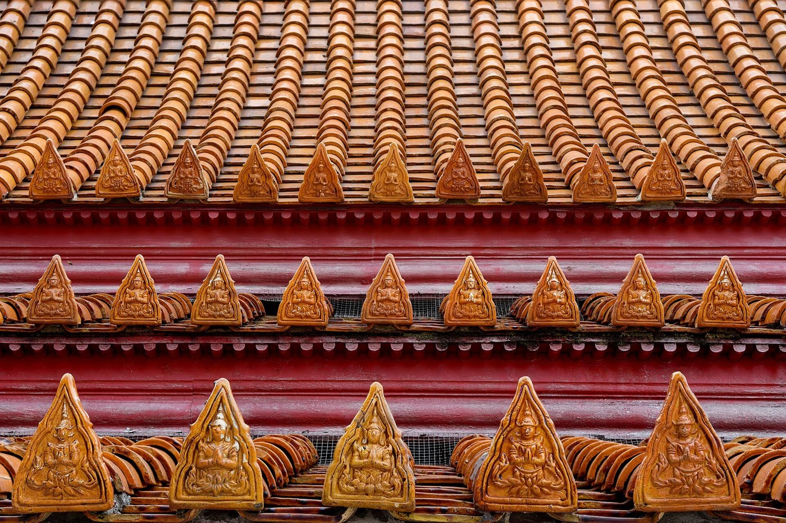

# 19 ลายไทย — ระบบ 4 ตระกูล · แม่ลาย · รายการลายตามชื่อ · รูปแบบการเรียงลาย

ไฟล์นี้ต่อจาก [13](13_ลวดลายและการประดับ.md) ซึ่งอธิบายหลักการและเทคนิค ส่วนไฟล์นี้เป็น **พจนานุกรมลาย** สำหรับค้นชื่อ

## 1. สี่ตระกูลของการเขียนลายไทย (กนก · นารี · กระบี่ · คชะ) [S23, S24]
การเรียนเขียนลายไทยและภาพไทยแบ่งเป็น 4 หมวด เริ่มจากกนกก่อนเสมอ เพราะเป็นพื้นฐานของทุกหมวด

| ตระกูล | เนื้อหา | ตัวอย่าง |
|---|---|---|
| **กนก** | ลวดลายประดับ เช่น เปลว ใบ ก้าน ดอก | กระหนกสามตัว ใบเทศ ก้านขด ประจำยาม กระจัง |
| **นารี** | ภาพมนุษย์ เทวดา นางฟ้า ในท่าต่างๆ | เทพพนม นางรำ กษัตริย์ |
| **กระบี่** | อมนุษย์ เช่น ยักษ์ ลิง ตัวละครรามเกียรติ์ | ทศกัณฐ์ หนุมาน ยักษ์ทวารบาล |
| **คชะ** | สัตว์ เช่น ช้าง ม้า และสัตว์หิมพานต์ | ช้างเอราวัณ ราชสีห์ คชสีห์ หงส์ |

| กนก | นารี | กระบี่ | คชะ |
|---|---|---|---|
|  |  |  |  |

## 2. แม่ลาย 9 แบบ (ตัวอย่างจากงานเครื่องถมเมืองนคร) [S25]
ช่างเริ่มจาก "ลายทั้ง 9 ลายเป็นลายหลัก จากนั้นจะต่อเติมลาย หรือที่เรียกว่าผูกลาย"
1. **กนกเปลว:** เลียนแบบธรรมชาติจากเปลวไฟ
2. **ใบเทศ:** เป็นช่อ มีก้าน กาบ ดอก ใบ ต่อกับลายอื่นได้
3. **ประจำยาม:** สี่เหลี่ยมด้านเท่า ข้างในเป็นดอกสี่กลีบ มีเกสรตรงกลาง
4. **พุ่มข้าวบิณฑ์:** ทรงพุ่มคล้ายหยดน้ำ
5. **กระจัง:** รูปสามเหลี่ยมหน้าจั่ว ใช้ตามขอบริมฐานของชิ้นงาน
6. **ก้านขด:** นำลายต่างๆ มาเขียนต่อเนื่องกันเป็นเถา
7. **บัวคว่ำ บัวหงาย:** รูปกลีบบัว ใช้ประกอบฐาน
8. **เม็ดบัว (ไข่ปลา):** กลมหรือรี ใช้เรียงต่อเป็นเส้น
9. **ภาพประกอบลาย:** ภาพเทวดา สัตว์หิมพานต์ ตัวละครในวรรณคดี และสิบสองนักษัตร

## 3. รายการลายตามชื่อ (เรียงตามหมวด)
> คำอธิบายที่มีรหัสแหล่ง [S#] มาจากแหล่งอ้างอิง ส่วนที่มีเครื่องหมาย ◇ เป็นคำอธิบายทั่วไปของช่าง **(ควรตรวจกับพจนานุกรมศัพท์ลายไทย ราชบัณฑิตยสถาน 2557)**

### 3.1 ตระกูลกนก (สามเหลี่ยมชายธง)
| ชื่อ | ลักษณะ | ใช้ที่ |
|---|---|---|
| กระหนกสามตัว | ตัวเหงา + กาบ + ตัวยอด เป็นแม่ลายของกระหนกทุกชนิด [S14] | ทุกที่ |
| กระหนกเปลว | ตัวยอดยืดยาวพลิ้วเหมือนเปลวไฟ [S1, S25] | หน้าบัน ซุ้ม ตู้ เครื่องถม |
| กระหนกใบเทศ | บากตัวลายเป็นหยักใบไม้ซ้อน [S1] เป็นลายที่พบมากที่สุดบนเครื่องถม (56%) [S25] | หน้าบัน เครื่องประดับ |
| กระหนกหางโต | ตัวยอดใหญ่ ปลายพองโต [S14] ◇ | ลายเครือเถา |
| กระหนกผักกูด | ปลายม้วนเหมือนยอดผักกูด [S1] ◇ | งานยุคแรก ลายเครือเถา |
| กระหนกนารี · หางหงส์ · ลายนาค · กอ · ช่อลาย | ชื่อตามรูปที่ประกอบ เช่น กระหนกที่ปลายเป็นหน้านาง หางหงส์ หรือหัวนาค [S1] | หางหงส์ของเครื่องลำยองทำเป็นกระหนกเปลว [S11] |

### 3.2 ตระกูลกระจังและลายขอบ
| ชื่อ | ลักษณะ | ใช้ที่ |
|---|---|---|
| กระจังฟันปลา | สามเหลี่ยมในสี่เหลี่ยม เป็นกระจังที่ง่ายที่สุด [S2] | ขอบฐาน |
| กระจังตาอ้อย | ปลายบากสองข้าง ข้างอ่อนเรียว [S2, S14] | บัวหงาย บัวคว่ำ |
| กระจังใบเทศ | แบ่งชั้นในด้วยแข้งสิงห์ [S2] | หัวเสา ขอบฐาน |
| กระจังหู / ปฏิญาณ | กว้าง 1 : สูง 3 [S2] | มุม ปลายแถว |
| กระจังรวน | กระจังหูที่กลับด้านยอด เอียงซ้ายหรือขวา [S2] | หลบหลังคา [S18] |
| ฟันยักษ์ | ◇ สามเหลี่ยมใหญ่เรียงห่าง | ขอบ |
| ไข่ปลา / เม็ดบัว | เม็ดกลมหรือรีเรียงเป็นเส้น [S25] | เส้นคั่น |
| ลูกฟัก | ◇ กรอบสี่เหลี่ยมนูน (แผงลูกฟัก) | บานประตู ฝาเรือน ขอบตู้ |
| ลูกขนาบ | ◇ แถบเส้นคู่ขนาบลายหลัก | ขอบแถบลาย |
| แข้งสิงห์ | เส้นแบ่งชั้นภายในกระจังและพุ่ม [S2, S14] | ใช้ภายในลาย |

### 3.3 ลายดอกและลายพุ่ม
| ชื่อ | ลักษณะ | ใช้ที่ |
|---|---|---|
| ประจำยาม | สี่เหลี่ยมตะแคง ดอกสี่ทิศ [S3, S15] | กลางหน้ากระดาน |
| ประจำยามก้ามปู | ◇ ประจำยามที่มีกระหนกยื่นออกสี่มุมคล้ายก้ามปู | ลายพื้น |
| พุ่มข้าวบิณฑ์ | กว้าง 2 : สูง 3 คือกระจังใบเทศ 2 ตัวต่อกัน [S14] | ลายดอกลอย ผนังด้านใน |
| ลายหน้าขบ | พุ่มที่ทำเป็นหน้าสัตว์หิมพานต์ [S3] | ตรงกลางลาย |
| ดอกพุดตาน | ดอกไม้กลมกลีบซ้อน (อิทธิพลจีน) [S16, S25] | พรรณพฤกษา งาน ร.3 |
| ดอกพิกุล | ◇ ดอกเล็กแปดกลีบเรียงเป็นพื้น | ลายพื้น เครื่องถม [S25] |
| ดอกลอย | ลายดอกที่วางกระจายเป็นจังหวะบนพื้น [S25] ◇ | ผนัง เพดาน ผ้า |
| ดอกจอก / ดาวเพดาน | ◇ ดอกกลมเรียงบนพื้นแดงหรือคราม | เพดานอุโบสถ |
| บัวคว่ำ / บัวหงาย / บัวแวง / บัวจงกล | รูปกลีบบัว [S25, S21] | ฐาน หัวเสา |

### 3.4 ลายเถาและลายต่อเนื่อง
| ชื่อ | ลักษณะ | ใช้ที่ |
|---|---|---|
| ก้านขด | ก้านขดเป็นวงต่อเนื่อง มีกระหนกและใบแตกออก [S25] | หน้าบัน ประตู |
| เครือเถา (หางโต · ใบเทศ · เปลว) | คดโค้งสอดสลับเหมือนเถาวัลย์ [S4] | หน้าบัน กรอบ ผ้า |
| รักร้อย (หน้าสิงห์ · บัวร้อย · ใบเทศ) | ลายร้อยต่อเป็นสาย ใช้ประดับเสาโบสถ์ วิหาร ปราสาท [S26] | เสา ครอบสันหลังคา [S18] |
| นกคาบ / นาคขบ | หน้านกหรือนาคคาบก้านลาย วางที่ข้อต่อของก้าน [S15] | ข้อของก้านขด |
| เถาเลื้อย | ◇ เถาไม้เลื้อยแบบธรรมชาติ | พรรณพฤกษา |

### 3.5 ลายแถว (การจัดเรียงลายตามตำแหน่ง)
| ชื่อ | ลักษณะ | ใช้ที่ |
|---|---|---|
| **ลายหน้ากระดาน** | แถบนอนยาว เรียงลายซ้ำ ใช้เป็นตัวกั้นหรือลายขอบ [S26] | ขอบบนและล่างของตู้ ฐาน หน้ากระดาน |
| **ลายกรวยเชิง** | ลายสามเหลี่ยมยาวห้อยหรือตั้ง ปลายแหลม (ทรงกรวย) [S26] ◇ | ตอนบนและตอนล่างของเสาขอบตู้ โคนเสา หัวเสา |
| ลายเฟื่อง / เฟื่องอุบะ | ◇ ลายห้อยเป็นพวงโค้ง (เฟื่อง) มีอุบะห้อยปลาย [S26] | ใต้คาน ขอบบน |
| ลายราชวัตร | ◇ ลายตารางทแยงที่มีดอกประจำยามที่จุดตัด (ใช้ประจำยามเป็นฐาน [S3]) | ลายพื้นผนังและผ้า |
| ลายประแจจีน | ลายเส้นหักมุมต่อเนื่องจากจีน มีหลายแบบ เช่น เมฆ สายฟ้า สวัสดิกะ ขนมเปียกปูน [S26] | ขอบ งาน ร.3 |
| ลายเกลียว | ◇ เส้นเกลียวเชือก | ขอบเส้นลวด |
| ลายผ้าทิพย์ | ◇ ผืนผ้าลายห้อยหน้าฐานพระหรือฐานชุกชี | หน้าฐานชุกชี |

## 4. ลายตามวัสดุ (เทคนิคบังคับรูปลาย)
- **ลายรดน้ำ:** ลายทองบนพื้นรักดำ ใช้กับตู้พระธรรม บานประตู และผนัง เป็นงานลายเส้นล้วน มีสีเดียวคือทอง [S16]
- **ลายถม (เครื่องถม):** แกะลายบนเงิน ถมยาดำ แล้วขัด ทำได้ทั้งถมเงินและถมทอง [S25]
- **ลายประดับมุก:** ฉลุเปลือกหอยมุกฝังในรัก ช่องไฟเป็นตัวกำหนดความงาม [S16]
- **ลายเบญจรงค์ / ลายน้ำทอง:** ลายบนเครื่องกระเบื้อง (ดูไฟล์ [25](25_ประณีตศิลป์_และช่างสิบหมู่.md))
- **ลายปูนปั้น / ไม้จำหลัก:** ลดความพลิ้วลงเพื่อความแข็งแรง [S16]
- **ลายกระเบื้องถ้วยชาม (วัดอรุณ):** ชิ้นถ้วยชามปะเป็นดอกและกลีบบนปูน

## 5. ใช้ลายให้ถูกที่ (สรุปสำหรับผู้ออกแบบ)
| ตำแหน่งบนอาคาร | ลายที่เหมาะ |
|---|---|
| หน้าบัน (สามเหลี่ยม) | ก้านขด เครือเถา กระหนกเปลว หรือใบเทศ ล้อมรูปประธาน แล้วกลับด้านให้สมมาตร |
| หน้ากระดานของฐาน | ประจำยามคั่นจังหวะ + ลายหน้ากระดาน |
| บัวคว่ำ บัวหงาย | กระจังตาอ้อยหรือกระจังใบเทศ เรียงชิดกัน |
| หัวเสา โคนเสา | บัวแวง บัวจงกล กรวยเชิง |
| ตัวเสา | รักร้อย |
| ครอบสันหลังคา | รักร้อย [S18] |
| หลบหลังคา | กระจังรวน [S18] |
| บานประตูหน้าต่าง | ลายรดน้ำ ก้านขด ทวารบาล หรือเทพพนม |
| ผนังด้านในและเพดาน | พุ่มข้าวบิณฑ์ ดอกลอย ดาวเพดาน |
