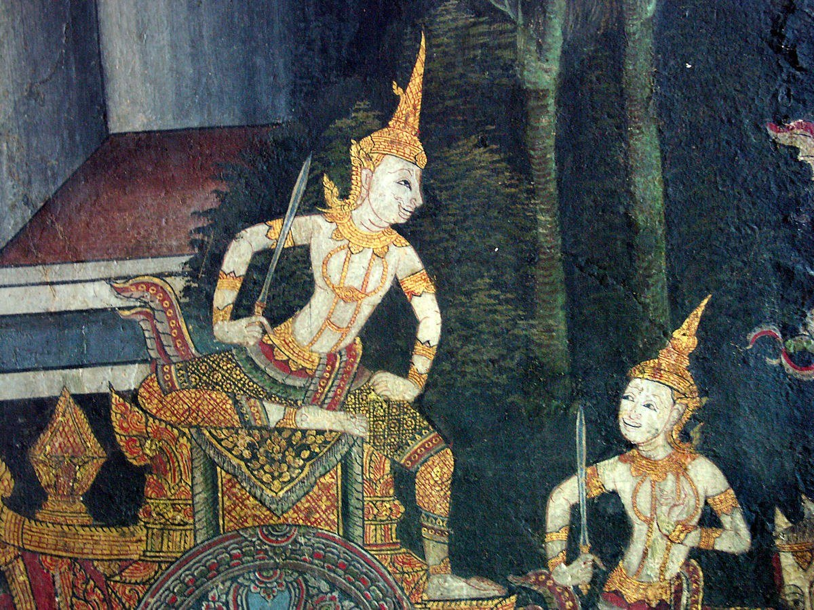
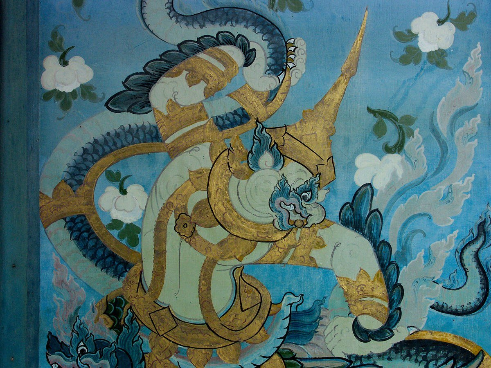
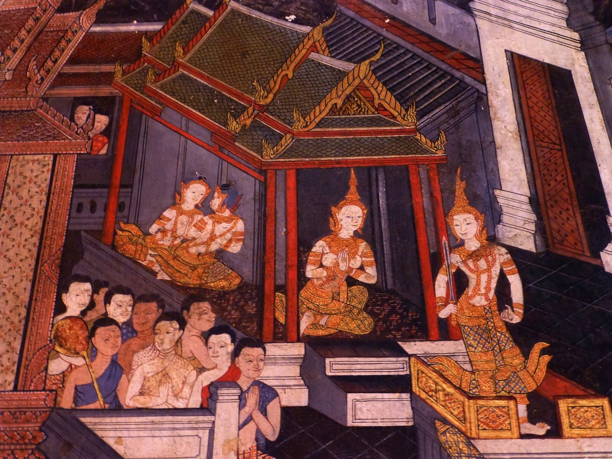
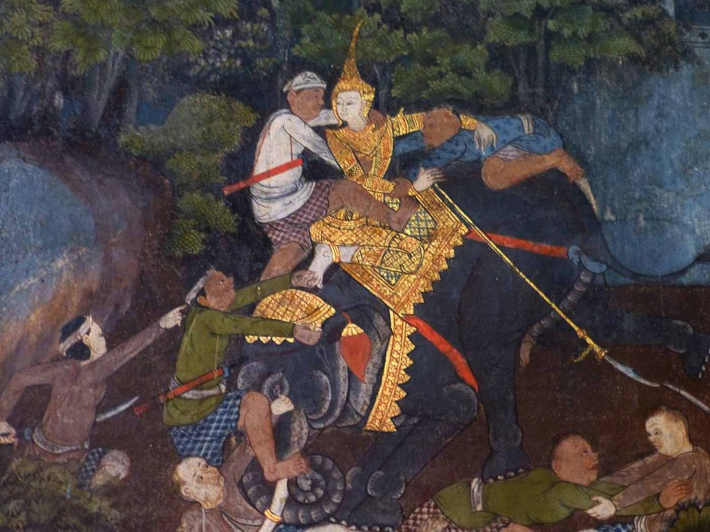
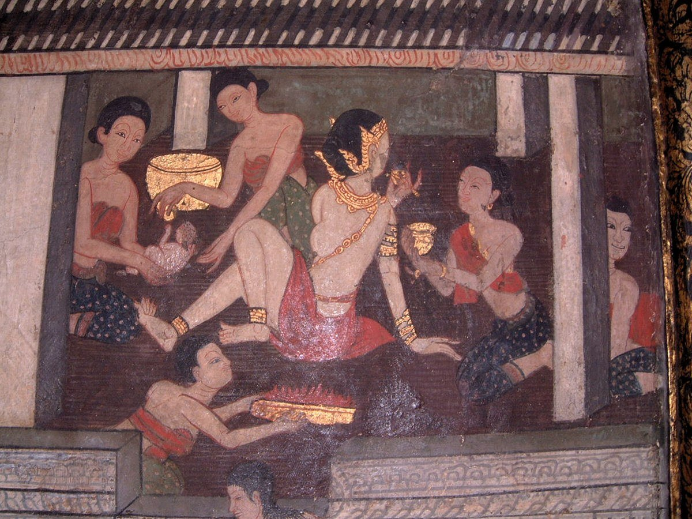
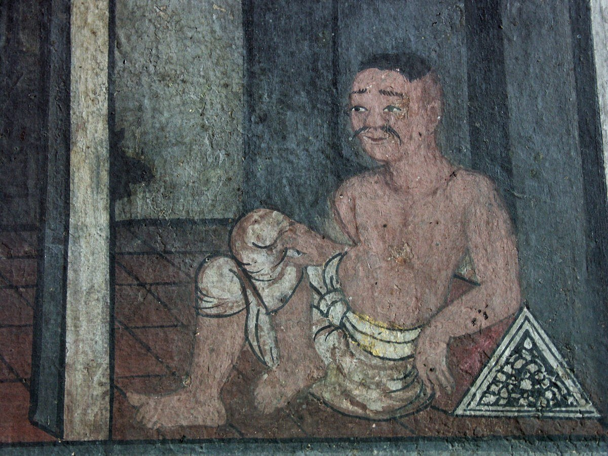

# 20 จิตรกรรมไทย — ลักษณะ · แบบแผนการวางเรื่องบนผนัง · สีและเทคนิค

## 1. ลักษณะของจิตรกรรมไทยประเพณี [S27, S28]

| ตัวภาพชั้นสูง (นารี) | อมนุษย์ (กระบี่) | สถาปัตยกรรมในภาพ |
|---|---|---|
|  |  |  |

| ฉากรบ | ภาพวิถีชีวิต | ชาวบ้าน |
|---|---|---|
|  |  |  |
- **ศิลปะแบบอุดมคติ (idealistic):** มุ่งความงามตามคติ ไม่ได้เลียนแบบความจริง
- **สองมิติ ไม่มีทัศนียภาพ:** ระบายสีแบน ไม่มีแสงเงา ใช้เส้นเป็นขอบเขตหลักของรูป
- **มุมมองจากที่สูง (bird's-eye):** "นำสิ่งใกล้ไว้ตอนล่างของภาพ สิ่งไกลไว้ตอนบนของภาพ" ทำให้เล่าเรื่องต่อเนื่องได้ทั้งผนัง
- **แบ่งตอนของเรื่อง:** ใช้ต้นไม้ ภูเขา ลำธาร โขดหิน หรือเส้น **สินเทา** (เส้นหยักฟันปลาที่แบ่งฉาก) คั่นเหตุการณ์
- **สี:** ใช้หลายสีแต่ให้มีสีเด่นสีเดียว (เอกรงค์)
- **ตัวภาพตามแบบ:**
  - เทวดาและกษัตริย์ "ลีลาอันชดช้อย" แต่งเครื่องทรง
  - ยักษ์และลิงแสดงพละกำลัง
  - ชาวบ้านแสดงอารมณ์ขันหรือความทุกข์ เขียนอิสระกว่าตัวภาพชั้นสูง
- **ยุครัตนโกสินทร์:** พื้นหลังเข้ม ปิดทองมาก
- **รัชกาลที่ 4:** ขรัวอินโข่งนำทัศนียภาพแบบตะวันตกเข้ามา [S28]

## 2. ⭐ แบบแผนการวางเรื่องบนผนังอุโบสถ (อยุธยาตอนปลายถึงรัตนโกสินทร์ตอนต้น) [S22]
"แต่เดิมนั้นพระอุโบสถโดยทั่วไป ผนังระหว่างกรอบหน้าต่างมักเขียนเรื่องพุทธประวัติหรือทศชาติ … บนผนังสกัดหน้าเขียนภาพพุทธประวัติตอนมารผจญ ผนังสกัดหลังเขียนภาพไตรภูมิโลกสัณฐาน หรืออาจจะเขียนแทนด้วยภาพพระพุทธเจ้าเสด็จโปรดพุทธมารดาและภาพเสด็จลงมาจากสวรรค์ชั้นดาวดึงส์ … เขียนภาพเทพชุมนุมบนผนังแปในส่วนผนังเหนือกรอบหน้าต่างขึ้นไป" (อ้างจาก สันติ เล็กสุขุม 2014)

| ผนัง | เรื่อง | เหตุผล |
|---|---|---|
| ผนังสกัดหน้า (ด้านประตู ตรงข้ามพระประธาน) | **มารผจญ** | พระประธานปางมารวิชัยหันหน้ามาทางนี้ เรื่องจึงต่อเนื่องกัน |
| ผนังสกัดหลัง (หลังพระประธาน) | **ไตรภูมิโลกสัณฐาน** หรือเสด็จลงจากดาวดึงส์ | ภาพจักรวาลอยู่ด้านหลังพระพุทธเจ้า |
| ผนังแป (เหนือหน้าต่าง) | **เทพชุมนุม** เรียงเป็นแถว หันไปทางพระประธาน | เหตุการณ์หลังตรัสรู้ เทวดามาชุมนุม |
| ผนังระหว่างช่องหน้าต่าง | **พุทธประวัติ / ทศชาติชาดก** | เดินอ่านเรื่องรอบอาคารได้ |

- **สมัยรัชกาลที่ 3 แบบแผนเปลี่ยนไป:**
  - วัดกัลยาณมิตรเขียนพุทธประวัติต่อเนื่องเหนือหน้าต่างทั้ง 4 ด้าน และเปลี่ยนภาพมารผจญเป็นโทณพราหมณ์แบ่งพระบรมสารีริกธาตุ
  - วัดเครือวัลย์เขียนชาดก 550 ชาติในกรอบสี่เหลี่ยม
  - วัดพระเชตุพน (26 ห้องภาพ) ใช้ผนังระหว่างหน้าต่างเขียนพระสาวกเอตทัคคะ 41 องค์ [S22]

## 3. สีและเทคนิค [S14, S28]
- **สีฝุ่นผสมกาว (เทมเพอรา)** ช่างเรียกว่า "รงค์" หรือ "กระยารงค์" และเรียกกาวว่า "น้ำยา"
- **เบญจรงค์ของช่างเขียน:** เหลือง คราม แดงชาด ขาว ดำ
  - อยุธยาตอนต้นใช้เพียงแดง เหลือง ขาว ดำ
  - สีครามและเขียว (ตั้งแซ) จากจีนเข้ามาในสมัยอยุธยาตอนปลาย
- **ที่มาของสี:** สีดินแดง ดินเหลือง ดินขาว (ดินสอพอง) เขม่า (ดินหม้อ) แร่ หิน โลหะ พืช และบางส่วนของสัตว์
- **พู่กันและแปรง:**
  - พู่กันขนหูวัวใช้ระบายสี
  - พู่กันหนวดหนูใช้ตัดเส้น เพราะปลายเรียวพลิ้ว
  - แปรงเปลือกกระดังงาและแปรงรากลำเจียกใช้กระทุ้งเป็นพุ่มไม้
- **ขั้นตอน:** เตรียมพื้น → ร่างภาพ → ลงสีพื้น → ระบายสี → ปิดทอง → ตัดเส้น
- **ลายรดน้ำ:** เขียนด้วยน้ำยาหรดาลบนพื้นรัก ปิดทอง แล้วรดน้ำล้างหรดาลออก ทองติดเฉพาะส่วนที่ไม่ได้เขียน
- **ลายกำมะลอ:** ระบายสีแบบจิตรกรรม แล้วเสริมด้วยเทคนิคลายรดน้ำ [S16]
- **พระบฏ:** จิตรกรรมบนผืนผ้า มีพระพุทธเจ้าอยู่กลางภาพ [S16]

## 4. เนื้อหาที่นิยม
พุทธประวัติ · ทศชาติชาดก (เช่น มหาชนก มโหสถ เวสสันดร) · ไตรภูมิ · เทพชุมนุม · รามเกียรติ์ (ระเบียงวัดพระแก้ว) · พระสาวก · และภาพวิถีชีวิตที่สอดแทรกในฉาก

## 5. ใช้กับงานโมเดลหรืองานกราฟิก
- **ภาพเล่าเรื่อง:** ใช้มุมมองจากที่สูงและแบ่งฉากด้วยสินเทาหรือเส้นต้นไม้ ไม่ใส่ทัศนียภาพ
- **ภายในอาคารจำลอง:** วางเรื่องตามแบบแผนผนังในข้อ 2 ถ้าวางผิดผนัง ผู้รู้จะเห็นทันที
