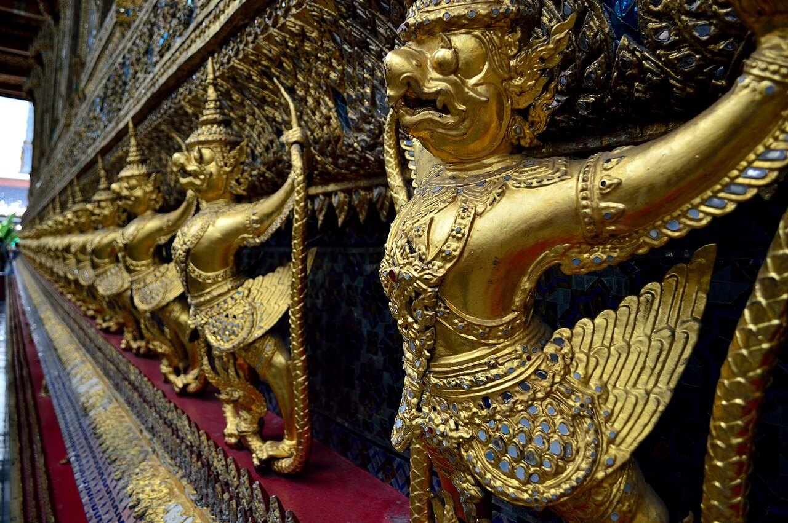
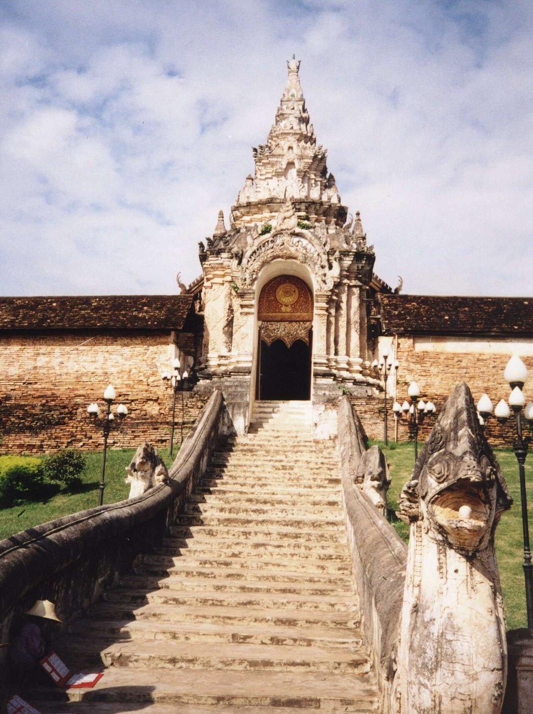
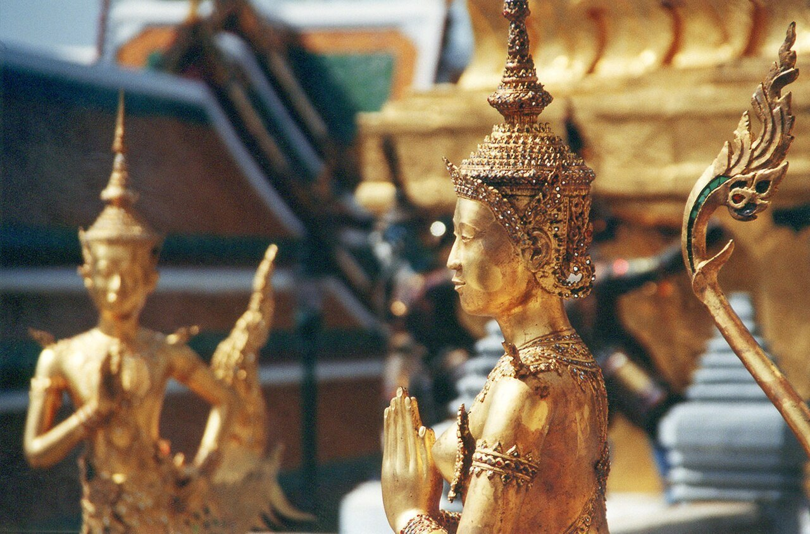
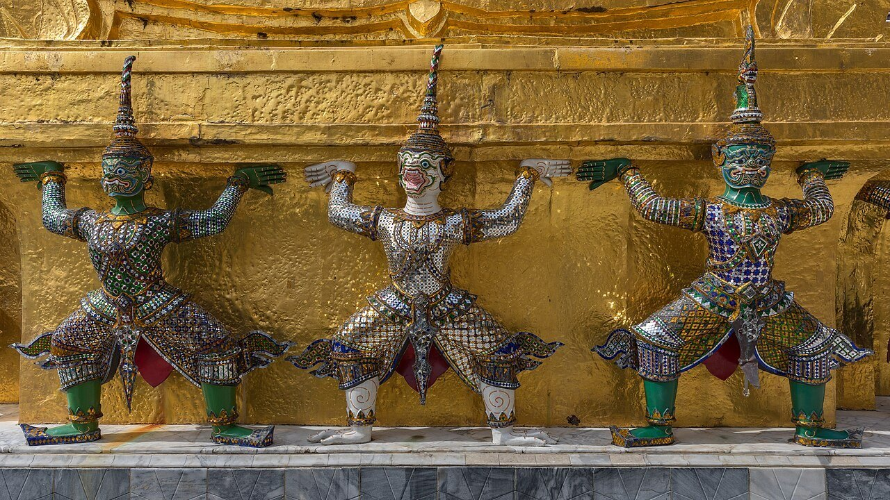
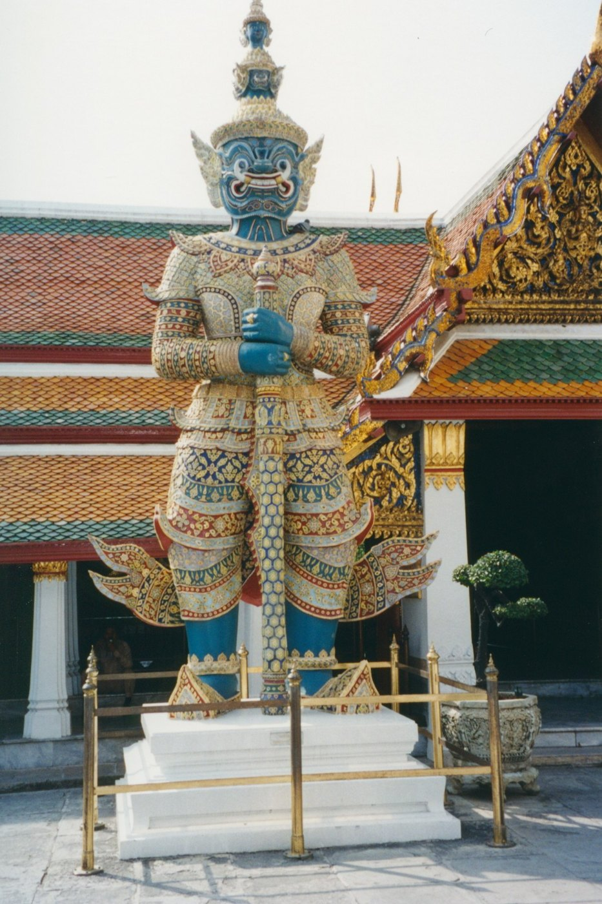
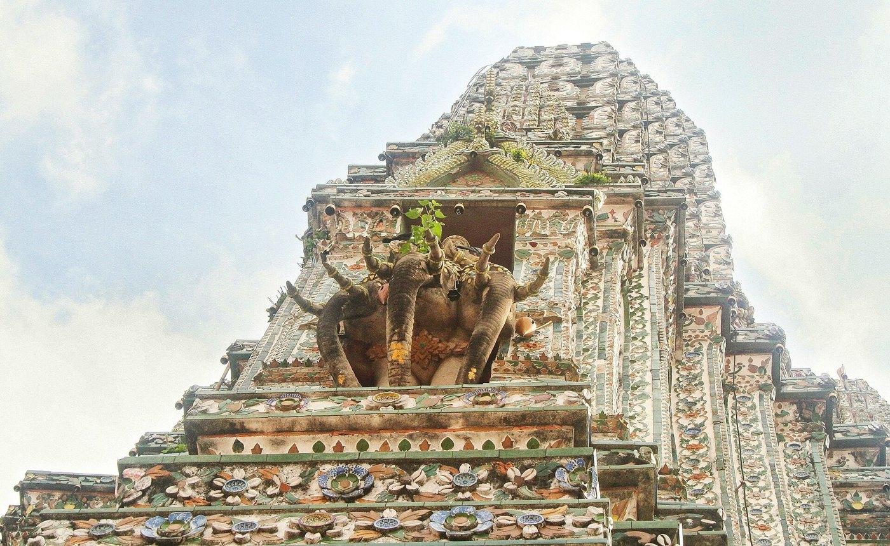

# 22 สัตว์หิมพานต์และสัตว์ในคติ — ครุฑ · นาค · กินรี · หงส์ · ราชสีห์ · คชสีห์ ฯลฯ

## 1. หิมพานต์
**ป่าหิมพานต์** เป็นป่าในจินตนาการเชิงเขาไกรลาส ปรากฏในไตรภูมิพระร่วงและรามเกียรติ์ สัตว์ในป่านี้มักผสมลักษณะของสัตว์หลายชนิดเข้าด้วยกัน [S30]
**แบ่ง 3 จำพวก:** สัตว์สองเท้า (ทวิบาท) · สัตว์สี่เท้า (จตุบาท) · ปลา [S30]

| ครุฑยุดนาค ฐานพระอุโบสถวัดพระแก้ว | บันไดนาค วัดพระธาตุลำปางหลวง | กินรี วัดพระแก้ว |
|---|---|---|
|  |  |  |

| ยักษ์แบกเจดีย์ วัดพระแก้ว | ยักษ์ทวารบาล วัดพระแก้ว | พระอินทร์ทรงเอราวัณ วัดอรุณ |
|---|---|---|
|  |  |  |

## 2. สัตว์สำคัญในศิลปะและสถาปัตยกรรม
| สัตว์ | ลักษณะ | ความหมายและตำแหน่งบนอาคาร |
|---|---|---|
| **ครุฑ** | ครึ่งนกครึ่งคน พาหนะของพระนารายณ์ เป็นศัตรูของนาค [S31] | **ครุฑยุดนาค** (ฐานอุโบสถหลวง) · **ครุฑพ่าห์** (ตราแผ่นดิน) · ครุฑหน้าเรือนยอดที่จุดตัดหลังคา (รูปอ้างอิง 39, 40) · ช่อฟ้าคือครุฑที่ยุดหางนาค [S11] สื่อถึงพระราชอำนาจและคติเทวราชา [S31] |
| **นาค** | งูใหญ่ เทพแห่งน้ำ แบ่ง 4 ตระกูลตามการเกิด (โอปปาติกะ สังเสทชะ อัณฑชะ ชลาพุชะ) [S32] | **ราวบันไดนาค** · **ลำยอง / นาคสะดุ้ง / หางหงส์** (ตัวนาคบนป้านลม) · **นาคปรก** · หัวเรือพระที่นั่ง · ความเชื่อ "นาคให้น้ำ" [S32] และคตินาคเป็นสะพานสายรุ้งเชื่อมโลกมนุษย์กับสวรรค์ ◇ |
| **กินรี / กินนร** | ครึ่งคนครึ่งนก (หญิง/ชาย) [S30] | ความงามและความอ่อนช้อย อยู่ในซุ้มฐาน (ฐานมณฑปวัดอรุณ) หางทำเป็นกระหนกสามตัว [S14] |
| **หงส์** | นกในคติ พาหนะของพระพรหม | เสาหงส์ หางหงส์ (ชื่อเรียกปลายป้านลม) |
| **ราชสีห์** | สิงห์ | ทวารบาลหน้าวัด · ฐานสิงห์ (ขาสิงห์) |
| **คชสีห์** | หัวช้าง ตัวสิงห์ | พละกำลัง [S30] |
| **นรสิงห์** | ครึ่งคนครึ่งสิงห์ | ลายบนเบญจรงค์ [S33] |
| **มกร** | สัตว์น้ำ (ผสมจระเข้กับช้าง) | ซุ้มขอม · ปลายราวบันได (มกรคายนาค) |
| **เหรา** | ครึ่งนาคครึ่งจระเข้ | หางหงส์บางแบบ |
| **สินธพ** | ม้าในคติ | |
| **เอราวัณ** | ช้างสามเศียรหรือ 33 เศียร พาหนะของพระอินทร์ | ซุ้มจระนำปรางค์ประธานวัดอรุณ (พระอินทร์ทรงเอราวัณ) [S12] |

## 3. ยักษ์และลิง (ตระกูลกระบี่)
- **ยักษ์:** ทวารบาล (เช่น ยักษ์วัดพระแก้ว) และยักษ์แบกที่ฐานปรางค์
- **ลิง (กระบี่):** กระบี่แบกที่ฐานปรางค์วัดอรุณ
- **ตัวละครรามเกียรติ์:** ทศกัณฐ์ และสหัสเดชะ เป็นยักษ์ที่ฐานพระปรางค์วัดอรุณ [S12]

## 4. หลักการเขียนสัตว์หิมพานต์
- จัดอยู่ในตระกูล **คชะ** ของการเขียนลายไทย ([19](19_ลายไทย_ระบบและรายการลาย.md))
- **ตัวสัตว์:** เส้นโครงเป็นแบบไทย ขนและเกล็ดเขียนเป็นกระหนก ส่วนหางและแผงคอเขียนเป็นเปลวกระหนก
- **เลือกให้ตรงตำแหน่ง:**
  - ครุฑและนาคใช้กับหลังคาและฐาน เพราะอยู่ในฟ้าและในน้ำ
  - กินรีใช้ในซุ้ม
  - สิงห์และยักษ์ใช้ที่ประตูและบันได เพราะทำหน้าที่ผู้เฝ้า
