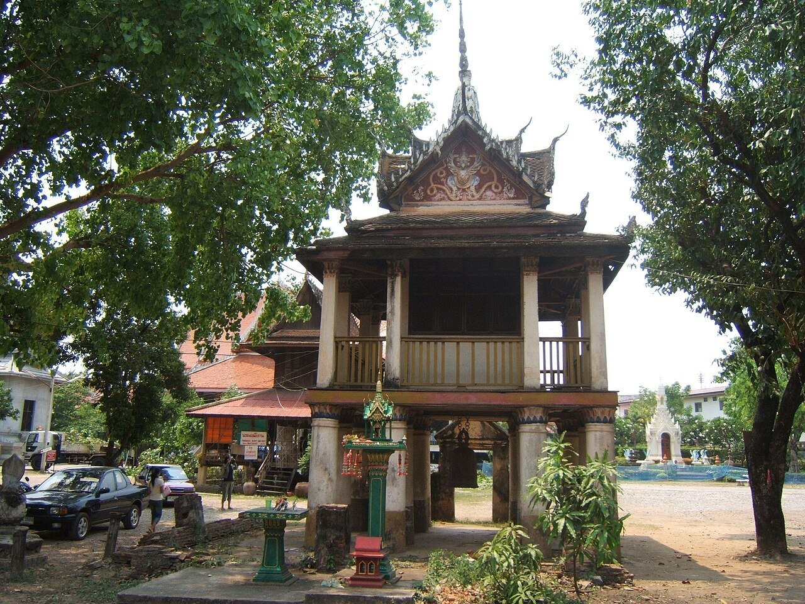
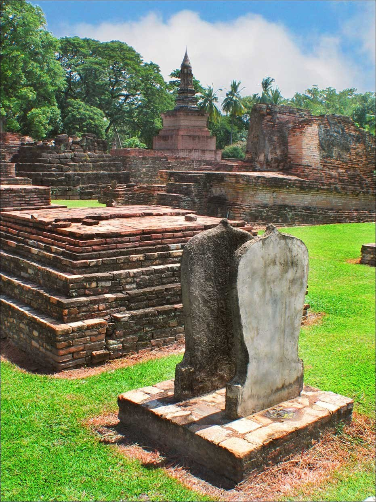
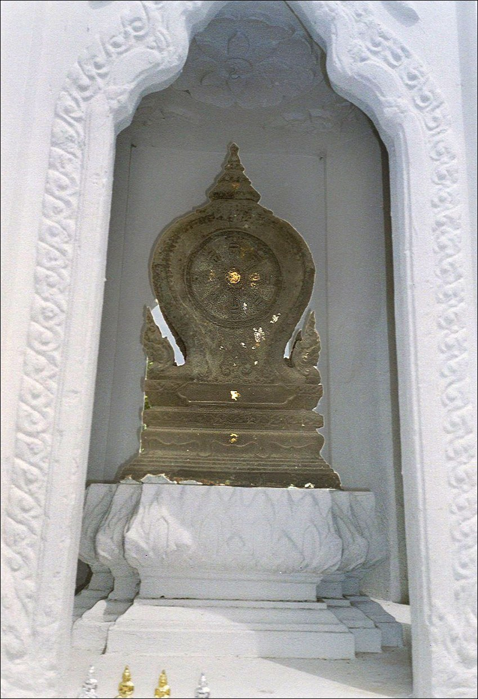
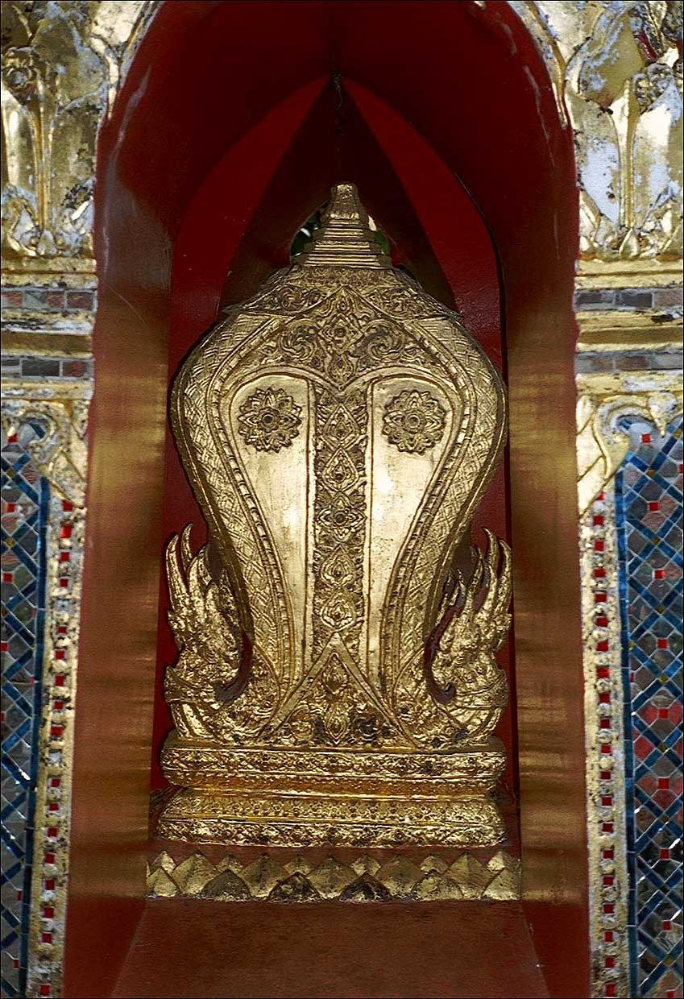
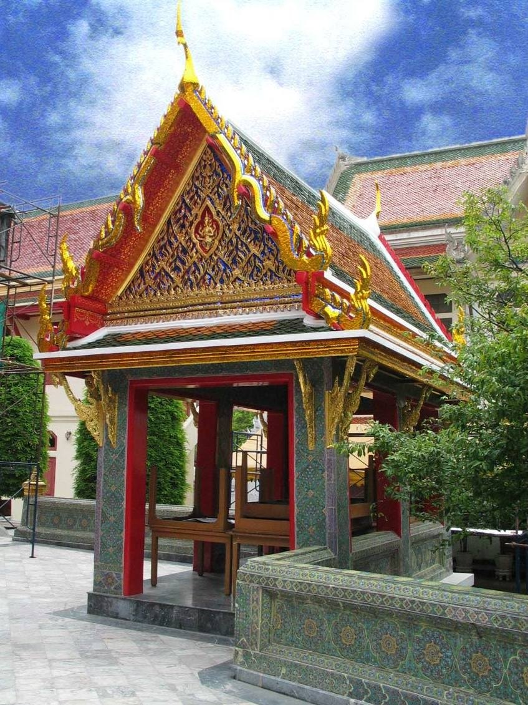
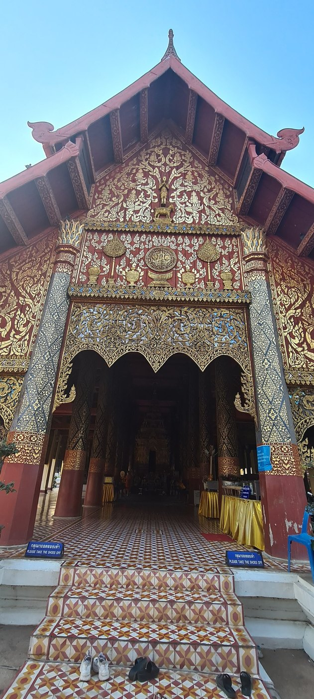
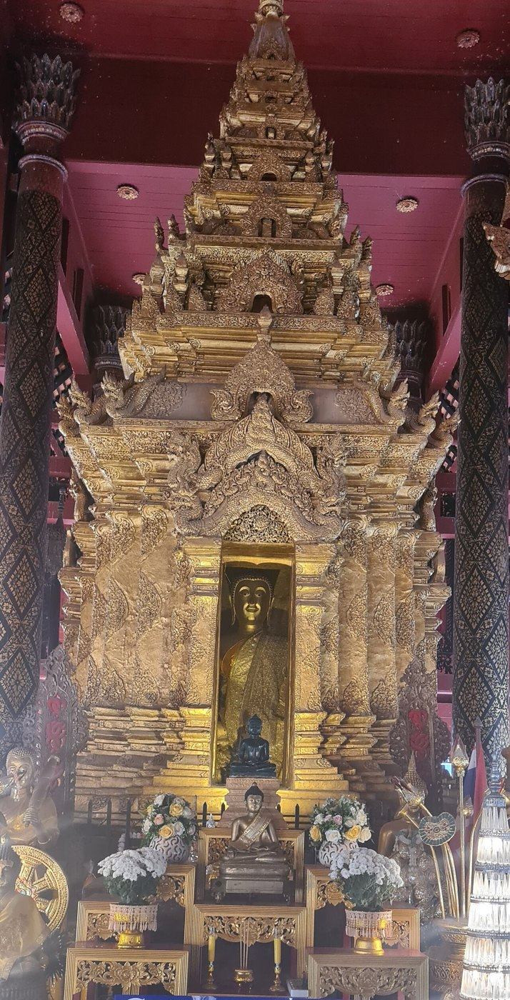
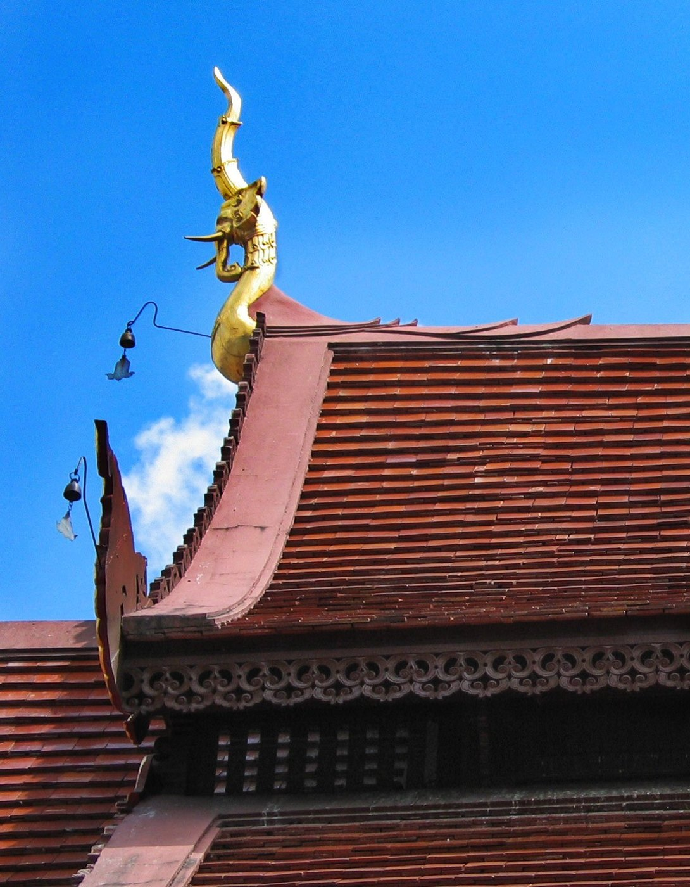

# 24 อาคารในวัด — ผังวัด · อุโบสถ · วิหาร · หอไตร · หอระฆัง · ศาลา · กุฏิ · วิหารล้านนา

## 1. ผังวัด [S11]
- **พุทธาวาส:** เขตพระพุทธเจ้า มีอุโบสถ วิหาร เจดีย์ ปรางค์ มณฑป หอไตร หอระฆัง
- **สังฆาวาส:** เขตสงฆ์ มีกุฏิ ศาลา ครัว
- กำแพงล้อมแยกจากโลกภายนอก และมี **กำแพงแก้ว** ล้อมรอบเขตอาคารศักดิ์สิทธิ์ชั้นใน

| อุโบสถ (วัดพระแก้ว) | หอไตร (วัดระฆัง) | หอระฆัง (วัดราชบูรณะ) |
|---|---|---|
|  |  |  |

| ใบเสมา สุโขทัย | ใบเสมาทรงมงกุฎ | ซุ้มเสมา วัดพระแก้ว | ศาลา วัดราชบพิธ |
|---|---|---|---|
|  |  |  |  |

## 2. อาคารแต่ละประเภท
| อาคาร | หน้าที่ | ลักษณะเด่น | ที่มา |
|---|---|---|---|
| **อุโบสถ (โบสถ์)** | สงฆ์ประชุมทำสังฆกรรมตามพระวินัย (มาจากบาลี อุป + วสฺ + อถ) | มี **ใบเสมา 8 ทิศ** กำหนดเขตสีมา (ใต้ดินฝังลูกนิมิต ◇) มีพระประธานสำคัญ หลังคาซ้อนและลด มีหน้าบันด้านสกัด | S36, S11 |
| **วิหาร** | ประดิษฐานพระพุทธรูป ให้ฆราวาสชุมนุมฟังธรรม | ผังผืนผ้า ใหญ่ คล้ายอุโบสถแต่ **ไม่มีใบเสมา** | S11, S9 |
| **เจดีย์ / ปรางค์** | บรรจุพระธาตุ แทนเขาพระสุเมรุ | ดู [09](09_ปรางค์.md), [10](10_เจดีย์.md) | |
| **มณฑป** | ประดิษฐานรอยพระพุทธบาท พระไตรปิฎก พระพุทธรูป | ผังจัตุรัสหรือกากบาท มียอดแหลม ดู [08](08_เครื่องยอด.md), [11](11_มณฑป_กรณีวัดอรุณ.md) | S11, S18 |
| **หอไตร** | เก็บพระไตรปิฎก | **มักสร้างกลางสระน้ำ** กันปลวกและแมลงสาบขึ้นไปกัดคัมภีร์ ถอดสะพานออกได้ มีทั้งแบบไม้ แบบก่ออิฐ และแบบผสม (ล่างก่อ บนไม้) หอไตรล้านนาประดับเทวดาถือดอกบัว | S37 |
| **หอระฆัง / หอกลอง** | ตีบอกเวลาและเรียกประชุมสงฆ์ | หอสูงมียอด | S11 |
| **ศาลาการเปรียญ** | ฟังเทศน์ เรียนธรรม | อาคารโถงใหญ่ | S11 |
| **ศาลา** | พักร้อนหลบฝน | โถง มีเสารับหลังคา | S11, S35 |
| **กุฏิ** | ที่อยู่สงฆ์ | ขนาดตามวินัย 12 × 7 คืบ (ราว 4 × 2.3 ม.) เพื่อไม่ให้สะสมสิ่งของ | S35 |
| **ระเบียงคด** | ทางเดินมีหลังคาล้อมอาคาร | มีพระพุทธรูปเรียงรายตลอดแนว | |

## 3. ศาลหลักเมือง [S35]
ศาลที่ประดิษฐานเสาหลักเมือง เทพผู้พิทักษ์เมือง เสาทำจากไม้ชัยพฤกษ์ ตั้งก่อนสร้างเมือง

## 4. วิหารล้านนา (ภาคเหนือ) ◇ (ควรตรวจกับงานวิจัยล้านนา)

| วิหารหลวง วัดพระธาตุลำปางหลวง | กู่ในวิหาร | ช่อฟ้าวิหารล้านนา |
|---|---|---|
|  |  |  |
- **หลังคาซ้อนและลดหลายชั้น** ชายคาคลุมต่ำ ลาดหลังคาด้านหน้าลดชั้นยืดเข้าหาทางเข้า [S11]
- **โหง่ (ช่อฟ้า):** อยู่กลางสัน (ภาคกลางอยู่ที่ปลายสัน) [S6]
- **หน้าแหนบ (หน้าบัน):** มีโก่งคิ้วและปากแล
- **สัตตภัณฑ์:** เชิงเทียน 7 ยอดหน้าพระประธาน สร้างตามคติจักรวาล [ผลค้นหางานวิจัย]
- **โขงพระเจ้า:** ซุ้มประดิษฐานพระประธาน
- **บันไดนาคหรือมกรคายนาค** หน้าวิหาร

## 5. ทิศและการวาง ◇
- อุโบสถส่วนมากหันหน้าไปทิศตะวันออก หรือหันหาแม่น้ำ
- พระประธานหันหน้าออกทางประตูหน้า ส่วนผนังด้านหลังพระประธานคือผนังสกัดหลัง (ดูแบบแผนจิตรกรรมใน [20](20_จิตรกรรมไทย.md))
