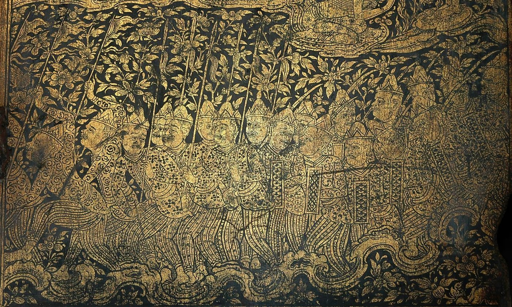
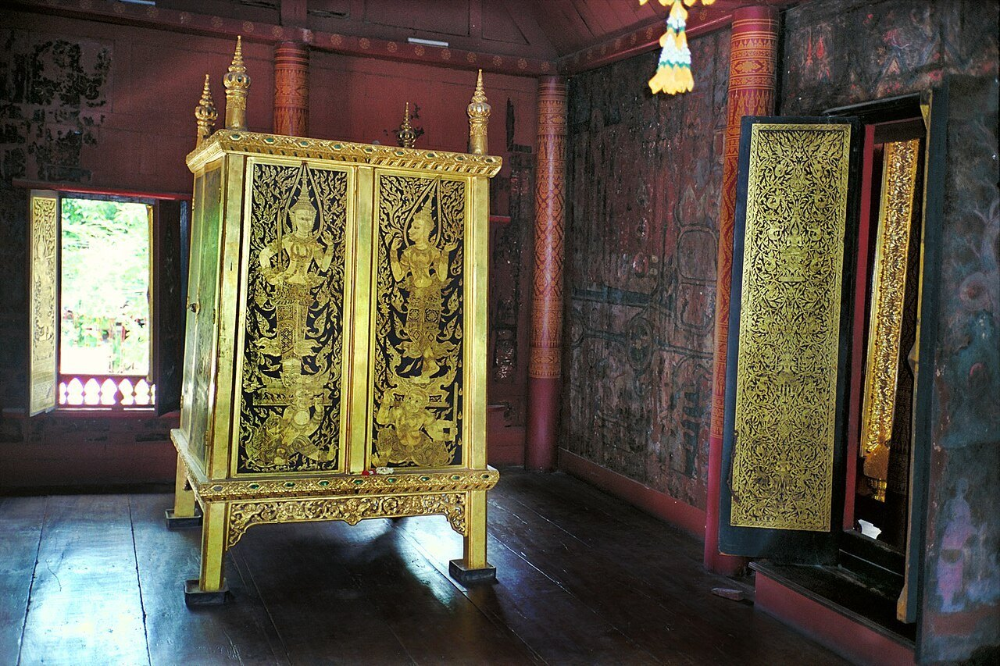
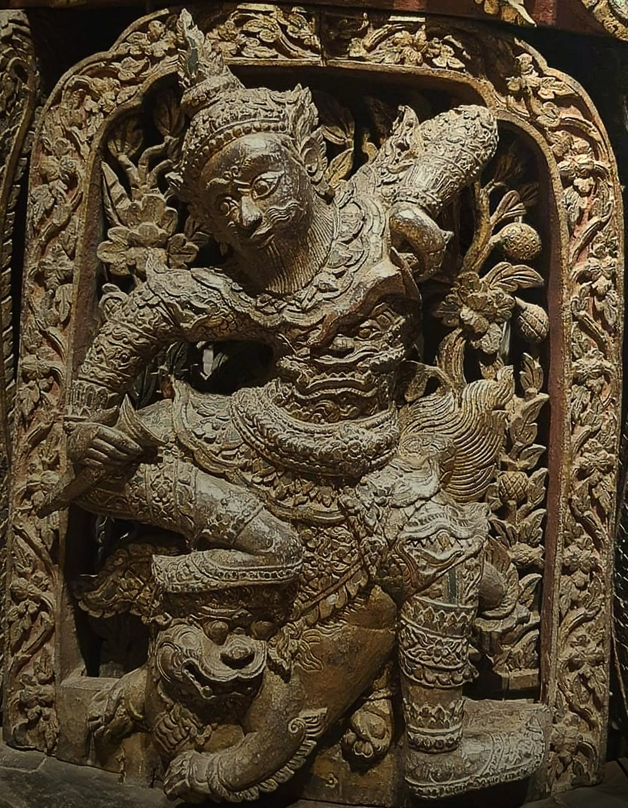
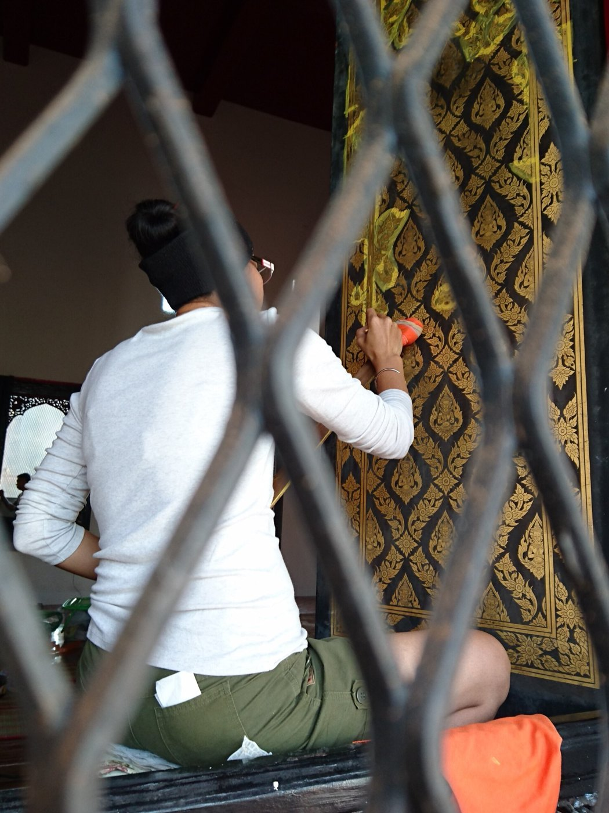

# 25 ประณีตศิลป์และช่างสิบหมู่ — ช่าง · เทคนิค · วัสดุ

## 1. ช่างสิบหมู่ [S38, S28]
"สิบ" มาจากบาลี **สิปฺป** (สันสกฤต ศิลฺป = ศิลปะ) ไม่ได้แปลว่ามีช่างเพียงสิบชนิด แต่เป็นการรวมช่างหลวงหลายแขนงไว้ในหมวดเดียว [S38]
รัชกาลที่ 1 ฟื้นฟูกรมช่างสิบหมู่หลังเสียกรุงศรีอยุธยา [S28]

| ช่าง | งาน |
|---|---|
| ช่างเขียน | จิตรกรรม ลายไทย ร่างแบบ (เป็นพื้นฐานของทุกแขนง [S16]) |
| ช่างแกะ | แกะไม้ แกะหนัง (หนังใหญ่) แกะตรา |
| ช่างสลัก | สลักหยวก สลักไม้ สลักหิน |
| ช่างกลึง | กลึงไม้ งา โลหะ |
| ช่างหล่อ | หล่อพระพุทธรูป หล่อโลหะ |
| ช่างปั้น | ปั้นปูน ปั้นดิน ปั้นขี้ผึ้ง (แม่พิมพ์) |
| ช่างหุ่น | หุ่นละคร หุ่นกระบอก หัวโขน |
| ช่างรัก | ลงรักปิดทอง ประดับกระจก ประดับมุก ลายรดน้ำ |
| ช่างบุ | บุโลหะเป็นลาย ทองแผ่ลวด |
| ช่างปูน | ก่อและฉาบปูน ปูนปั้นประดับอาคาร |

| ลายรดน้ำ ตู้พระธรรมอยุธยา | ตู้พระธรรมในหอไตรวัดระฆัง | ไม้จำหลัก ธรรมาสน์อยุธยา | ช่างบูรณะลายรดน้ำ |
|---|---|---|---|
|  |  |  |  |

## 2. เทคนิคประณีตศิลป์
| เทคนิค | วิธีทำ | ที่มา |
|---|---|---|
| **ลายรดน้ำ** | เขียนลายด้วยน้ำยาหรดาลบนพื้นรักดำ ลงรัก ปิดทอง แล้วรดน้ำ ทองติดเฉพาะส่วนที่ไม่ได้เขียน | S16, S28 |
| **ลายกำมะลอ** | ระบายสีแบบจิตรกรรมบนพื้นรัก แล้วเสริมด้วยเทคนิครดน้ำ | S16 |
| **ประดับมุก** | ฉลุเปลือกหอยมุกฝังในพื้นรัก ช่องไฟคือหัวใจของงาน รุ่งเรืองสมัยอยุธยา (บานประตูมุก) | S16, S28 |
| **ประดับกระจก** | ชิ้นกระจกสีปะบนปูนปั้นหรือไม้ ส่วน **ไส้ลาย** คือกระจกรูปหยดน้ำในไส้ของลาย | S16 |
| **เครื่องถม** | แกะลายบนเงิน ถมยาถมสีดำ แล้วขัด ทำได้ทั้งถมเงินและถมทอง เครื่องถมเมืองนครมีชื่อเสียงที่สุด แบบถมตะทอง = เงินมีจุดทอง | S25, S28 |
| **เบญจรงค์** | เครื่องกระเบื้องเขียนลายด้วยวิธีลงยา 5 สี (ดำ ขาว เหลือง แดง เขียว/คราม) ลายที่นิยม: เทพพนม นรสิงห์ กนก ก้านขด | S33 |
| **ลายน้ำทอง** | เบญจรงค์ที่เขียนเส้นทอง เริ่มในรัตนโกสินทร์ตอนต้น | S33 |
| **จำหลักไม้** | แกะไม้สัก ไม้ประดู่ ทำบานประตู หน้าต่าง หน้าบัน และพระพุทธรูป | S28 |
| **ปูนปั้น** | ปั้นลายบนผนังและหน้าบัน (นิยมในแบบพระราชนิยม ร.3) | S15, S16 |
| **ประดับกระเบื้องถ้วยชาม** | ตัดเครื่องถ้วยจีนเป็นกลีบ ปะเป็นดอกไม้บนปูน (วัดอรุณ) | S12 |
| **สังคโลก** | เครื่องเคลือบสุโขทัย สีเขียวไข่กา | S28 |

## 3. วัสดุอาคารตามยุค [S9, S35]
- **ทวารวดี:** อิฐ ศิลาแลง
- **ลพบุรี:** อิฐ หินทราย ศิลาแลง
- **เชียงแสน / ล้านนา:** ไม้ กระเบื้องดินเผา
- **อยุธยาและรัตนโกสินทร์:** ก่ออิฐถือปูน เครื่องบนเป็นไม้ หลังคามุงกระเบื้องเคลือบ ประดับปิดทองกระจก
