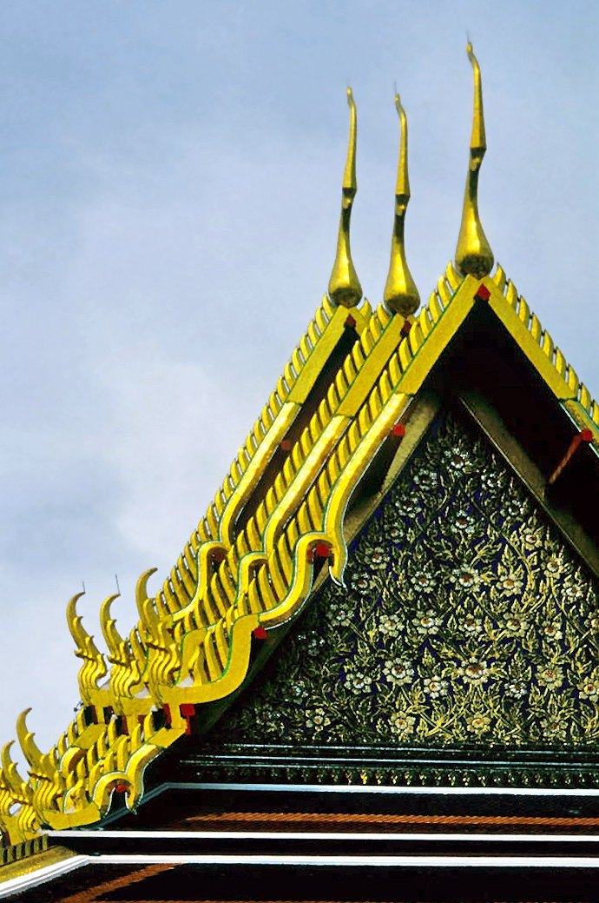

# Thai Art, Lai Thai & Thai Architecture Knowledge Base
# คลังความรู้ลายไทย ศิลปะไทย และสถาปัตยกรรมไทย

**อ่านบนเว็บ:** https://theparitt.github.io/thai-art-knowledge/ (GitHub Pages) · https://thai-art-knowledge.pages.dev (Cloudflare)
**สำหรับ AI:** `llms.txt` · `llms-full.txt` · `knowledge.json` · `glossary.json` · `photos.json` (ที่ราก URL ของเว็บ)

A Thai-language, source-cited reference on Thai traditional architecture (bases, redented corners, layered roofs, lamyong ornaments, spires, prang, chedi, mondop), Lai Thai ornament, painting, Buddha images, Himmapan creatures and the ten crafts. Illustrated only with real, freely licensed photographs and experts' sketches from Wikimedia Commons, each credited. Text: CC BY-SA 4.0 — see [LICENSE.md](LICENSE.md).

---

## เอกสารสถาปัตยกรรมและศิลปะไทย — สำหรับงานออกแบบและทำโมเดล

*ภาพ: LBM1948 · CC BY-SA 4.0 · Wikimedia Commons*

ชุดเอกสารนี้แยกเป็นส่วนๆ ของอาคารและศิลปะไทยประเพณี **ทุกไฟล์มีทั้งคำอธิบายและภาพต้นฉบับจริง** (ภาพถ่ายหรือภาพร่างของผู้รู้จาก Wikimedia Commons พร้อมเครดิต) ไม่ใช้แผนภาพที่วาดย่อเอง
ข้อมูลทุกข้ออ้างแหล่งด้วยรหัส **[S#]** ดูรายละเอียดแหล่งใน [sources.md](sources.md)

## เริ่มอ่านตรงนี้
1. [00_ปรัชญาและคติ.md](00_ปรัชญาและคติ.md) — ทรงมาก่อนเครื่องประดับ · ทรงจอมแห · ไตรภูมิ · ฐานานุศักดิ์
2. [15_กฎการออกแบบและข้อผิดพลาด.md](15_กฎการออกแบบและข้อผิดพลาด.md) — checklist และกฎที่ผู้ดูแลยืนยันจากงานจริง
3. [18_รูปอ้างอิง.md](18_รูปอ้างอิง.md) — รูปจริงทุกรูปพร้อมโน้ตว่าต้องดูอะไร

## สารบัญ
| ไฟล์ | เรื่อง | ภาพหลัก |
|---|---|---|
| [00](00_ปรัชญาและคติ.md) | ปรัชญา คติ ไตรภูมิ ฐานานุศักดิ์ ช่างสิบหมู่ สีเบญจรงค์ | ผังวัดอรุณกับไตรภูมิ |
| [01](01_ภาพรวม_โครงสร้าง.md) | 3 ส่วนแนวตั้ง · พุทธาวาส/สังฆาวาส · นิยามปราสาท/มณฑป/บุษบก · ลำดับการออกแบบ | |
| [02](02_ฐาน.md) | ฐานเขียง ฐานบัว ฐานสิงห์ ฐานหย่อนท้องช้าง ฐานแบก | รูปตัดฐาน, ฐานยื่นตามมุข |
| [03](03_ย่อมุม.md) | ย่อมุมไม้สี่ถึงไม้ยี่สิบ · ย่อมุมแบบรัศมี | ผังย่อมุม |
| [04](04_ตัวเรือน_เสา_ผนัง_ซุ้ม.md) | ผนัง เสา บัวหัวเสา คันทวย ซุ้ม มุข | พระมณฑปวัดพระแก้ว |
| [05](05_หลังคา.md) | **ซ้อน · ลด · ตับ · มุข · จัตุรมุข · ปราสาท · กฎผืนหลังใหญ่กว่า** | 3 แผนภาพ + 4 รูป |
| [06](06_หน้าจั่ว_หน้าบัน.md) | หน้าบัน · ปั้นลมตามฐานานุศักดิ์ | ปั้นลม 3 ระดับ |
| [07](07_เครื่องลำยอง.md) | รวยระกา นาคสะดุ้ง งวงไอยรา ใบระกา ช่อฟ้า หางหงส์ | ลำยองบนแปลาน, แบบช่อฟ้า |
| [08](08_เครื่องยอด.md) | ยอดบุษบก-มณฑป 16 ส่วน · วิธีขึ้นทรง · สัดส่วน · ระยะชุดเชิงกลอน | การขึ้นทรงจอมแห |
| [09](09_ปรางค์.md) | ปรางค์ · ทรงปรางค์ · วัดอรุณ | |
| [10](10_เจดีย์.md) | เจดีย์ระฆัง ย่อมุม ลังกา สุโขทัย | |
| [11](11_มณฑป_กรณีวัดอรุณ.md) | มณฑปทิศวัดอรุณ: ทุกรอบที่แก้ | รูปด้านยาว, ทั้งองค์ |
| [12](12_บันได_ระเบียง_กำแพงแก้ว.md) | บันได พนัก กำแพงแก้ว ใบเสมา | |
| [13](13_ลวดลายและการประดับ.md) | **ลายไทย:** กระหนกสามตัว กระจัง ประจำยาม พุ่มข้าวบิณฑ์ เครือเถา · หลักการ 5 · เทคนิค 5 | กระหนกสามตัว, แม่ลาย |
| [14](14_ประติมากรรมประดับ.md) | ผู้แบก กินรี เทวดา ทวารบาล | |
| [15](15_กฎการออกแบบและข้อผิดพลาด.md) | Checklist | |
| [16](16_แปลงเป็นงานไม้ตัด.md) | ทำแต่ละส่วนด้วยไม้ 1.5 มม. Cricut | |
| [17](17_ยุคสมัย.md) | ยุคสมัยตั้งแต่ทวารวดีถึงปัจจุบัน | |
| [18](18_รูปอ้างอิง.md) | **รูปอ้างอิงทั้งหมดพร้อมโน้ต** | ทุกภาพ |
| [อภิธานศัพท์](อภิธานศัพท์.md) | ไทย ↔ อังกฤษ ↔ ไฟล์ | |
| [sources](sources.md) | แหล่งอ้างอิง | |

## โฟลเดอร์
- `images/photos/` — ภาพต้นฉบับจริงจาก Wikimedia Commons (สัญญาอนุญาตเสรี) พร้อม `manifest.json` ที่บันทึกผู้ถ่าย สัญญาอนุญาต และลิงก์ที่มา (คัดเลือกด้วย `research/commons.py`, รายการที่เลือกอยู่ใน `research/picks.sh`)
- `research/derived_diagrams/` — แผนภาพที่วาดย่อเอง **ไม่ใช่แหล่งอ้างอิง ไม่ใช้ในคลังความรู้** เก็บไว้ใช้ออกแบบภายหลัง
- `images/annotated/` — รูปจริงที่ใส่หมายเลขและชื่อส่วน (สร้างด้วย `research/annotate_refs.py`)
- `images/reference/` — รูปที่ผู้ดูแลส่งมา **ใช้ภายในเท่านั้น**
- `research/` — ข้อความเต็มที่ดึงจาก PDF งานวิชาการ และสคริปต์ทั้งหมด

## หมายเหตุความแม่นยำ
- เรื่องที่มีงานวิชาการรองรับ (ยอดบุษบก-มณฑป เครื่องลำยอง ลายไทย ซ้อน) อ้างแหล่งไว้ตรงจุดนั้น
- ข้อที่ยังไม่แน่ใจ หรือแหล่งยังขัดกัน มีเครื่องหมาย **(ควรตรวจ)** เช่น รูปในซุ้มปรางค์ทิศวัดอรุณ และพระพุทธรูปในมณฑปแต่ละทิศ
- **กฎที่ผู้ดูแลยืนยันจากงานจริง** (ไฟล์ 15) ใช้เหนือข้อสันนิษฐานทั่วไปและเหนือโมเดลสแกน
- หนังสือหลักที่ควรหามาอ่านเพิ่ม: สมใจ นิ่มเล็ก *เครื่องบนและงานประดับของสถาปัตยกรรมไทย* (2539) และราชบัณฑิตยสถาน *พจนานุกรมศัพท์ลายไทย* (2557) (ดู sources.md)
- ถ้าได้กฎใหม่จากงานต่อไป ให้เพิ่มในไฟล์ 15 และในไฟล์ของส่วนนั้น

## เว็บไซต์ (Cloudflare Pages)
- **เว็บ:** https://thai-art-knowledge.pages.dev
- **สำหรับ AI:** `/llms.txt` · `/llms-full.txt` · `/knowledge.json` · `/glossary.json` · `/md/<slug>.md`
- **สร้างและ deploy** (รันใน WSL NewUbuntu ซึ่ง login wrangler ไว้แล้ว):
  `cd /mnt/e/blender/thai-architecture-docs && npm run deploy`
- **โค้ด:**
  - `site/build.mjs` แปลง md เป็น HTML พร้อมไฟล์สำหรับ AI
  - `site/pages.mjs` กำหนดลำดับหน้า slug และชื่ออังกฤษ (**เพิ่มไฟล์ md ใหม่ต้องลงชื่อในนี้ด้วย**)
  - `site/shots.sh` ถ่ายภาพหน้าเว็บไว้ตรวจ
- **เผยแพร่:** `images/photos/` (ภาพ Commons มีเครดิตอัตโนมัติ) และ `images/renders/` (ภาพโมเดลของเรา ใช้เฉพาะในกรณีศึกษา ไม่ใช่ภาพอ้างอิง) ส่วนภาพที่ไม่มีสัญญาอนุญาตเสรีใน `images/reference/` และ `images/annotated/` จะแทนด้วยคำบรรยาย

- [40 เครื่องมือสร้างชิ้นส่วนไทย: โครง ลาย วัสดุ และหลักฐาน](40_เครื่องมือสร้างชิ้นส่วนไทย_โครงลายและวัสดุ.md) — [scoped engine knowledge](ship-engine-knowledge.json)
